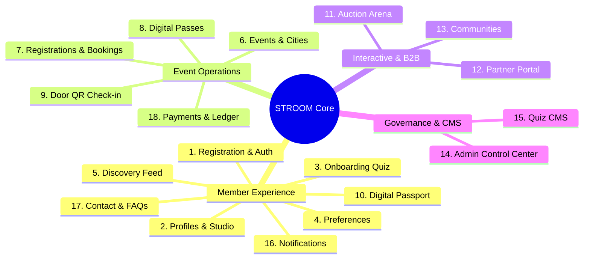
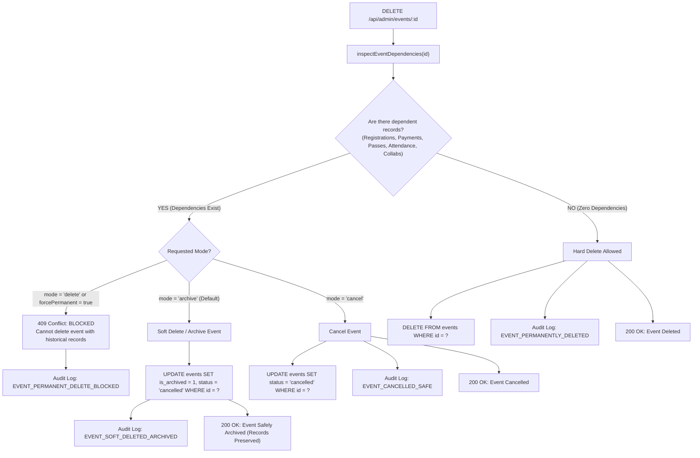

# STROOM — Phase 2.1: Feature Domain Migration Matrix

**Date:** 2026-11-13  
**Document:** `PHASE2_1_FEATURE_MIGRATION_MATRIX.md`  
**Current Branch:** `feature/stroom-production-launch`  
**Scope:** Exhaustive specification across all 18 business feature domains and 156 endpoints  
**Status:** **APPROVED ARCHITECTURAL DESIGN SPECIFICATION**

---

## 1. Domain Coverage Overview

The STROOM platform encompasses **18 functional domains** spanning customer-facing social discovery, event lifecycle, gamified live auctions, B2B partner management, community building, financial ledger integrity, and administrative operations.



---

## 2. Feature Domain Deep Dives

### Domain 1: Registration & Authentication
- **Business Purpose:** Provide secure member signup, session establishment, password resets, and session identity lookup.
- **Express Routes:** 5 endpoints (`POST /api/auth/register`, `POST /api/auth/login`, `POST /api/auth/logout`, `GET /api/auth/me`, `POST /api/auth/reset-password`).
- **Target Hono Routes:** `src/worker/routes/auth.ts` -> mounted at `/api/auth`.
- **Database Tables:** `users`, `email_verifications`, `audit_logs`, `rate_limits`.
- **Core Business Rules:**
  - Case-insensitive email and username uniqueness.
  - Password preservation: 188 existing accounts (61 scrypt, 127 legacy SHA-256) preserved without plaintext password access.
  - Zero-Knowledge Rule: scrypt hashes cannot be verified using PBKDF2.
  - Generates signed JWT (HMAC-SHA256, 7-day expiration) via `jose`.
  - Suspended accounts (`account_status = 'suspended'`) blocked with `403 Forbidden`.
  - Concurrency-safe rate limiting: Cloudflare WAF rule + atomic D1 `rate_limits` upsert (`ON CONFLICT DO UPDATE SET count = count + 1 RETURNING count`).
- **Serverless Edge Adaptation:**
  - **Local Development:** Miniflare executes audited scrypt on Node.js with no 10ms CPU limit.
  - **Production Deployment:** **Option A (Strangler Fig Express Auth - $0)** anchors auth to Node.js C++ OpenSSL; **Option B (Workers Paid - $5/mo)** executes audited edge scrypt within Paid 50ms/Unbound CPU allowance.

---

### Domain 2: Member Profiles & Studio
- **Business Purpose:** Manage user public identity, social links, bio, avatar, and persona showcase.
- **Express Routes:** 4 endpoints (`GET /api/users/profile`, `PUT /api/users/profile`, `GET /api/users/:id/public`, `POST /api/users/avatar`).
- **Target Hono Routes:** `src/worker/routes/users.ts`.
- **Database Tables:** `users`, `user_tags`, `achievements`, `digital_passes`.
- **Core Business Rules:**
  - Avatar image URLs validated for safe protocols (`https://`) and hosted in Cloudflare R2.
  - Public profile obscures sensitive fields (email, phone, notification preferences, internal flags).
  - Vibe tags dynamically loaded from `user_tags`.
- **Serverless Edge Adaptation:**
  - Avatar uploads handled via presigned R2 upload URLs or direct binary streaming to Worker R2 binding (`env.MEDIA_BUCKET.put()`).

---

### Domain 3: Onboarding & Persona Quiz
- **Business Purpose:** Interactive personality questionnaire assigning users a community vibe persona (e.g., "The Conversationalist", "The Strategist").
- **Express Routes:** 7 endpoints (`GET /api/onboarding/quiz`, `POST /api/onboarding/session`, `GET /api/onboarding/session/:id`, `POST /api/onboarding/session/:id/response`, `POST /api/onboarding/session/:id/complete`, `POST /api/onboarding/session/:id/skip`, `GET /api/onboarding/personas`).
- **Target Hono Routes:** `src/worker/routes/onboarding.ts`.
- **Database Tables:** `quiz_versions`, `quiz_questions`, `quiz_options`, `quiz_sessions`, `quiz_responses`, `personas`, `user_tags`, `users`.
- **Core Business Rules:**
  - Active quiz fetched from published version (`is_active = 1`).
  - Answer weighting calculates persona score. Completing quiz atomically updates `users.onboarding_status = 'COMPLETED'` and inserts calculated persona vibe tags into `user_tags`.
  - Skipping sets `onboarding_status = 'SKIPPED'` and assigns default "Explorer" persona.
- **Serverless Edge Adaptation:**
  - Atomic batch execution via `env.DB.batch()` for saving responses and updating user profile in one round trip.

---

### Domain 4: User Preferences & Privacy Settings
- **Business Purpose:** Manage notification toggles, privacy visibility (show profile to strangers, show pass history), and interest tags.
- **Express Routes:** 5 endpoints (`GET /api/users/preferences`, `PUT /api/users/preferences`, `GET /api/users/tags`, `POST /api/users/tags`, `DELETE /api/users/tags/:tag`).
- **Target Hono Routes:** `src/worker/routes/preferences.ts`.
- **Database Tables:** `users`, `user_tags`.
- **Core Business Rules:**
  - Privacy settings stored as JSON text: `show_social_links`, `show_upcoming_events`, `show_auction_activity`.
  - Notification toggles: `email_event_reminders`, `email_marketing`, `inapp_auction_alerts`.
  - Vibe tags sync: deleting a tag deletes the specific `user_tags` row and synchronizes `users.interests_json`.

---

### Domain 5: Discovery Feed & Member Networking
- **Business Purpose:** Smart recommendation feed of upcoming events, compatible members, and partner hotspots.
- **Express Routes:** 1 endpoint (`GET /api/discovery/feed`).
- **Target Hono Routes:** `src/worker/routes/discovery.ts`.
- **Database Tables:** `events`, `users`, `user_tags`, `partners`, `cities`.
- **Core Business Rules:**
  - Scores events and members based on shared interest tags and mutual city location.
  - Filters out suspended users and unapproved partner venues.
  - Caches discovery algorithm weights and results in Worker isolate memory (60s TTL).

---

### Domain 6: Events & Cities Catalog
- **Business Purpose:** Public browsing of curated offline meetups, mystery dinners, sports tournaments, and city directories.
- **Express Routes:** 5 endpoints (`GET /api/events`, `GET /api/events/:slug`, `GET /api/events/cities`, `GET /api/events/cities/:slug`, `GET /api/events/featured`).
- **Target Hono Routes:** `src/worker/routes/events.ts`.
- **Database Tables:** `events`, `cities`, `partner_venues`, `event_registrations`.
- **Core Business Rules:**
  - Only published, non-archived events visible to public (`is_published = 1 AND is_archived = 0`).
  - Calculates real-time `available_seats = capacity - seats_booked`.
  - Returns associated venue location, city details, and pricing in INR.
- **Serverless Edge Adaptation:**
  - City catalog and featured events cached with `Cache-Control: public, s-maxage=300` at the Cloudflare edge cache.

---

### Domain 7: Event Registrations & Booking Lifecycle
- **Business Purpose:** Secure seat reservation, booking confirmation, ticket tier selection, and cancellation.
- **Express Routes:** 4 endpoints (`POST /api/events/:id/register`, `GET /api/events/:id/registration-status`, `POST /api/events/:id/cancel`, `GET /api/users/registrations`).
- **Target Hono Routes:** `src/worker/routes/events.ts` and `src/worker/routes/registrations.ts`.
- **Database Tables:** `events`, `event_registrations`, `digital_passes`, `payment_transactions`, `audit_logs`.
- **Core Business Rules:**
  - Atomic seat decrement: `UPDATE events SET available_seats = available_seats - 1 WHERE id = ? AND available_seats > 0`.
  - Creates corresponding `event_registrations` row and auto-provisions a `digital_passes` entry.
  - Cannot cancel if linked to settled payment without prior refund.
- **Serverless Edge Adaptation:**
  - Executed via `env.DB.batch()` with concurrency verification.

---

### Domain 8: Digital Passes
- **Business Purpose:** Dynamic QR-coded member passes for registered events with live status (valid, checked-in, expired, void).
- **Express Routes:** 4 endpoints (`GET /api/passes`, `GET /api/passes/:id`, `GET /api/passes/:id/qr`, `GET /api/passes/verify/:pass_code`).
- **Target Hono Routes:** `src/worker/routes/passes.ts`.
- **Database Tables:** `digital_passes`, `events`, `users`.
- **Core Business Rules:**
  - Generates secure alphanumeric pass code (`STR-HYD-XXXXXX`).
  - QR verification endpoint allows venue staff and event managers to confirm ticket authenticity.
  - Displays checkin status: `confirmed`, `checked_in`, `cancelled`, `no_show`.

---

### Domain 9: Door QR Check-in & Attendance Verification
- **Business Purpose:** Scanner interface for door volunteers to check in attendees in real time.
- **Express Routes:** 2 endpoints (`POST /api/passes/checkin`, `POST /api/passes/revert-checkin`).
- **Target Hono Routes:** `src/worker/routes/passes.ts`.
- **Database Tables:** `digital_passes`, `event_attendance`, `audit_logs`.
- **Core Business Rules:**
  - Door staff must have `events.checkin` or `admin` permission.
  - Atomic transition from `confirmed` to `checked_in`. Records `checked_in_at` timestamp and `checked_in_by` user ID.
  - Automatically writes an entry to `event_attendance` ledger and triggers achievement evaluation.

---

### Domain 10: Digital Passport & Achievement Badges
- **Business Purpose:** Gamified milestone tracker documenting attended events, community reputation, and unlocked NFT-style badges.
- **Express Routes:** 3 endpoints (`GET /api/users/passport`, `GET /api/users/achievements`, `POST /api/users/achievements/claim`).
- **Target Hono Routes:** `src/worker/routes/passport.ts`.
- **Database Tables:** `achievements`, `user_achievements`, `event_attendance`, `digital_passes`.
- **Core Business Rules:**
  - Pre-seeded achievements: Pioneer Member, Event Veteran, Auction Master, Social Butterfly.
  - Unlocked when attendance thresholds are met (e.g. 3 attended events).
  - Displays event passport stamps with date, city, and host signatures.

---

### Domain 11: Auction Arena (Premier Mock Auctions & Real-Time Bidding)
- **Business Purpose:** Real-time auction room simulation for sports teams/players with live bids, countdown gavel, and team purse management.
- **Express Routes:** 23 endpoints (`/api/auctions/*` — room status, catalog, bid placement, gavel hammer, player shift, team rosters, SSE stream).
- **Target Hono Routes:** `src/worker/routes/auction.ts`.
- **Database Tables:** `auction_rooms`, `auction_players`, `auction_bids`, `auction_teams`, `audit_logs`.
- **Core Business Rules:**
  - Bid increment slabs: under 10L (+10k), 10L-50L (+25k), 50L-1Cr (+50k), >1Cr (+100k).
  - Purse enforcement: team cannot bid more than available purse balance.
  - Gavel cycle: Gavel 1 -> Gavel 2 -> SOLD / UNSOLD.
  - Atomic bid placement: `UPDATE auction_rooms SET current_bid = ?, current_bidder_id = ? WHERE id = ? AND current_bid < ? AND status = 'LIVE'`.
- **Serverless Edge Adaptation & Capacity Engineering:**
  - **Worker Invocations vs. Cache Accounting:** Cache API hits do **NOT** eliminate Worker invocations. Every client poll executes the Worker `fetch()` handler and consumes 1 Worker request against Cloudflare quotas. Cache hits reduce downstream D1 queries, but NOT edge Worker requests.
  - **The Polling Quota Hazard:** 50 clients polling at 2s interval burn 180,000 Worker requests in 2 hours (**180% of daily free quota; exhausted in 66 min**). Concurrency of 50+ clients strictly requires **Cloudflare Workers Paid ($5/mo)**.
  - **Target Hono Gated Adaptive Polling Engine (`GET /api/auctions/:id/poll`):**
    1. **Active Gating:** Polling occurs ONLY when `room.status === 'LIVE'`. Closed/scheduled rooms are not polled.
    2. **Adaptive Intervals:** 2s during active lot bidding (<10s since last bid), 5s during waiting/idle lot, 10s during lot transitions, with exponential backoff up to 15s max if consecutive 304s are received.
    3. **Cloudflare Edge Cache API (`caches.default`):** 1-second TTL on live state endpoint collapses D1 row reads by 99.8% (from 3.6M reads to 7,200 reads for 1,000 clients over a 2-hour event).
    4. **Conditional Requests:** `If-None-Match` with ETag version counter returns `304 Not Modified` without payload body.
    5. **Concurrency Upper Bound:** The 250-bidder concurrency figure is an **unbenchmarked theoretical estimate** that requires Workers Paid and reproducible `k6` load testing prior to production claims. Beyond 250 concurrent live bidders, upgrade to **Cloudflare Durable Objects + WebSockets**.

---

### Domain 12: Partner Portal (B2B Venues, Campaigns, Coupons & Calendars)
- **Business Purpose:** Dedicated portal for cafes, lounges, and spaces to partner with STROOM, offer member perks, and track redemptions.
- **Express Routes:** 36 endpoints (`/api/partners/*` — profile, venues, spaces, calendar, campaigns, coupons, redemptions, staff, proposals).
- **Target Hono Routes:** `src/worker/routes/partners.ts`.
- **Database Tables:** `partners`, `partner_venues`, `venue_spaces`, `partner_staff`, `partner_campaigns`, `partner_coupons`, `coupon_redemptions`, `partner_collaborations`, `partner_audit_logs`.
- **Core Business Rules:**
  - Scoped access: Partners can only read and mutate entities belonging to their authenticated `partner_id`.
  - Coupon redemption checks: verifies coupon validity window, minimum order amount, and enforces `used_count < max_redemptions` atomically.
  - Venue approval: Partner venues require admin verification (`is_admin_verified = 1`) before appearing on public discovery.

---

### Domain 13: Communities & Member Clubs
- **Business Purpose:** Niche micro-communities (e.g. Hyderabad Board Gamers, Bengaluru Weekend Hikers) with dedicated events and chat boards.
- **Express Routes:** 4 endpoints (`GET /api/communities`, `GET /api/communities/:slug`, `POST /api/communities/:id/join`, `POST /api/communities/:id/leave`).
- **Target Hono Routes:** `src/worker/routes/communities.ts`.
- **Database Tables:** `communities`, `community_members`, `events`.
- **Core Business Rules:**
  - Joining adds user to `community_members` and increments `member_count`.
  - Leaving verifies membership, decrements count, and removes member record.

---

### Domain 14: Admin Control Center & Analytics
- **Business Purpose:** Central management cockpit for superadmins, operations leads, and community managers to monitor KPIs, moderate users, configure platform parameters, and audit system events.
- **Express Routes:** 42 endpoints (`/api/admin-hub/*` or `/api/admin/*` — dashboard metrics, users CRUD, roles, events CRUD, safe delete, payments, refunds, broadcasts, settings, audit logs).
- **Target Hono Routes:** `src/worker/routes/adminHub.ts`.
- **Database Tables:** All 42 tables, especially `users`, `events`, `payment_transactions`, `audit_logs`, `platform_settings`, `broadcast_notifications`.
- **Core Business Rules:**
  - Granular RBAC enforcement across 11 roles using `requirePermission(...)`.
  - Role management: users cannot elevate their own role or promote someone above their own privilege level.
  - System audit trail: all mutations log `actor_id`, `actor_role`, `action`, `before_data`, and `after_data`.

---

### Domain 15: Quiz CMS (Versioning, Draft Branching & Reordering)
- **Business Purpose:** Content management system for authoring and revising onboarding personality quizzes with draft versioning, question reordering, and instant rollback.
- **Express Routes:** 12 endpoints (`/api/admin/quiz/*` — versions, questions, options, draft activation, publishing, reordering).
- **Target Hono Routes:** `src/worker/routes/quizCms.ts`.
- **Database Tables:** `quiz_versions`, `quiz_questions`, `quiz_options`.
- **Core Business Rules:**
  - Published versions are immutable (`is_published = 1`). Modifying a quiz requires creating a new draft version (`is_draft = 1`).
  - Publishing a draft version deactivates the previous active version atomically.
  - Question and option reordering uses atomic statement batches to update sequential display indices.

---

### Domain 16: Notifications & Broadcasts
- **Business Purpose:** Real-time in-app alerts, pass status notifications, and targeted administrative mass announcements.
- **Express Routes:** 6 endpoints (`GET /api/users/notifications`, `POST /api/users/notifications/:id/read`, `POST /api/users/notifications/read-all`, `POST /api/admin/broadcasts`, `GET /api/admin/broadcasts`).
- **Target Hono Routes:** `src/worker/routes/notifications.ts`.
- **Database Tables:** `notifications`, `broadcast_notifications`, `users`.
- **Core Business Rules:**
  - Unread notifications retrieved efficiently via composite index `idx_notifications_unread(user_id, is_read)`.
  - Mass broadcasts support target audience filtering: `all`, `city:<city_id>`, `role:<role_name>`, `onboarding_status:<status>`.
  - Duplicate broadcast throttle: blocks identical title/audience within 1 hour (`adminHub.ts:2001`).

---

### Domain 17: Contact & Public FAQs
- **Business Purpose:** Public customer support inquiries, partnership inquiries, and searchable knowledge base.
- **Express Routes:** 2 endpoints (`POST /api/contact`, `GET /api/faqs`).
- **Target Hono Routes:** `src/worker/routes/contact.ts`.
- **Database Tables:** `contact_submissions`, `faqs`.
- **Core Business Rules:**
  - Publicly accessible without authentication.
  - Subject classification: `general`, `partnership`, `event_inquiry`, `support`.
  - FAQs grouped by category with display sorting order.

---

### Domain 18: Payments Ledger, Refunds & Financial Integrity
- **Business Purpose:** Immutable double-entry financial transaction ledger, payment status reconciliation, and administrator-issued refunds.
- **Express Routes:** 4 endpoints (`GET /api/admin/payments`, `POST /api/admin/payments/:id/refund`, `GET /api/admin/payments/summary`, `GET /api/users/payments`).
- **Target Hono Routes:** `src/worker/routes/payments.ts`.
- **Database Tables:** `payment_transactions`, `event_registrations`, `events`, `users`, `audit_logs`.
- **Core Business Rules:**
  - Financial records are strictly immutable: no `DELETE` statements ever execute on `payment_transactions`.
  - Refunds execute atomically:
    1. Verify transaction status is `Successful`.
    2. Update status to `Refunded`, set `refund_amount`, `refund_reason`, `refunded_by`, and `refunded_at`.
    3. Update linked `event_registrations.checkin_status` to `cancelled`.
    4. Decrement `events.seats_booked` by 1.
    5. Write immutable `audit_logs` record with previous and updated state.

---

## 3. The Event Safe Deletion Protocol (Architectural Specification)

A central safety invariant of the STROOM platform is **Guaranteed Historical Financial and Attendance Preservation**.

### 3.1 Business Motivation
Events in STROOM are linked to paid ticket transactions, door check-in logs, partner venue bookings, and auction rooms. A hard `DELETE FROM events WHERE id = ?` would either crash on SQLite foreign key violations (`ON DELETE RESTRICT`) or catastrophically destroy audit trails, financial ledgers, and attendance history (`ON DELETE CASCADE`).

### 3.2 The Safe Deletion Decision Tree



### 3.3 Implementation in Hono Worker (`src/worker/routes/adminHub.ts`)

```typescript
// Architectural implementation pattern for Hono Worker
app.delete('/api/admin/events/:id', requirePermission('events.delete'), async (c) => {
  const { id } = c.req.param();
  const db = c.env.DB;
  const user = c.get('user');
  const mode = c.req.query('mode')?.toLowerCase() || 'archive';

  // 1. Inspect dependencies across all relational tables
  const [regCount, payCount, passCount] = await Promise.all([
    db.prepare('SELECT COUNT(*) as count FROM event_registrations WHERE event_id = ?').bind(id).first<{ count: number }>(),
    db.prepare('SELECT COUNT(*) as count FROM payment_transactions WHERE event_id = ?').bind(id).first<{ count: number }>(),
    db.prepare('SELECT COUNT(*) as count FROM digital_passes WHERE event_id = ?').bind(id).first<{ count: number }>(),
  ]);

  const hasProtectedDependencies = (regCount?.count || 0) > 0 || (payCount?.count || 0) > 0 || (passCount?.count || 0) > 0;

  // 2. Strict enforcement: Hard delete permanently blocked if dependencies exist
  if (mode === 'delete' && hasProtectedDependencies) {
    return c.json({
      error: 'Cannot permanently delete an event with associated registrations, attendance records, or payment history. Use Archive Event instead.',
      dependencies: { registrations: regCount?.count, payments: payCount?.count, passes: passCount?.count }
    }, 409);
  }

  // 3. Safe Archival Mode (Preserves all relational history)
  if (mode === 'archive' || hasProtectedDependencies) {
    await db.batch([
      db.prepare("UPDATE events SET is_archived = 1, status = 'cancelled', updated_at = datetime('now') WHERE id = ?").bind(id),
      db.prepare(`
        INSERT INTO audit_logs (id, actor_id, actor_name, actor_role, action, entity_type, entity_id, details, created_at)
        VALUES (?, ?, ?, ?, 'EVENT_SOFT_DELETED_ARCHIVED', 'event', ?, ?, datetime('now'))
      `).bind(crypto.randomUUID(), user.id, user.full_name, user.role, id, JSON.stringify({ mode, preservedRegistrations: regCount?.count }))
    ]);

    return c.json({ success: true, action: 'archived', message: 'Event safely archived. All historical records preserved.' });
  }

  // 4. Hard Delete (Only for zero-dependency draft events)
  await db.batch([
    db.prepare('DELETE FROM events WHERE id = ?').bind(id),
    db.prepare(`
      INSERT INTO audit_logs (id, actor_id, actor_name, actor_role, action, entity_type, entity_id, created_at)
      VALUES (?, ?, ?, ?, 'EVENT_PERMANENTLY_DELETED', 'event', ?, datetime('now'))
    `).bind(crypto.randomUUID(), user.id, user.full_name, user.role, id)
  ]);

  return c.json({ success: true, action: 'deleted', message: 'Unused draft event permanently removed.' });
});
```

---

## 4. Summary Matrix of Domain Migration Characteristics

| Domain # | Domain Name | Endpoints | Auth Level | DB Operations | Edge Adaptation Strategy |
| :---: | :--- | :---: | :--- | :--- | :--- |
| **1** | Registration & Auth | 5 | Public / Token | Scrypt hash, User insert, JWT sign | Web Crypto scrypt + `jose` JWT |
| **2** | Profiles & Studio | 4 | Required | Profile select/update, R2 URLs | R2 signed upload / binary stream |
| **3** | Onboarding Quiz | 7 | Optional / Req | Version fetch, session upsert, persona calc | Single-roundtrip `env.DB.batch()` |
| **4** | Preferences | 5 | Required | Tag sync, JSON settings update | Application-level JSON parsing |
| **5** | Discovery Feed | 1 | Public / Opt | Multi-table score match, limit 20 | In-isolate 60s memory caching |
| **6** | Events & Cities | 5 | Public | City/Event catalog, slug lookup | Edge CDN caching (s-maxage=300) |
| **7** | Registrations | 4 | Required | Capacity decrement, pass insert | Optimistic atomic batch |
| **8** | Digital Passes | 4 | Required / Staff | Pass lookup, QR verification | Fast indexed read on `pass_code` |
| **9** | Door QR Check-in | 2 | RBAC Staff | Checkin status, attendance log | Atomic batch with `meta.changes` guard |
| **10**| Digital Passport | 3 | Required | Milestone compute, achievement unlock | Computed on-the-fly from attendance |
| **11**| Auction Arena | 23 | Required / Admin| Live bid, gavel hammer, player shift | 2-second client polling endpoint |
| **12**| Partner Portal | 36 | Partner RBAC | B2B CRUD, coupon redemption | Scoped `partner_id` query enforcement |
| **13**| Communities | 4 | Public / Req | Membership join/leave, member count | Atomic increment / decrement |
| **14**| Admin Control Center| 42 | Admin RBAC | Dashboard KPIs, user moderation, settings | Strict 11-role permission middleware |
| **15**| Quiz CMS | 12 | Admin RBAC | Version branching, question reorder | Batch execution of reorder arrays |
| **16**| Notifications | 6 | Required / Admin| Alert fetch, mark read, mass broadcast | Composite indexed lookup + duplicate throttle |
| **17**| Contact & FAQs | 2 | Public | Inquiry insert, FAQ list | Open public endpoints with rate limiting |
| **18**| Payments & Ledger | 4 | Admin / User | Transaction ledger, refund reconciliation | Strictly immutable audit-logged batches |
| **Total**| **18 Domains** | **156** | — | **All 42 Relational Tables** | **Zero-Cost Serverless Edge Architecture** |
