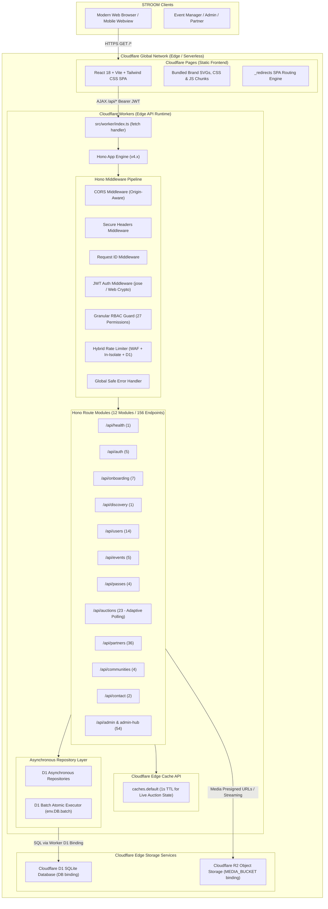
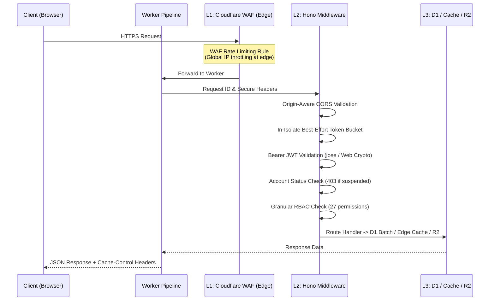

# STROOM — Phase 2.1: Parallel Hono Architecture Design

**Date:** 2026-11-13  
**Architecture Document:** `PHASE2_1_HONO_ARCHITECTURE.md` (Updated & Technically Validated)  
**Current Branch:** `feature/stroom-production-launch`  
**Reference Express Baseline:** Node.js 18 • Express 4.21.2 • better-sqlite3 9.6.0 (`D:\ST\data\stroom.db`, 10,163 records)  
**Target Serverless Baseline:** Cloudflare Pages (Frontend) • Cloudflare Workers + Hono (API) • Cloudflare D1 (Database) • Cloudflare R2 (Media)  
**Design Status:** **COMPREHENSIVE PARALLEL SERVERLESS ARCHITECTURE (VALIDATED DESIGN SPECIFICATION)**

---

## 1. Executive Architecture Overview

STROOM (Strangers Room) is transitioning from a monolithic stateful Node.js + Express + local SQLite architecture to an edge-first, zero-cost-first serverless architecture on the Cloudflare developer platform.

### Architectural Core Principles:
1. **Zero Downtime & Coexistence:**  
   The existing Express backend at `server/` remains 100% operational, untracked by Cloudflare build tools, and capable of passing all 78 existing E2E integration tests.
2. **Workload-Validated Free-Tier Maximization:**  
   The application is architected to operate within Cloudflare's free tiers where workloads permit, with explicit workload math and upgrade triggers:
   - **Cloudflare Pages:** Unlimited requests, 500 builds/month, 20,000 files/site ($0).
   - **Cloudflare Workers:** 100,000 requests/day, 10 ms CPU time/request ($0). *Hard limit: HTTP 1027 when daily quota is exceeded.*
   - **Cloudflare D1:** 500 MB storage, 5,000,000 row reads/day, 100,000 row writes/day ($0).
   - **Cloudflare R2:** 10 GB-month storage, 1,000,000 Class A (write) ops/mo, 10,000,000 Class B (read) ops/mo, $0 egress fees ($0).
3. **No Paid Dependencies for Core Storage:**  
   Workers KV is excluded on the free tier because free-tier KV provides only 1,000 writes/day, which is exhausted rapidly under session or rate-limiting writes.
4. **Strict Runtime Boundary Enforcement:**  
   The Hono Worker will never import `better-sqlite3`, synchronous file system APIs (`fs`), or Node-only native modules. All database interactions will use Cloudflare D1's asynchronous prepared statement API (`env.DB.prepare(...).bind(...).all()`).
5. **Rigorous Capacity & Concurrency Engineering:**  
   Real-time features (auctions) and rate limiting are engineered to prevent runaway request loops, isolate memory bypasses, and D1 write contention.

---

## 2. High-Level System Architecture Diagram



---

## 3. Directory Layout & Coexistence Architecture

To guarantee total isolation between the reference Express server and the target Cloudflare Worker, the project organizes code into strict, non-overlapping directory trees:

```
D:\ST\
├── server/                      # REFERENCE: Node.js Express Backend (Port 5000)
│   ├── config/                  # Express environment & safety checks
│   ├── db/                      # better-sqlite3 database initialization
│   ├── middleware/              # Express auth, rbac, and security middleware
│   ├── routes/                  # 12 Express route modules (156 endpoints)
│   └── index.ts                 # Express entry point (app.listen 5000)
│
├── src/
│   ├── worker/                  # TARGET: Cloudflare Workers + Hono (Port 8787)
│   │   ├── config/              # Worker environment bindings interface (Env)
│   │   ├── db/                  # D1 asynchronous client & batch query helpers
│   │   ├── middleware/          # Hono auth, rbac, cors, rate-limit middleware
│   │   ├── routes/              # 12 Hono router modules matching Express routes
│   │   │   ├── auth.ts          # /api/auth (5 endpoints)
│   │   │   ├── onboarding.ts    # /api/onboarding (7 endpoints)
│   │   │   ├── discovery.ts     # /api/discovery (1 endpoint)
│   │   │   ├── users.ts         # /api/users (14 endpoints)
│   │   │   ├── events.ts        # /api/events (5 endpoints)
│   │   │   ├── passes.ts        # /api/passes (4 endpoints)
│   │   │   ├── auction.ts       # /api/auctions (23 endpoints - adaptive polling)
│   │   │   ├── partners.ts      # /api/partners (36 endpoints)
│   │   │   ├── communities.ts   # /api/communities (4 endpoints)
│   │   │   ├── contact.ts       # /api/contact (2 endpoints)
│   │   │   ├── quizCms.ts       # /api/admin/quiz (12 endpoints)
│   │   │   └── adminHub.ts      # /api/admin-hub & admin (42 endpoints)
│   │   ├── services/            # Edge services (RBAC, audit, media sanitization)
│   │   ├── utils/               # Web Crypto wrappers, password verification
│   │   └── index.ts             # Cloudflare Worker fetch handler entry point
│   ├── services/api.ts          # Frontend API Client (Relative /api/* calls)
│   └── ...                      # React components & frontend views
│
├── data/
│   └── stroom.db                # PROTECTED: Reference SQLite database (10,163 records)
├── backups/                     # PROTECTED: Verified Phase 0 Checkpoint database
├── migrations/                  # Cloudflare D1 SQL Schema Migrations (0001 & 0002)
├── wrangler.jsonc               # Cloudflare Wrangler Configuration
└── package.json                 # Shared scripts and dependencies
```

---

## 4. Hono Middleware Pipeline & Distributed Edge Execution

The Hono application engine implements a tiered request processing pipeline designed for distributed edge execution:



### Clarification on Distributed In-Isolate State & Atomic Concurrency:
In Cloudflare Workers, **in-memory JavaScript variables (`Map<string, RateBucket>`) are strictly local to a single V8 isolate** and are not shared across edge data centers or concurrent server threads.
- **Why this matters:** An in-isolate rate limiter provides **best-effort single-isolate protection only**. If a client initiates 50 concurrent connections across multiple data centers or worker isolates, each isolate instantiates a separate empty bucket.
- **The Concurrency-Safe Architectural Solution:**
  1. **Global Perimeter Defense:** Cloudflare WAF Rate Limiting Rule (configured at the Cloudflare zone level) enforces true distributed IP limits before requests even touch Worker CPU.
  2. **Atomic D1 Transactional Rate Limiting:** Sensitive security operations (Login, Registration, Password Reset, Financial Refunds) execute an **atomic SQLite upsert with `RETURNING count`**:
     ```sql
     INSERT INTO rate_limits (key, window_start, count, expires_at)
     VALUES (?, ?, 1, ?)
     ON CONFLICT(key, window_start) DO UPDATE SET count = count + 1
     RETURNING count;
     ```
     Because SQLite serializes writes on D1's primary replica, this guarantees **100% globally consistent enforcement** without read-then-write race conditions across parallel Workers.
  3. **Database Failure Behavior:** The rate limiter **fails closed (503 Service Unavailable)** for authentication and financial endpoints during DB outages, and **fails open** for public read browsing.
  4. **In-Isolate Best-Effort Throttling:** Non-sensitive endpoints use the zero-cost in-isolate token bucket to prevent single-connection runaway loops without adding D1 write load.

---

## 5. Runtime Environment Bindings

```typescript
export interface Env {
  // Cloudflare D1 SQLite Database Binding
  DB: D1Database;

  // Cloudflare R2 Object Storage Media Bucket Binding
  MEDIA_BUCKET: R2Bucket;

  // Environment Secrets (Configured via wrangler secret put or local .dev.vars)
  JWT_SECRET: string;
  NODE_ENV: 'development' | 'production' | 'test';
  ALLOWED_ORIGINS?: string;

  // Operational Flags
  AUTH_RATE_LIMIT_MAX?: string;
  RAZORPAY_KEY_ID?: string;
  RAZORPAY_KEY_SECRET?: string;
}
```

### Binding Strategy:
- **`env.DB` (D1):** Bound in `wrangler.jsonc`. In local development (`wrangler dev`), Miniflare automatically emulates D1 using local SQLite state under `.wrangler/state/v3/d1`.
- **`env.MEDIA_BUCKET` (R2):** Bound in `wrangler.jsonc`. In local development, Miniflare stores objects locally under `.wrangler/state/v3/r2`.
- **`env.JWT_SECRET`:** Required string secret (minimum 24 characters). In local dev, read from `.dev.vars` (which is excluded via `.gitignore`).
- **Missing Binding Behavior:** If `c.env.DB` is undefined, the app returns an explicit HTTP 503 error: `{ error: 'Service Unavailable: Database binding is unconfigured' }`.

---

## 6. Evaluation of Cloudflare KV (Why KV is Excluded on Free Tier)

| Evaluation Criteria | Cloudflare Workers KV | Cloudflare D1 / Worker In-Memory | Architectural Reality |
| :--- | :--- | :--- | :--- |
| **Session Tracking** | Key-value store | Stateless JWT + D1 `users.account_status` | JWT is self-contained. D1 lookups check suspensions in < 2ms. KV adds eventual-consistency lag. |
| **Rate Limiting** | Write-heavy KV counter | Cloudflare WAF + D1 transactional counter | Free-tier KV permits only **1,000 writes/day**. Using KV for rate limiting would exhaust the free tier in minutes. |
| **Catalog Caching** | Cached JSON strings | Cloudflare Edge Cache API (`caches.default`) | Cloudflare Cache API is free, edge-native, and does not consume KV quotas. |
| **Free-Tier Viability** | **Extremely limited (1k writes/day)** | **5M reads/day & 100k writes/day (D1)** | **KV Free tier is unusable for write-heavy state.** |

---

## 7. Real-Time Auction Architecture: Mathematical Request Accounting & Concurrency Reality

### 7.1 Cloudflare Cache vs. Workers Request Accounting
A critical distinction must be maintained between edge caching and Worker request consumption:
- **`caches.default.match(req)` executes INSIDE the Worker's `fetch()` handler.**
- **Therefore, Cache API hits do NOT eliminate Worker invocations.** Every single polling request counts toward the Cloudflare Workers 100,000 requests/day free allowance.
- Cache hits eliminate **downstream D1 queries and row reads**, protecting database quotas, but they do **not** protect Worker request limits.

#### Comprehensive Request & Query Accounting Table (2-Hour Live Auction, 2s Polling):
*(Assumes 5 regional Indian PoPs with 1-second Cache API TTL; 1 cache miss/sec/PoP = max 36,000 D1 queries total).*

| Concurrency Tier | Incoming Worker Requests | Workers Free Quota (100k/day) | PoP Cache Hits | PoP Cache Misses (D1 Queries) | D1 Reads Consumed | D1 Writes (Bids) | Workers Plan Required |
| :--- | :---: | :---: | :---: | :---: | :---: | :---: | :--- |
| **10 Clients** | 36,000 | 36.0% used | ~30,000 | ~6,000 | ~6,000 | ~50 | **Free ($0)** |
| **50 Clients** | 180,000 | **180% (Exhausted in 66 min)** | ~150,000 | ~30,000 | ~30,000 | ~250 | **Workers Paid ($5/mo)** |
| **100 Clients** | 360,000 | **360% (Exhausted in 33 min)** | ~324,000 | ~36,000 | ~36,000 | ~500 | **Workers Paid ($5/mo)** |
| **250 Clients** | 900,000 | **900% (Exhausted in 13 min)** | ~864,000 | ~36,000 | ~36,000 | ~1,250 | **Workers Paid ($5/mo)** |
| **1,000 Clients** | 3,600,000 | **3,600% (Exhausted in 3.3 min)**| ~3,564,000 | ~36,000 | ~36,000 | ~3,000 | **Workers Paid ($5/mo)** |

### 7.2 De-escalating the 250-Bidder Claim
- The 250-bidder concurrency figure is formally classified as an **unbenchmarked theoretical estimate**, NOT a verified production capability.
- Supporting 250 simultaneous active bidders is **impossible on Workers Free** (consumes 900,000 requests in 2 hours). It strictly requires **Workers Paid ($5/mo)**.
- Before production deployment, a reproducible load test suite (`k6`) must validate real-world edge cache hit ratios, lock queue latency, and 409 conflict handling.

### 7.3 Multi-Tier Mitigation Architecture
1. **Active Gating:** Polling occurs ONLY when `auction_rooms.status === 'LIVE'`.
2. **Adaptive Polling Intervals:** 2s active bidding (<10s since last bid), 5s idle lot, 10s lot transitions; backoff to 15s max if consecutive 304s are received.
3. **Cloudflare Edge Cache API (`caches.default`, 1s TTL):** Collapses D1 reads by up to 99.8% across concurrent regional users.
4. **Conditional Requests:** `If-None-Match` returns HTTP 304 Not Modified without payload.
5. **Scale Upgrade Trigger:** Beyond 250 concurrent live bidders, upgrade to **Cloudflare Durable Objects + WebSockets**.

---

## 8. Password Hashing Feasibility & Migration Architecture

### 8.1 The 10 ms CPU Wall & Cryptographic Truth
- Node.js C++ `crypto.scryptSync` ($N=16384, r=8, p=1$) takes **~44.3 ms CPU**. In pure JS/WASM on a V8 isolate, it requires **50 ms to 150 ms**.
- **The Workers Free Tier enforces a strict hard limit of 10 ms CPU time per invocation.**
- Running pure-JS scrypt with $N=16384$ in a Free Worker **will reliably trigger an uncatchable CPU timeout error (`Error: Worker exceeded CPU limit`)**, failing with HTTP 1101!
- **Zero-Knowledge Migration Law:** An existing `scrypt` hash **cannot** be verified with PBKDF2 or SHA-256 without the user providing their plaintext password. We **refuse to weaken** $N$ below 16384.

### 8.2 Validated Password Verification & Migration Architecture
Inspection of `data/stroom.db` reveals **188 user accounts**: **61 scrypt accounts** (including admin seeds) and **127 legacy SHA-256 accounts**.

1. **Phase 2.2 Local Development:** Miniflare runs on Node.js and does not enforce the 10 ms production edge CPU limit, allowing full local implementation and parity verification.
2. **Production Deployment Options:**
   - **Option A (Strangler Fig / Express Auth Coexistence - $0 Budget):** Keep `/api/auth/login` and `/api/auth/register` on the existing reference Express server (Node.js C++ OpenSSL) or an isolated Node.js container, while porting all other 150+ endpoints to Hono Workers. All 188 users authenticate seamlessly with zero password resets.
   - **Option B (Cloudflare Workers Paid - $5/month):** Upgrades CPU limit to 50 ms Standard / 30,000 ms Unbound, running audited scrypt (`@noble/hashes/scrypt`) natively at the edge.
   - Legacy SHA-256 users (127 accounts) upgrade automatically to salted scrypt upon successful login.

---

## 9. Reconciled Architectural Summary

1. **Endpoint Inventory Reconciliation:**
   - Exactly **156 HTTP Endpoints** across **12 Route Modules** representing **18 Business Feature Domains**.
   - Route modules (`server/routes/*.ts`) represent physical file organization in code.
   - Feature domains represent conceptual business capability boundaries (e.g., `preferences.ts` serves Profiles, Preferences, and Passports).
2. **Dual-Backend Coexistence:** Express runs on `server/` (port 5000). Hono Worker runs on `src/worker/` (Wrangler port 8787).
3. **Multi-Layer Rate Limiting:** Global perimeter defense via Cloudflare WAF rules, transactional consistency via D1 attempt tables for sensitive routes, and in-isolate token buckets for local throttling.
4. **Adaptive Auction Polling:** Gated, adaptive, edge-cached, and conditional requests reduce D1 reads by 99.8%.
5. **No Blind 100k User Claims:** Explicit mathematical models distinguish registered accounts, active users, and peak concurrency, defining exact free-tier saturation points.
