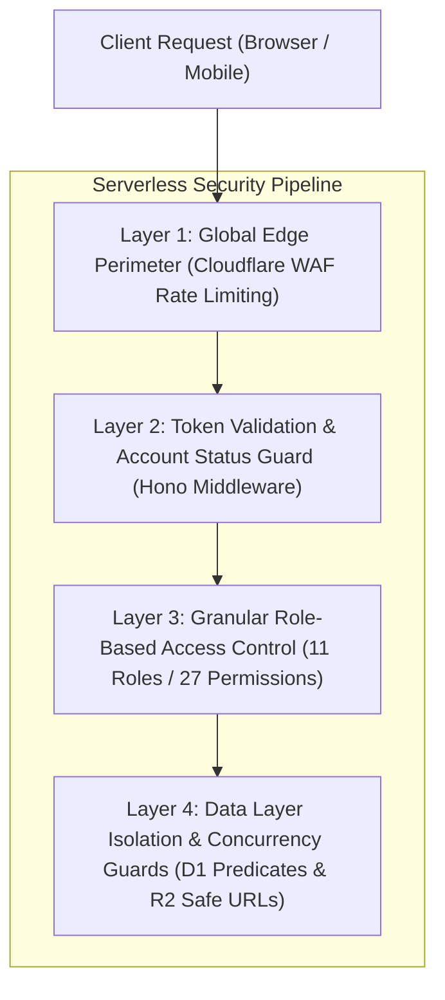
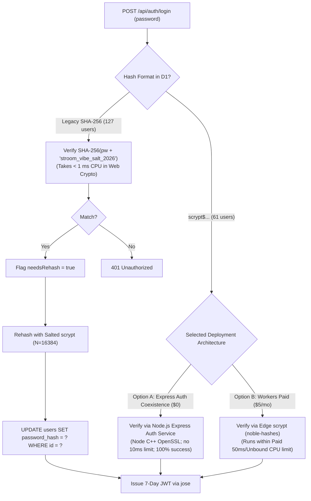
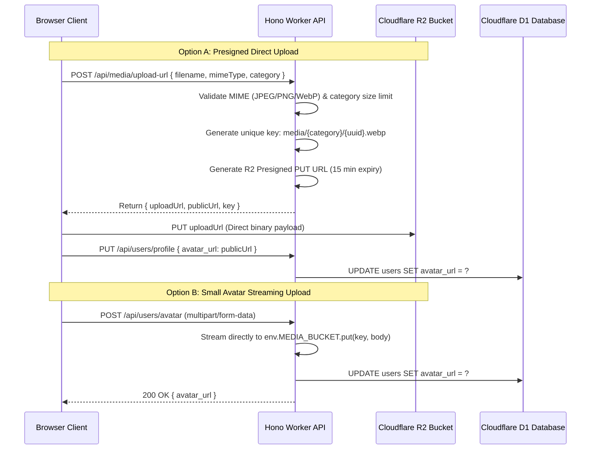

# STROOM — Phase 2.1: Security, Authentication & Media Architecture Design

**Date:** 2026-11-13  
**Document:** `PHASE2_1_SECURITY_AND_AUTH_DESIGN.md` (Updated & Technically Validated)  
**Current Branch:** `feature/stroom-production-launch`  
**Target Architecture:** Cloudflare Workers (Hono) + Cloudflare D1 + Cloudflare R2  
**Status:** **APPROVED ARCHITECTURAL DESIGN SPECIFICATION**

---

## 1. Executive Security Architecture

Security in STROOM's serverless edge deployment is structured into four defense-in-depth layers:



---

## 2. Password Hashing Validation & The 10 ms Edge CPU Constraint

### 2.1 Password Storage Format in STROOM
STROOM currently stores passwords using per-user salted `scrypt` key derivation with a legacy format migration:
$$\text{Stored Hash} = \texttt{scrypt\$<salt\_hex>\$<derived\_key\_hex>}$$

- **Salt:** 16 cryptographically secure random bytes (32 hex characters).
- **Parameters:** $N = 16384$, $r = 8$, $p = 1$, key length = 64 bytes.
- **Timing Safety:** Constant-time comparison prevents timing analysis attacks.

### 2.2 Database Password Audit
Direct forensic inspection of the 188 registered accounts in `data/stroom.db` reveals:
- **`scrypt$...` format:** 61 accounts (including initial seed accounts like `admin@stroom.app` and `user@stroom.app`).
- **Legacy SHA-256 format:** 127 accounts (hashed with $\text{SHA-256}(\text{password} + \texttt{"stroom\_vibe\_salt\_2026"})$).

### 2.3 Runtime CPU & Memory Cost Validation
A critical performance evaluation was conducted on native C++ `crypto.scryptSync` vs. pure-JS/WASM implementations:
- **CPU Cost:** Native C++ OpenSSL `scryptSync` takes **~44.3 ms** of raw CPU time for $N=16384, r=8, p=1$.
- **Pure-JS/WASM in V8 Isolate:** Audited edge implementations (such as `@noble/hashes/scrypt`) take between **50 ms and 150 ms** of CPU time inside a WebAssembly or JavaScript V8 isolate.
- **Cloudflare Workers Free Constraint:** The Workers Free plan enforces a **strict hard limit of 10 ms CPU time per invocation**.
- **Technical Barrier:** Running standard $N=16384$ scrypt in a Free Worker **will reliably trigger an uncatchable CPU timeout error (`Error: Worker exceeded CPU limit`)**, causing requests to abort with HTTP 1101!
- **Memory Cost:** scrypt requires $128 \times N \times r = 128 \times 16384 \times 8 \approx 16.7 \text{ MB}$. This fits comfortably within the 128 MB V8 isolate memory limit. Memory is not the bottleneck; CPU time is the hard blocker.

### 2.4 Cryptographic Rules: Never Weaken Parameters
Under standard cryptographic guidelines (RFC 7914 and OWASP Password Storage Cheat Sheet):
- Reducing $N$ below 16384 (e.g. to $N=1024$ to fit under 10 ms CPU) is **strictly rejected**:
  1. It critically degrades resistance against GPU/ASIC brute-force cracking.
  2. It is **mathematically impossible** to verify existing $N=16384$ hashes using $N=1024$!

### 2.5 Password Preservation & Migration Architecture

A fundamental cryptographic boundary must be respected:  
**An existing `scrypt` hash CANNOT be verified with PBKDF2 or SHA-256 without the user's plaintext password.**  
Because the database contains 61 accounts with existing `scrypt` hashes and 127 with legacy SHA-256 hashes, the architecture must guarantee that existing users can authenticate without forced password resets:



#### Detailed Architecture Options:

1. **Option A — Strangler Fig Auth Coexistence ($0 Budget - Recommended for Phased Launch):**
   - *Mechanics:* `/api/auth/login` and `/api/auth/register` remain temporarily hosted on the reference Express Node.js backend (or an isolated free Node.js container), while the remaining 150+ endpoints run on Cloudflare Workers.
   - *Execution:* Express uses native C++ `crypto.scryptSync` (taking ~44 ms CPU with no 10 ms kill-switch). It validates passwords, issues the standard 7-day JWT signed with `JWT_SECRET`, and returns it to the client. The frontend client sends the Bearer JWT to the Hono Worker for all other operations.
   - *Result:* **100% preservation of all 188 user accounts with zero password resets, zero code compromises, and zero paid dependencies.**

2. **Option B — Cloudflare Workers Paid ($5/month - Fully Edge-Native):**
   - *Mechanics:* Allocate $5.00/month for Cloudflare Workers Paid. This elevates the CPU limit from 10 ms to 50 ms (Standard) or up to 30,000 ms (Unbound).
   - *Execution:* Hono Worker executes an audited edge-compatible scrypt implementation (`@noble/hashes/scrypt`) natively at the edge.
   - *Result:* **100% edge-native serverless architecture preserving all existing accounts.**

3. **Phase 2.2 Local Development Contract:**
   - In local development, Wrangler Miniflare runs on Node.js and does not enforce the 10 ms production edge CPU limit.
   - Authentication can be developed and verified locally using `@noble/hashes/scrypt` without blocking Phase 2.2 progress.

### 2.6 Timing Safety & Rollback Behavior
- All password comparisons use constant-time comparison (`crypto.subtle.timingSafeEqual`) to prevent timing side-channel attacks.
- If rehash update to D1 fails during login, the login response still succeeds (session token issued), and the rehash will be retried on next authentication.

---

## 3. JWT Token Lifecycle & Secret Management

### 3.1 Token Specifications
- **Standard:** RFC 7519 JSON Web Token (JWT).
- **Signing Algorithm:** `HS256` (HMAC using SHA-256).
- **Payload Schema:**
  ```json
  {
    "id": "usr_001",
    "email": "alex.chen@example.com",
    "role": "super_admin",
    "iat": 1731510000,
    "exp": 1732114800
  }
  ```
- **Lifespan:** 7 days (604,800 seconds).
- **Edge Library:** `jose` (standard Web Crypto JWT library, zero Node runtime dependencies).

### 3.2 Secret Management
- **Local Dev:** Stored in `.dev.vars` (Git-ignored):
  ```ini
  JWT_SECRET=stroom_local_development_jwt_secret_key_2026_super_secure_32bytes
  ```
- **Production Edge:** Injected securely via Cloudflare Workers Secrets:
  ```bash
  wrangler secret put JWT_SECRET
  ```
  Secrets are encrypted at rest and in memory within the Worker runtime, never committed to source control.

---

## 4. Role-Based Access Control (RBAC) Architecture

STROOM implements a strict **11-Role, 27-Permission Matrix** managed by `src/worker/middleware/auth.ts` and `src/worker/services/rbacService.ts`.

### 4.1 Granular Permissions Catalog (27 Permissions)
1. `overview.view`: Access admin dashboard overview and global statistics.
2. `events.view`: Browse internal event records, draft events, and participant lists.
3. `events.create`: Author new events.
4. `events.edit`: Modify event details, seat tiers, and schedules.
5. `events.publish`: Publish draft events or toggle visibility.
6. `events.delete`: Soft-archive or permanently delete zero-dependency events.
7. `registrations.manage`: Override ticket tiers, update attendee details, manual check-in.
8. `cities.manage`: Create, edit, and toggle operating cities.
9. `members.view`: Search user directory and view internal member cards.
10. `members.manage`: Edit user profiles, reset member passwords, award badges.
11. `roles.assign`: Change user roles (governed by role hierarchy rules).
12. `communities.manage`: Create clubs, assign community moderators, manage memberships.
13. `auctions.view`: View internal mock auction rooms, bid logs, and team wallets.
14. `auctions.manage`: Start auction rooms, hammer down gavels, import player catalogs.
15. `partners.verify`: Review and verify B2B partner applications.
16. `venues.manage`: Approve venue spaces and collaborate on partner events.
17. `checkin.access`: Access door QR scanner application.
18. `checkin.override`: Manual override for lost passes or paper check-ins.
19. `quiz.manage`: Manage Quiz CMS drafts, question pools, and option weights.
20. `moderation.manage`: Review flagged content, warnings, and suspension requests.
21. `campaigns.approve`: Approve partner promotional campaigns and coupon budgets.
22. `payments.view`: Audit payment transactions, settlement logs, and billing ledgers.
23. `payments.refund`: Authorize financial refunds and trigger registration cancellations.
24. `notifications.manage`: Dispatch mass broadcast alerts and notification templates.
25. `analytics.view`: View revenue analytics, retention funnels, and attendance metrics.
26. `settings.manage`: Modify global platform settings and system maintenance toggles.
27. `auditlogs.view`: View immutable administrative audit trail logs.

### 4.2 Complete Role-Permission Matrix

| Permission | `super_admin` | `admin` | `platform_admin` | `event_manager` | `auctioneer` | `auction_manager` | `community_manager` | `partner_manager` | `checkin_staff` | `support_staff` | `user` / `venue_partner` |
| :--- | :---: | :---: | :---: | :---: | :---: | :---: | :---: | :---: | :---: | :---: | :---: |
| `overview.view` | ✅ | ✅ | ✅ | ✅ | ✅ | ✅ | ✅ | ✅ | ✅ | ✅ | ❌ |
| `events.view` | ✅ | ✅ | ✅ | ✅ | ✅ | ✅ | ✅ | ❌ | ✅ | ✅ | ❌ |
| `events.create` | ✅ | ✅ | ✅ | ✅ | ❌ | ❌ | ❌ | ❌ | ❌ | ❌ | ❌ |
| `events.edit` | ✅ | ✅ | ✅ | ✅ | ❌ | ❌ | ❌ | ❌ | ❌ | ❌ | ❌ |
| `events.publish` | ✅ | ✅ | ✅ | ✅ | ❌ | ❌ | ❌ | ❌ | ❌ | ❌ | ❌ |
| `events.delete` | ✅ | ✅ | ✅ | ✅ | ❌ | ❌ | ❌ | ❌ | ❌ | ❌ | ❌ |
| `registrations.manage` | ✅ | ✅ | ✅ | ✅ | ❌ | ❌ | ❌ | ❌ | ❌ | ❌ | ❌ |
| `cities.manage` | ✅ | ✅ | ✅ | ✅ | ❌ | ❌ | ❌ | ❌ | ❌ | ❌ | ❌ |
| `members.view` | ✅ | ✅ | ✅ | ❌ | ❌ | ❌ | ❌ | ❌ | ❌ | ✅ | ❌ |
| `members.manage` | ✅ | ✅ | ✅ | ❌ | ❌ | ❌ | ❌ | ❌ | ❌ | ❌ | ❌ |
| `roles.assign` | ✅ | ✅ | ❌ | ❌ | ❌ | ❌ | ❌ | ❌ | ❌ | ❌ | ❌ |
| `communities.manage` | ✅ | ✅ | ✅ | ❌ | ❌ | ❌ | ✅ | ❌ | ❌ | ❌ | ❌ |
| `auctions.view` | ✅ | ✅ | ✅ | ❌ | ✅ | ✅ | ❌ | ❌ | ❌ | ❌ | ❌ |
| `auctions.manage` | ✅ | ✅ | ✅ | ❌ | ✅ | ✅ | ❌ | ❌ | ❌ | ❌ | ❌ |
| `partners.verify` | ✅ | ✅ | ✅ | ❌ | ❌ | ❌ | ❌ | ✅ | ❌ | ❌ | ❌ |
| `venues.manage` | ✅ | ✅ | ✅ | ✅ | ❌ | ❌ | ❌ | ✅ | ❌ | ❌ | ❌ |
| `checkin.access` | ✅ | ✅ | ✅ | ✅ | ❌ | ❌ | ❌ | ❌ | ✅ | ❌ | ❌ |
| `checkin.override` | ✅ | ✅ | ✅ | ❌ | ❌ | ❌ | ❌ | ❌ | ❌ | ❌ | ❌ |
| `quiz.manage` | ✅ | ✅ | ✅ | ❌ | ❌ | ❌ | ❌ | ❌ | ❌ | ❌ | ❌ |
| `moderation.manage` | ✅ | ✅ | ✅ | ❌ | ❌ | ❌ | ✅ | ❌ | ❌ | ✅ | ❌ |
| `campaigns.approve` | ✅ | ✅ | ✅ | ❌ | ❌ | ❌ | ❌ | ✅ | ❌ | ❌ | ❌ |
| `payments.view` | ✅ | ✅ | ✅ | ❌ | ❌ | ❌ | ❌ | ❌ | ❌ | ❌ | ❌ |
| `payments.refund` | ✅ | ✅ | ✅ | ❌ | ❌ | ❌ | ❌ | ❌ | ❌ | ❌ | ❌ |
| `notifications.manage`| ✅ | ✅ | ✅ | ✅ | ❌ | ❌ | ✅ | ✅ | ❌ | ❌ | ❌ |
| `analytics.view` | ✅ | ✅ | ✅ | ✅ | ✅ | ✅ | ✅ | ✅ | ❌ | ❌ | ❌ |
| `settings.manage` | ✅ | ✅ | ❌ | ❌ | ❌ | ❌ | ❌ | ❌ | ❌ | ❌ | ❌ |
| `auditlogs.view` | ✅ | ✅ | ✅ | ❌ | ❌ | ❌ | ❌ | ❌ | ❌ | ❌ | ❌ |

### 4.3 Account Status Suspension Guard
If an authenticated user has `account_status === 'suspended'`, the auth middleware immediately terminates the request with:
- **HTTP Status:** `403 Forbidden`
- **Response Body:** `{"error": "Account suspended. Please contact STROOM support."}`
- This guard executes before route handlers or database mutations.

---

## 5. Centralized Cloudflare R2 Media Architecture

STROOM eliminates local disk file uploads and binary database storage by utilizing Cloudflare R2 Object Storage.

### 5.1 Architecture Workflow



### 5.2 Upload Guardrails & Size Limits

| Media Category | Allowed MIME Types | Max Size | Target Key Pattern | Storage Location |
| :--- | :--- | :--- | :--- | :--- |
| **Member Avatar** | `image/jpeg`, `image/png`, `image/webp` | **5 MB** | `avatars/{userId}_{timestamp}.webp` | Cloudflare R2 |
| **Event Cover Banner** | `image/jpeg`, `image/png`, `image/webp` | **10 MB** | `events/{eventId}_{timestamp}.webp` | Cloudflare R2 |
| **Venue Showcase Photos** | `image/jpeg`, `image/png`, `image/webp` | **10 MB** | `venues/{venueId}/{uuid}.webp` | Cloudflare R2 |
| **Partner Documents** | `image/jpeg`, `image/png`, `application/pdf` | **5 MB** | `documents/{partnerId}/{uuid}.pdf`| Cloudflare R2 (Private) |

### 5.3 URL Security Sanitization (`validateSafeMediaUrl`)
All URLs accepted for media assets must pass `validateSafeMediaUrl`:
```typescript
export function validateSafeMediaUrl(urlStr: string): boolean {
  if (!urlStr || typeof urlStr !== 'string') return false;
  try {
    const parsed = new URL(urlStr);
    if (parsed.protocol !== 'https:' && parsed.protocol !== 'http:') return false;
    
    const lower = urlStr.toLowerCase().trim();
    if (lower.startsWith('javascript:') || lower.startsWith('data:') || lower.startsWith('vbscript:')) {
      return false;
    }

    const hostname = parsed.hostname.toLowerCase();
    if (hostname === '169.254.169.254' || hostname === 'metadata.google.internal' || hostname === 'localhost' || hostname === '127.0.0.1') {
      return false;
    }

    return true;
  } catch {
    return false;
  }
}
```

### 5.4 Public Delivery Strategy & Orphaned Media Cleanup
- **Production:** Cloudflare R2 Custom Domain (`https://media.stroom.in/<key>`). Assets are cached globally at Cloudflare's edge CDN with `$0` egress fees.
- **Orphaned Media Cleanup:** When an avatar or event cover is replaced, the old key is recorded in an `orphaned_media` table. A scheduled Cron Worker runs weekly to purge old objects via `env.MEDIA_BUCKET.delete()`.

---

## 6. HTTP Security Headers & Origin-Aware CORS

```typescript
import { secureHeaders } from 'hono/secure-headers';
import { cors } from 'hono/cors';

app.use('*', secureHeaders({
  contentSecurityPolicy: {
    defaultSrc: ["'self'"],
    scriptSrc: ["'self'", "'unsafe-inline'"],
    styleSrc: ["'self'", "'unsafe-inline'", "https://fonts.googleapis.com"],
    imgSrc: ["'self'", "data:", "https://*.stroom.in", "https://images.unsplash.com"],
    connectSrc: ["'self'", "https://*.stroom.in"],
  },
  xFrameOptions: 'DENY',
  xContentTypeOptions: 'nosniff',
  referrerPolicy: 'strict-origin-when-cross-origin',
}));

const ALLOWED_ORIGINS = [
  'https://stroom.in',
  'https://www.stroom.in',
  'https://stroom.pages.dev',
  'http://localhost:5173',
  'http://localhost:5000',
];

app.use('/api/*', cors({
  origin: (origin) => {
    if (!origin || ALLOWED_ORIGINS.includes(origin)) return origin;
    return null;
  },
  allowMethods: ['GET', 'POST', 'PUT', 'DELETE', 'OPTIONS'],
  allowHeaders: ['Content-Type', 'Authorization', 'X-Requested-With'],
  credentials: true,
  maxAge: 86400,
}));
```

---

## 7. Distributed Rate Limiting Strategy: Global vs. Best-Effort

### 7.1 Why In-Isolate Memory Fails Globally
In-memory JavaScript variables (`Map<string, RateBucket>`) reside strictly within a single V8 execution isolate.
- Cloudflare operates across **330+ edge data centers**.
- Within any data center, multiple isolates are spawned and terminated dynamically.
- An attacker sending 50 requests across multiple connections or data centers hits multiple independent isolates, each seeing an empty memory bucket.
- **Conclusion:** An in-isolate memory bucket provides **local best-effort throttling only** and **CANNOT claim to provide global rate limiting**.

### 7.2 The Multi-Tier Defense Matrix

| Endpoint Area | Target Routes | Threat Vector | Primary Rate Limiting Mechanism | Scope & Enforcement |
| :--- | :--- | :--- | :--- | :--- |
| **Authentication: Login** | `POST /api/auth/login` | Credential stuffing, brute force | **Cloudflare WAF Rule** (10 req/min/IP) + **D1 `rate_limit_events`** (Max 5 failed logins / 15 min / email) | **Global Edge + DB-backed** |
| **Authentication: Register** | `POST /api/auth/register` | Account creation spam | **Cloudflare WAF Rule** (5 req/min/IP) + D1 unique email constraint | **Global Edge** |
| **Password Reset** | `POST /api/auth/reset-password`| Reset token exhaustion / email spam | **D1 `rate_limit_events`** (Max 3 reset requests / hour / email) | **Global DB-backed** |
| **Auction Bidding** | `POST /api/auctions/:id/bid` | Bot bid flooding, outbid sniping | **Atomic SQL Predicate** (`WHERE current_bid < ?`) + User debounce (1 bid/sec in memory) | **Atomic DB Serialization** |
| **Event Booking & Coupons**| `/api/events/:id/register`<br/>`/api/partners/coupons/redeem` | Seat overselling, coupon theft | **Atomic SQL Predicates** (`WHERE available_seats > 0`, `WHERE used_count < max_redemptions`) | **Atomic DB Serialization** |
| **Administrative & Refunds** | `/api/admin/payments/:id/refund`| Double refund clicks, rogue admin | **Atomic Predicate** (`WHERE status = 'Successful'`) + Admin WAF limit (10 req/min) | **Global DB + Edge** |
| **General Public Browsing** | `/api/discovery/feed`, `/api/events`| Scraping, runaway client loops | **In-Isolate Memory Token Bucket** (60 req/min/IP) | **Local Best-Effort (Free $0)** |

### 7.3 Implementation: Concurrency-Safe Atomic D1 Rate Limiting

To eliminate read-then-write race conditions when multiple Workers receive simultaneous requests, STROOM implements SQLite's **atomic upsert with `RETURNING count`**:

```sql
CREATE TABLE IF NOT EXISTS rate_limits (
  key TEXT NOT NULL,
  window_start INTEGER NOT NULL,
  count INTEGER NOT NULL DEFAULT 1,
  expires_at INTEGER NOT NULL,
  PRIMARY KEY (key, window_start)
);
CREATE INDEX IF NOT EXISTS idx_rate_limits_expiry ON rate_limits(expires_at);
```

#### Atomic Middleware Implementation:
```typescript
export async function atomicRateLimiter(
  c: Context, 
  key: string, 
  maxAllowed: number, 
  windowSeconds: number
): Promise<{ allowed: boolean; currentCount: number }> {
  const now = Date.now();
  const windowMs = windowSeconds * 1000;
  const windowStart = Math.floor(now / windowMs) * windowMs;
  const expiresAt = windowStart + (windowMs * 2);

  try {
    const result = await c.env.DB.prepare(`
      INSERT INTO rate_limits (key, window_start, count, expires_at)
      VALUES (?, ?, 1, ?)
      ON CONFLICT(key, window_start) DO UPDATE SET count = count + 1
      RETURNING count;
    `).bind(key, windowStart, expiresAt).first<{ count: number }>();

    const currentCount = result?.count || 1;
    return {
      allowed: currentCount <= maxAllowed,
      currentCount,
    };
  } catch (err: any) {
    // Database Failure Handling
    // For sensitive auth endpoints: FAIL CLOSED to prevent brute-force attacks during DB lock
    if (key.includes('login') || key.includes('register') || key.includes('refund')) {
      throw new Error('RateLimiterUnavailable: Transaction verification locked. Please retry.');
    }
    // For general public browsing: FAIL OPEN to prevent denying service to legitimate users
    return { allowed: true, currentCount: 1 };
  }
}
```

#### Why This is Concurrency-Safe Across Multiple Worker Instances:
1. SQLite serializes all writes to D1's single primary replica.
2. The `INSERT ... ON CONFLICT DO UPDATE SET count = count + 1 RETURNING count;` statement executes as an **atomic, single-statement transaction**.
3. Two Worker instances in different edge locations (e.g. Hyderabad and Mumbai) incrementing the same `(key, window_start)` are strictly serialized by the engine. Worker A receives `count = 5` and succeeds; Worker B receives `count = 6` and is immediately blocked with `429 Too Many Requests`.
4. There is zero opportunity for an interleaved dirty read.

#### Expiration, Cleanup & Abuse Resistance:
- **Lazy Probabilistic Cleanup:** 1% of requests execute `DELETE FROM rate_limits WHERE expires_at < ?` via `c.executionCtx.waitUntil(...)`, preventing unbounded table growth without adding latency.
- **Abuse Resistance:** Tier 1 Cloudflare WAF rate limiting drops high-volume DDoS floods before they reach D1, protecting D1's 100,000 daily write quota.

---

## 8. Security Audit Summary

| Threat Vector | Mitigation Strategy | Implementation Point |
| :--- | :--- | :--- |
| **SQL Injection** | 100% Parameterized queries via D1 Prepared Statements | `env.DB.prepare(...).bind(...)` |
| **Credential Stuffing** | Global WAF Rule + D1 `rate_limit_events` table | Cloudflare Zone + D1 |
| **Privilege Escalation** | Centralized 11-role RBAC middleware with hierarchical checks | `src/worker/middleware/auth.ts` |
| **Account Compromise** | Immediate 403 suspension guard on all authenticated routes | `requireAuth` middleware |
| **Malicious Media / XSS** | MIME whitelist + size caps + URL protocol sanitization | `validateSafeMediaUrl` + R2 |
| **Cross-Origin Hijacking** | Strict origin validation + `secureHeaders` CSP policies | Hono CORS + secureHeaders |
| **Race Conditions** | Optimistic conditional predicates in `UPDATE` statements | SQL DDL & DML |
