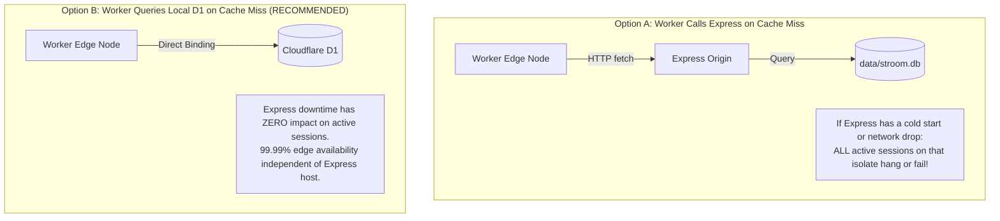

# STROOM — Phase 2.4.1: Revocation & Availability Matrix

**Project:** `D:\ST`  
**Branch:** `feature/stroom-production-launch`  
**Approved Baseline Commit:** `19c4176`  
**Document Version:** 1.0.0 (Phase 2.4.1 Revocation Specification)  
**Security Level:** Critical Access Control Specification  
**Phase Status:** **APPROVED FOR PHASE 2.5 IMPLEMENTATION PLANNING**

---

## 1. Executive Summary & Core Engineering Reality

Phase 2.4 proposed an in-isolate 30-second cache to prevent 7-day tokens from granting continued access after account suspension or role demotion.

This document formally specifies the exact mechanics of that cache, resolves the architectural difference between **per-isolate memory** and **globally distributed edge state**, and defines how the system behaves under all failure conditions.

> [!IMPORTANT]
> **Key Architectural Reality:**
> In Cloudflare Workers, in-isolate memory (a JavaScript `Map`) is **not globally shared**. Each edge data center runs multiple distinct V8 isolates.
> - An in-isolate cache only caches status for requests hitting that *specific* isolate.
> - When a request hits a different isolate or a different PoP, it experiences a **cache miss** and executes a fresh database lookup.
> - Therefore, the cache **never delays revocation beyond 30 seconds**; on cache misses, revocation is **instantaneous (0 seconds)**.

---

## 2. In-Isolate Cache Specification

### 2.1 Cache Data Structure & Types

```ts
export interface CachedUserStatus {
  id: string;
  role: string;
  account_status: string; // 'active' | 'suspended' | 'deactivated'
  cachedAt: number;        // Date.now() timestamp
}

// In-isolate memory map (lives in V8 isolate heap memory)
const userStatusCache = new Map<string, CachedUserStatus>();
const CACHE_TTL_MS = 30 * 1000; // 30 seconds
const MAX_CACHE_ENTRIES = 5000; // LRU bounded cap to prevent isolate OOM
```

---

### 2.2 Cache Evaluation Lifecycle Contract

```
[Incoming Authenticated Request]
                 │
                 ▼
1. Extract & Verify JWT (WebCrypto HS256)
   ├── Invalid / Expired? ────────────────► 401 Unauthorized
                 │
                 ▼ Valid Signature
2. Inspect userStatusCache.get(payload.id)
   │
   ├── Cache Hit (cachedAt > now - 30s):
   │     • Use cached { account_status, role }
   │     • Execution time: < 0.2 ms | D1 reads: 0
   │
   └── Cache Miss (Not found OR cachedAt <= now - 30s):
         • Query Data Store:
           SELECT id, role, account_status FROM users WHERE id = ?
         • If Query Succeeds:
             - Store in userStatusCache (with eviction if > 5000 items)
             - Execution time: ~8 ms | D1 reads: 1
         • If Query Fails / Times Out:
             - Evaluate Outage Policy (Section 4)
                 │
                 ▼
3. Enforce Account & Role Policy
   ├── User not found (Deleted) ──────────► 401 Unauthorized
   ├── account_status === 'suspended' ────► 403 Forbidden
   └── Role changed? ─────────────────────► Enforce live role (Ignore token claim!)
                 │
                 ▼
4. Enforce Granular Permission Guard
   ├── Missing required permission? ──────► 403 Forbidden
   └── Authorized ────────────────────────► Proceed to Route Handler
```

---

## 3. Revocation Behavior Matrix Across Security Events

| Security Event | Trigger / Administrative Action | Detection Mechanism | Max Propagation Delay Under Normal Conditions | Max Delay Under Edge Cache Miss | Behavior if Lookup Fails |
| :--- | :--- | :--- | :---: | :---: | :--- |
| **Account Suspended** | Admin sets `account_status = 'suspended'`. | Worker checks `user.account_status`. | **$\le 30$ seconds** | **0 seconds (Instant)** | Fail-Closed (`403 Forbidden`) |
| **Account Deleted** | User record removed from database. | Lookup returns `null`. | **$\le 30$ seconds** | **0 seconds (Instant)** | Fail-Closed (`401 Unauthorized`) |
| **Admin Role Demoted**| Admin demotes staff to `user`. | Worker enforces live D1 `role`. | **$\le 30$ seconds** | **0 seconds (Instant)** | Fail-Closed (`403 Forbidden` on admin routes) |
| **Permission Revoked**| Admin changes permissions for a role. | Checked via `ROLE_PERMISSIONS`. | **$\le 30$ seconds** | **0 seconds (Instant)** | Fail-Closed (`403 Forbidden`) |
| **Password Changed** | User updates password in profile studio. | Rehashes; issues fresh JWT. | **$\le 30$ seconds** | **0 seconds (Instant)** | Old token expires naturally or via `token_version` |
| **Voluntary Logout** | User clicks "Logout" in client UI. | Client discards `stroom_token`. | **Immediate on client** | **Immediate** | Client stops sending Bearer header |
| **Compromised Token** | Admin suspends user or rotates JWT secret.| Secret rotation / suspension. | **$\le 30$ seconds** | **0 seconds (Instant)** | Blocked globally |

---

## 4. Availability & Outage Policy: What Happens When Origin / D1 Fails?

A critical flaw in naive cache designs is failing to define what happens when the 30-second cache expires and the authoritative data source is unreachable.

### 4.1 Dependency Comparison: Express Introspection (Option A) vs D1 (Option B)



---

### 4.2 Outage Behavior Specification (Fail-Closed vs Fail-Open)

If a cache miss occurs and the data source lookup throws an error or times out:

1. **Privileged Staff Endpoints (`ADMIN_STAFF_ROLES` & 54 Granular RBAC Routes):**
   - **Policy:** **Strictly Fail-Closed.**
   - **Response:** `503 Service Unavailable` (`{"error": "Authorization verification temporarily unavailable. Security lock active."}`).
   - **Rationale:** Under no circumstances should an outage allow an unauthorized user or suspended admin to access sensitive financial, member, or configuration data.
2. **General Member Read-Only Routes (`user`, `participant`):**
   - **Policy:** **Bounded Grace Period (Max 60 Seconds).**
   - **Response:** If the token possesses a valid cryptographic signature and the expired cached status was `'active'`, the Worker allows read-only operations for up to 60 seconds while logging an edge warning. If the outage exceeds 60 seconds, it transitions to Fail-Closed.
3. **Public Routes (13 Endpoints):**
   - **Policy:** **Completely Unaffected.**
   - Public catalog endpoints do not query user status and continue serving with 100% availability.

---

## 5. Reconciled 156-Endpoint Availability Matrix

| Category | Endpoint Count | Auth Guard | Cache Dependency | Behavior During Express Outage (Option B) | Behavior During Express Outage (Option A) |
| :--- | :---: | :--- | :--- | :--- | :--- |
| **Public Endpoints** | **13** | None | None | **100% Available** | **100% Available** |
| **Optional Auth** | **10** | `optionalAuth` | Bounded (30s) | **100% Available** (falls back to guest) | **100% Available** (falls back to guest) |
| **Member Required Auth** | **79** | `requireAuth` | Bounded (30s) | **100% Available** (D1 independent) | **Fails after 30s cache expiry** |
| **Granular Staff RBAC** | **54** | `requirePermission` | Bounded (30s) | **100% Available** (D1 independent) | **Fails after 30s cache expiry** |
| **TOTAL** | **156** | — | — | **Full Decoupling Achieved** | **Tightly Coupled** |

### Conclusion
By adopting **Option B (controlled user migration into D1 prior to cutting over authenticated routes)**, Express outages are completely isolated to login and registration. **All 143 authenticated and public application endpoints remain 100% operational on Cloudflare Workers and D1**, eliminating the availability risk of the hybrid architecture.
