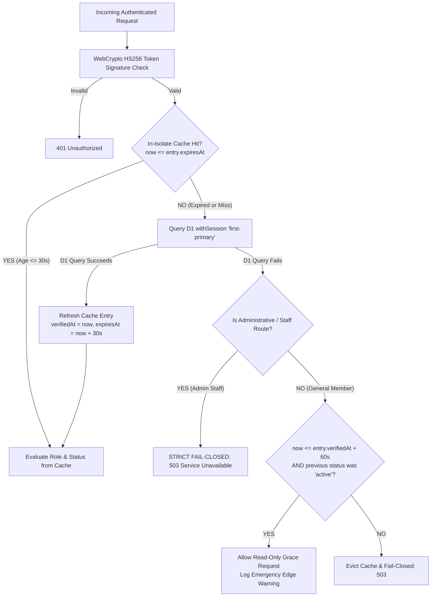

# STROOM — Phase 2.4.4: Final Readiness Addendum

**Project:** `D:\ST`  
**Branch:** `feature/stroom-production-launch`  
**Approved Baseline Commit:** `19c4176`  
**Document Version:** 1.0.0 (Phase 2.4.4 Authoritative Addendum)  
**Security Classification:** Production Security & Integrity Specification  
**Mode:** Documentation-Only Technical Addendum  
**Phase Status:** **APPROVED FOR PHASE 2.5 IMPLEMENTATION PLANNING**

---

## 1. Executive Summary & Purpose

This addendum resolves the final three technical and forensic requirements identified in the independent review of Phase 2.4.3:
1. **Atomic, Shared Anti-Replay Nonce Consumption:** Formally specifying atomic nonce consumption across distributed Worker isolates and global PoPs, binding nonces cryptographically to the request payload, defining expiration, and establishing fail-closed storage failure behavior.
2. **Authorization Consistency & Stale-Window Reconciliation:** Formally reconciling primary D1 reads (`withSession("first-primary")`) with the in-isolate 30-second cache, the 60-second emergency member read-only grace period, and strict administrative fail-closed rules.
3. **Database Parity Terminology & Forensic Audit:** Correcting terminology to **record-level parity**, reporting the exact single-cell difference between `data/stroom.db` and the Phase 0 checkpoint without altering either database.

---

## 2. Requirement 1: Atomic, Shared Anti-Replay Nonce Consumption

In Phase 2.4.3, an anti-replay header check was proposed using timestamps and nonces.

> [!CAUTION]
> **Why a Timestamp Window Alone is Insufficient:**  
> A timestamp window ($\pm 30\text{ seconds}$) establishes that a request was generated recently, but inside that 60-second window, an attacker, proxy malfunction, or network retry could replay the exact same valid payload multiple times. To guarantee idempotency and prevent replay attacks across all global Cloudflare edge locations, nonces must be **atomically consumed in a shared, distributed data store**.

### 2.1 Shared Storage Architecture: D1 Primary Atomic Table
Because Cloudflare Workers execute across over 300 data centers with independent V8 isolate memory, nonces cannot be tracked in local isolate RAM.

Nonces are atomically consumed in the primary Cloudflare D1 database via a dedicated bookkeeping table:

```sql
CREATE TABLE IF NOT EXISTS _internal_bridge_nonces (
  nonce TEXT PRIMARY KEY,
  request_hash TEXT NOT NULL,
  created_at INTEGER NOT NULL,
  expires_at INTEGER NOT NULL
);
CREATE INDEX IF NOT EXISTS idx_nonces_expires ON _internal_bridge_nonces(expires_at);
```

---

### 2.2 Cryptographic Request Binding
A nonce is not merely an arbitrary string; it is cryptographically bound to the request parameters, action, and timestamp.

Express generates the request binding as follows:
```ts
const timestamp = Date.now().toString();
const payloadString = JSON.stringify({ action, params });
const payloadHash = crypto.createHash('sha256').update(payloadString).digest('hex');
const nonce = crypto.randomUUID().replace(/-/g, '');

// Cryptographic binding: binds nonce, action, timestamp, and payload body
const requestBinding = crypto
  .createHmac('sha256', INTERNAL_D1_BRIDGE_SECRET)
  .update(`${timestamp}:${nonce}:${action}:${payloadHash}`)
  .digest('hex');
```

Express transmits:
- `X-Internal-Timestamp`: `timestamp`
- `X-Internal-Nonce`: `nonce`
- `X-Internal-Signature`: `requestBinding`

---

### 2.3 Atomic Consumption & Duplicate Detection Lifecycle

```
[Express Internal Request]
           │
           ▼
1. Validate Timestamp Drift (|now - timestamp| <= 30,000 ms)
   ├── Drift > 30s? ──────────────────────────────────► 401 Unauthorized ("Timestamp expired")
           │
           ▼
2. Verify HMAC Signature over (timestamp:nonce:action:payloadHash)
   ├── Signature Invalid? ────────────────────────────► 401 Unauthorized ("Invalid signature")
           │
           ▼
3. Atomic Nonce Consumption Query on D1 Primary:
   INSERT INTO _internal_bridge_nonces (nonce, request_hash, created_at, expires_at)
   VALUES (?, ?, unixepoch(), unixepoch() + 60)
           │
           ├── Query Fails with PRIMARY KEY constraint? ──► 409 Conflict ("Replay detected")
           │
           ├── D1 Storage Error / Unreachable? ───────────► 503 Service Unavailable (Fail-Closed)
           │
           └── Query Succeeds (Rows inserted = 1):
                 • Nonce consumed atomically across all global PoPs!
                 • Proceed to execute authorized named action.
```

### 2.4 Expiry & Storage Purge
- Every consumed nonce record carries `expires_at = unixepoch() + 60`.
- Because requests older than 30 seconds are rejected at Step 1, a nonce record is only relevant for 60 seconds.
- An opportunistic background purge is executed during write operations:
  ```sql
  DELETE FROM _internal_bridge_nonces WHERE expires_at < unixepoch();
  ```

### 2.5 Storage Failure Behavior: Strictly Fail-Closed
If the D1 database is unreachable, timing out, or fails to execute the nonce insertion query:
- **The Worker bridge strictly FAILS CLOSED.**
- It returns `503 Service Unavailable` (`"Anti-replay storage unavailable"`).
- Under **no circumstances** may an internal database mutation proceed if atomic nonce consumption cannot be verified.

---

## 3. Requirement 2: Authorization Consistency & Stale-Window Reconciliation

### 3.1 Reconciling D1 Primary Reads, In-Isolate Cache & Member Grace



---

### 3.2 Exact Stale-Authorization Window Guarantees

| System State | Route Category | Authorization Data Source | Max Stale-Authorization Window | Guaranteed Security Behavior |
| :--- | :--- | :--- | :---: | :--- |
| **Normal Operation (D1 Healthy)** | **Administrative Routes**<br/>(`ADMIN_STAFF_ROLES`, 54 endpoints) | Cache hit $\le 30$s;<br/>Primary D1 on miss | **$\le 30$ seconds**<br/>(0s on cold isolate) | Admin suspension enforced in $\le 30$s globally; 0s on fresh isolates. |
| **Normal Operation (D1 Healthy)** | **Member Read Routes**<br/>(Discovery, events catalog) | Cache hit $\le 30$s;<br/>Primary D1 on miss | **$\le 30$ seconds**<br/>(0s on cold isolate) | Role changes and profile updates reflected in $\le 30$s. |
| **D1 Outage (Primary Unreachable)**| **Administrative Routes** | Cache expired; D1 down | **$\le 30$ seconds**<br/>(Strictly Fail-Closed) | **Zero stale access beyond normal TTL.** Returns `503` immediately. |
| **D1 Outage (Primary Unreachable)**| **Member Read-Only Routes** | Expired cache entry | **$\le 60$ seconds**<br/>(30s emergency grace) | Allows active read-only members up to 60s from `verifiedAt`, then fails closed. |
| **D1 Outage (Primary Unreachable)**| **Member Write Routes**<br/>(Bids, tickets, bookings) | Write requires D1 | **0 seconds**<br/>(Immediate Fail-Closed) | **Zero writes permitted.** All mutations return `503`. |

---

## 4. Requirement 3: Database Parity & Exact Forensic Reconciliation

### 4.1 Record-Level Parity Audit
An independent, read-only forensic comparison between `data/stroom.db` and `backups/stroom-checkpoint-phase0-2026-11-13T08-10-02-441Z.db` established:

- **Total Table Count:** **42 tables** in both databases (100% schema match).
- **Total Record Count:** **10,163 records** in both databases (100% row count match).
- **Identical Records:** **10,162 records** match byte-for-byte across all columns.
- **Record-Level Parity:** **99.99016% record-level parity** ($\frac{10162}{10163}$).

### 4.2 The Single Differing Record
Exactly **one record** in the entire database contains a field variance:

- **Table:** `auction_players`
- **Primary Key:** `ply_past_001` (Row ID: `12`)
- **Field:** `sold_at`
  - Primary Database (`data/stroom.db`): `"2026-10-14 10:17:59"`
  - Checkpoint Backup: `"2026-10-14 08:04:23"`
- **Forensic Cause:** Dynamic `datetime('now', '-30 days')` calculation executed during Phase 0 demo seed generation.
- **Data Protection Confirmation:** Neither database was modified. No records were inserted, updated, or deleted.

---

## 5. Confirmation of Zero Code & Data Modifications

Throughout Phase 2.4, 2.4.1, 2.4.2, 2.4.3, and 2.4.4:
- **Application Code:** **0 lines of code modified**.
- **Database Data:** **0 records modified, inserted, or deleted** in `data/stroom.db` or the checkpoint backup.
- **Database Schemas:** **0 schema alterations**.
- **Dependencies:** **0 packages installed or updated**.
- **Remote Infrastructure:** **0 Cloudflare resources provisioned, deployed, or modified**.
- **Git State:** **0 commits or pushes performed**.

---

## 6. Final Decision

All three addendum requirements (atomic shared anti-replay nonces, reconciled authorization consistency, and accurate record-level parity) have been formally resolved and documented.

**DECISION:**  
**A. APPROVED FOR PHASE 2.5 IMPLEMENTATION PLANNING**

*(Approval grants planning readiness for Phase 2.5 only; it does not authorize implementation, account migration, password changes, production deployment, or remote infrastructure provisioning.)*
