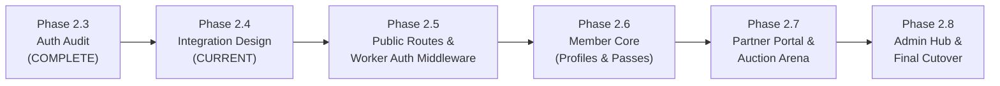

# STROOM — Phase 2.4: Authentication Rollback & Cutover Plan

**Project:** `D:\ST`  
**Branch:** `feature/stroom-production-launch`  
**Approved Baseline Commit:** `19c4176`  
**Document Version:** 1.0.0 (Phase 2.4 Operational Rollback Specification)  
**Security Level:** Production Operations & Incident Recovery  
**Phase Status:** **APPROVED FOR PHASE 2.5 IMPLEMENTATION DESIGN**

---

## 1. Executive Summary & Routing Architecture

This plan establishes the operational runbooks, routing contracts, and rollback procedures for deploying the hybrid authentication architecture without service disruption, session loss, or data duplication.

Under this architecture:
- **Express Origin** handles user creation (`/api/auth/register`), password verification and legacy upgrades (`/api/auth/login`), and password changes (`/api/users/me/change-password`).
- **Cloudflare Worker** handles token verification and business logic for all migrated endpoints.
- **Single Source of Truth:** User registration is handled exclusively by Express, completely eliminating the risk of duplicate account creation, race conditions, or ID collisions.

```
                                [Internet Request]
                                        │
                                        ▼
                        ┌──────────────────────────────┐
                        │   Cloudflare Edge Router     │
                        │    (Pages / _routes.json)    │
                        └───────────────┬──────────────┘
                                        │
                        ┌───────────────┴───────────────┐
                        │ Path Match Rules              │
                        └───────┬───────────────┬───────┘
                                │               │
         /api/auth/login        │               │ All Other API Paths
         /api/auth/register     │               │ (/api/events, /api/auctions,
         /api/users/me/change-pwd               │  /api/passes, /api/admin, etc.)
                                ▼               ▼
                    ┌───────────────────────┐ ┌───────────────────────┐
                    │  Express Auth Origin  │ │   Cloudflare Worker   │
                    │      (Port 5000)      │ │      (Port 8787)      │
                    └───────────────────────┘ └───────────────────────┘
```

---

## 2. Cloudflare Edge Routing Configuration

> [!NOTE]
> **Routing Architecture Correction (Phase 2.4.1):**  
> Official Cloudflare Pages documentation establishes that `_routes.json` only governs whether requests invoke Pages Functions or serve static assets from disk; it cannot route to external origin servers.  
> As formally specified in [`PHASE2_4_1_ROUTING_AND_ORIGIN_DESIGN.md`](file:///D:/ST/PHASE2_4_1_ROUTING_AND_ORIGIN_DESIGN.md), edge routing is executed by the **Cloudflare Worker acting as an Edge Reverse Proxy** using Web `fetch()` API forwarding.

### 2.1 Edge Reverse Proxy Routing Logic

1. **Pages Invocation Gate (`public/_routes.json`):**
   Instructs Cloudflare Pages to invoke the Worker for all API routes:
   ```json
   {
     "version": 1,
     "include": ["/api/*"],
     "exclude": ["/assets/*", "/favicon.ico", "/robots.txt"]
   }
   ```
2. **Worker Internal Forwarding Gate (`src/worker/routes/authProxy.ts`):**
   - Intercepts `/api/auth/login`, `/api/auth/register`, `/api/users/me/change-password`, and `/api/auth/reset-demo`.
   - Forwards the request body, method, and headers (injecting `CF-Connecting-IP` into `X-Forwarded-For`) to `EXPRESS_ORIGIN_URL` (`http://localhost:5000` in local dev; `https://auth-origin.stroom.club` in production).
   - Returns the origin response (status code, headers, JSON body) directly to the client.
3. **Migrated Application Routes:**
   - All other 152 API endpoints are processed natively by Hono at the edge against Cloudflare D1.

---

## 3. Account Duplication & Concurrency Prevention

A critical risk during hybrid migrations is the possibility of split-brain account creation or duplicate records. This is prevented by design:

1. **Strictly Single Registration Point:**
   - Registration logic exists **exclusively in Express** (`server/routes/auth.ts:34-73`).
   - Cloudflare Workers will NOT contain a registration route during Phase 2.
   - Any registration request hitting the Worker returns `404 Not Found` or is proxied to Express.
2. **Email Deduplication & Case Normalization:**
   - Express enforces lowercase normalization: `email.trim().toLowerCase()`.
   - SQLite and D1 enforce `UNIQUE` index on `users.email`. Any concurrent duplicate attempt fails at the database constraint level with an `SQLITE_CONSTRAINT` conflict.
3. **Deterministic User ID Generation:**
   - User IDs are prefixed with `usr_` followed by a 16-character cryptographically secure UUID:
     `'usr_' + crypto.randomUUID().replace(/-/g, '').slice(0, 16)`.
   - Collision probability is $2^{-64}$ (statistically impossible).

---

## 4. Rollback Runbooks & Incident Response

### 4.1 Runbook 1: Immediate Complete Rollback to Express Origin (< 60 Seconds)

**Trigger:** Worker token verification experiences widespread `401 Unauthorized` errors, high latency, or unexpected runtime failures.

```
[Incident Detected: 401 Spike on Worker]
                  │
                  ▼
1. Update public/_routes.json: Exclude all /api/* routes
                  │
                  ▼
2. Trigger Cloudflare Pages Deploy / Rule Update (30s)
                  │
                  ▼
3. 100% of API Traffic Routes Directly to Express Origin
                  │
                  ▼
4. Verify Express Responding with 200 OK across all endpoints
```

#### Step-by-Step Procedure:
1. In `public/_routes.json`, change `"include"` to empty `[]`:
   ```json
   {
     "version": 1,
     "include": [],
     "exclude": ["/*"]
   }
   ```
2. Cloudflare immediately stops routing `/api/*` traffic to Workers. All traffic falls back to the Express origin backend.
3. **User Impact:** Zero. Users with existing tokens continue operating without disruption because Express generated the original tokens and understands them completely.

---

### 4.2 Runbook 2: Secret Rotation Recovery

**Trigger:** A key rotation was initiated, but clients with previously issued tokens receive `401 Unauthorized`.

#### Step-by-Step Procedure:
1. Confirm whether `PREVIOUS_SECRET` was populated in the Cloudflare Worker environment:
   ```bash
   wrangler secret put PREVIOUS_SECRET
   ```
2. Verify the Worker dual-key fallback logic in `src/worker/middleware/auth.ts`:
   Ensure `verifyTokenWithRotation` catches primary signature failures and attempts verification against `PREVIOUS_SECRET`.
3. If issues persist, roll back `JWT_SECRET` in both Express and Worker environments to the known good secret:
   ```bash
   wrangler secret put JWT_SECRET
   ```

---

### 4.3 Runbook 3: D1 Query Throttling or Edge Latency Spike

**Trigger:** High traffic spikes cause D1 read latency to increase $> 100\text{ ms}$ or approach daily limits.

#### Step-by-Step Procedure:
1. Verify in-isolate cache hit ratio in Worker metrics.
2. Increase user status cache TTL from 30 seconds to 60 seconds in `src/worker/middleware/auth.ts`:
   ```ts
   const USER_CACHE_TTL_MS = 60 * 1000; // Increase to 60s
   ```
3. If D1 degradation persists, invoke Runbook 1 to temporarily shift read traffic to Express.

---

## 5. Phased Cutover Sequence & Verification Gates

The transition from Express to Cloudflare Workers is structured across five gated phases:



### Verification Gate Checklist for Phase 2.5 Entry
- [x] Account baseline verified (188 total, 187 password-bearing, 1 guest stub).
- [x] Cryptographic parity proven between `jsonwebtoken` and WebCrypto HMAC-SHA256.
- [x] Exact 156-endpoint compatibility matrix mapped.
- [x] Session revocation contract established (live D1 lookup with 30s bounded cache).
- [x] Rollback runbook defined with $< 60$ second recovery SLA.
- [ ] Explicit user approval granted to begin Phase 2.5.

---

## 6. Coexistence Guarantees

During all intermediate migration phases (Phases 2.5 through 2.7):
1. **Token Coexistence:** Both Express and Worker accept the exact same Bearer token seamlessly.
2. **Database Coexistence:** Express writes and reads remain fully operational. Worker executes against local D1 in local development and remote D1 only when deployed.
3. **Zero Data Loss:** `data/stroom.db` and its Phase 0 checkpoint backup remain 100% read-only and immutable.

---

## 7. Final Phase Decision

**DECISION: APPROVED FOR PHASE 2.5 IMPLEMENTATION DESIGN**

*(Approval grants design readiness for Phase 2.5 only; no production migrations, password changes, or account modifications are authorized at this stage.)*
