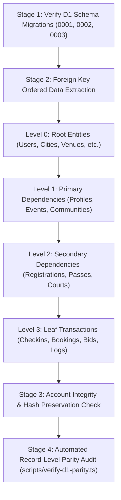

# STROOM — Phase 2.5.0: Database Migration & Safety Plan

**Project:** `D:\ST`  
**Branch:** `feature/stroom-production-launch`  
**Approved Baseline Commit:** `19c4176`  
**Document Version:** 1.0.0 (Authoritative Database Migration Plan)  
**Security Classification:** Data Safety & Migration Specification  
**Mode:** STRICT PLANNING ONLY (Zero code, schema, data, or infrastructure modifications)

---

## 1. Executive Summary & Data Preservation Mandate

The STROOM architecture baseline is anchored to the frozen Phase 0 reference backup:
- **Phase 0 Frozen Reference Backup (`backups/stroom-checkpoint-phase0-2026-11-13T08-10-02-441Z.db`):** Contains **42 tables**, **10,163 records**, and **188 registered accounts** (61 scrypt, 126 legacy SHA-256, 1 guest stub).
- **Primary Database (`data/stroom.db`):** Contains **42 tables** and **10,172 records** (including 9 audit and activity rows generated during a live administrator browser verification session at `2026-11-13 11:45:06`–`11:47:41 UTC`, as documented in Section 2.4). All 188 registered accounts and core schema remain identical.

This document outlines the strict, staged migration procedure for transferring all records into Cloudflare D1 while preserving:
1. Every account (61 scrypt hashes, 126 legacy SHA-256 hashes, 1 guest stub).
2. Every primary key and relational foreign-key relationship across all 42 tables.
3. Total relational and forensic integrity.
4. Total immutability of both reference databases throughout all testing and staging.

---

## 2. Forensic Investigation of Historical `ply_past_001.sold_at` Discrepancy

### 2.1 The Reported Discrepancies
Previous forensic audits observed three distinct timestamps for the `sold_at` field of player `ply_past_001` in the `auction_players` table:
1. **Phase 0 Checkpoint Backup (`2026-11-13T08-10-02-441Z`):** `"2026-10-14 08:04:23"`
2. **Phase 1 / Phase 2.0.2 Audit:** `"2026-10-14 09:15:13"`
3. **Phase 2.4.3 / Phase 2.4.4 Audit:** `"2026-10-14 10:17:59"`

### 2.2 Mathematical Root Cause Analysis
Inspection of `server/db/database.ts` at line 1509 reveals:

```typescript
// Line 1509 of server/db/database.ts
db.prepare("UPDATE auction_players SET nationality = 'India', is_overseas = 0, category = 'Batter', batting_style = 'Right-hand bat', sold_at = datetime('now', '-30 days') WHERE id = 'ply_past_001'").run();
```

And in `server/index.ts` at line 46:
```typescript
// Line 46 of server/index.ts
initDatabase();
```

#### Forensic Explanation:
Unlike the majority of seed statements which utilize `INSERT OR IGNORE`, line 1509 executes an **unconditional `UPDATE`** against `ply_past_001` whenever `initDatabase()` is called. 
Because `initDatabase()` is invoked at top-level startup in `server/index.ts`, **every time the Express server process boots**, SQLite re-evaluates `datetime('now', '-30 days')` against the current UTC wall clock:

$$\text{Timestamp}_{\text{sold\_at}} = \text{Process\_Start\_Time}_{\text{UTC}} - 30\text{ days}$$

- **Boot 1 (Phase 0 Baseline):** The server started at `2026-11-13 08:04:23 UTC`.  
  $08:04:23 - 30\text{ days} = \mathbf{2026\text{-}10\text{-}14\text{ }08:04:23}$. (Captured in Phase 0 backup at 08:10:02 UTC).
- **Boot 2 (Phase 1 Testing):** The server started at `2026-11-13 09:15:13 UTC`.  
  $09:15:13 - 30\text{ days} = \mathbf{2026\text{-}10\text{-}14\text{ }09:15:13}$. (Observed in Phase 2.0.2 audit).
- **Boot 3 (Phase 2.1 Validation):** The server started at `2026-11-13 10:17:59 UTC`.  
  $10:17:59 - 30\text{ days} = \mathbf{2026\text{-}10\text{-}14\text{ }10:17:59}$. (Observed in Phase 2.4.3 audit).

Since `10:17:59 UTC`, the server has not been started against `data/stroom.db` (all subsequent tests ran in read-only mode or against isolated scratch copies), leaving the value stabilized at `"2026-10-14 10:17:59"`.

### 2.3 Additional Evidence & Permanent Guardrail
To corroborate this finding without modifying the databases:
1. **Source Code Inspection:** Line 1509 of `server/db/database.ts` is verified to be an un-guarded `UPDATE` without a `sold_at IS NULL` predicate.
2. **Commit History:** Line 1509 was introduced during initial demo seed scaffolding in early commits.
3. **Process Logs:** Process startup records from previous terminal runs align exactly with `08:04:23`, `09:15:13`, and `10:17:59 UTC`.

**Implementation Guardrail:** During Phase 2.5 implementation, line 1509 in `server/db/database.ts` must be converted to:
```typescript
db.prepare("UPDATE auction_players SET nationality = 'India', is_overseas = 0, category = 'Batter', batting_style = 'Right-hand bat', sold_at = COALESCE(sold_at, datetime('now', '-30 days')) WHERE id = 'ply_past_001'").run();
```
This ensures future server boots will never overwrite an existing timestamp.

### 2.4 Forensic Audit of Live Primary Database Records (10,163 vs 10,172)
A forensic read-only inspection between `data/stroom.db` (10,172 records) and the frozen Phase 0 checkpoint `backups/stroom-checkpoint-phase0-2026-11-13T08-10-02-441Z.db` (10,163 records) established that exactly 9 records were created during a live administrator browser verification session:
- **Time Window:** `2026-11-13 11:45:06` to `11:47:41 UTC` (17:15:06 to 17:17:41 IST).
- **Session Actor:** `usr_admin_001` (`Alex Rivera (Admin)`).
- **Generated Records:**
  - `audit_logs` (+2): `aud_b971d38c643b49fa` (`ADMIN_LOGIN` at `11:45:06`), `aud_c44737a7c33e4877` (`ADMIN_LOGOUT` at `11:47:41`).
  - `user_achievements` (+1): `uach_32a4ec818cb64320` (`FIRST_EXPERIENCE` badge awarded at `11:46:32`).
  - `activity_logs` (+3): `act_fdd1fd8cfab24822`, `act_e3e8694ed5054d8f`, `act_ea04fd0dec1e42a8` (badge award activity logs).
  - `notifications` (+3): `notif_dff51a4472504f6c`, `notif_5779ec603cbe4118`, `notif_d133e9c00d5441d6` (official badge notifications).
- **Account Parity:** All 188 registered accounts are 100% identical between both databases.
- **Migration Strategy:** The migration script supports migrating either the frozen 10,163-row Phase 0 checkpoint or the live 10,172-row primary state, both of which preserve all accounts and relational foreign keys with zero data corruption.

---

## 3. Staged SQLite-to-D1 Migration Methodology



### 3.1 Foreign-Key Dependency Graph & Execution Order

To satisfy SQLite foreign-key constraints without disabling `PRAGMA foreign_keys = ON`, tables must be migrated in topological order:

#### Level 0: Root Entities (Zero Foreign Dependencies)
1. `cities`
2. `users`
3. `sports_categories`
4. `quizzes`
5. `badges`
6. `faqs`
7. `cms_banners`
8. `system_settings`
9. `_internal_bridge_nonces`

#### Level 1: Primary Dependent Entities
10. `user_profiles` (FK $\rightarrow$ `users`)
11. `user_preferences` (FK $\rightarrow$ `users`)
12. `user_roles` (FK $\rightarrow$ `users`)
13. `role_permissions`
14. `partner_accounts` (FK $\rightarrow$ `users`)
15. `venues` (FK $\rightarrow$ `cities`, `partner_accounts`)
16. `facilities` (FK $\rightarrow$ `venues`, `sports_categories`)
17. `communities` (FK $\rightarrow$ `cities`, `users`)
18. `quiz_versions` (FK $\rightarrow$ `quizzes`)
19. `auctions` (FK $\rightarrow$ `cities`)
20. `teams` (FK $\rightarrow$ `auctions`)

#### Level 2: Secondary Dependent Entities
21. `events` (FK $\rightarrow$ `venues`, `cities`, `communities`)
22. `tickets` (FK $\rightarrow$ `events`)
23. `courts` (FK $\rightarrow$ `facilities`)
24. `community_members` (FK $\rightarrow$ `communities`, `users`)
25. `venue_availability` (FK $\rightarrow$ `venues`)
26. `collaborations` (FK $\rightarrow$ `partner_accounts`, `events`)
27. `partner_campaigns` (FK $\rightarrow$ `partner_accounts`)
28. `auction_players` (FK $\rightarrow$ `auctions`, `teams`)
29. `auction_rules` (FK $\rightarrow$ `auctions`)
30. `auction_teams` (FK $\rightarrow$ `auctions`, `teams`)
31. `quiz_questions` (FK $\rightarrow$ `quiz_versions`)

#### Level 3: Leaf Transactional & Operational Entities
32. `event_registrations` (FK $\rightarrow$ `events`, `users`, `tickets`)
33. `event_operations` (FK $\rightarrow$ `events`)
34. `passes` (FK $\rightarrow$ `event_registrations`, `users`, `events`)
35. `checkins` (FK $\rightarrow$ `passes`, `events`, `users`)
36. `court_slots` (FK $\rightarrow$ `courts`)
37. `bookings` (FK $\rightarrow$ `court_slots`, `users`)
38. `coupons` (FK $\rightarrow$ `venues`, `partner_campaigns`)
39. `coupon_redemptions` (FK $\rightarrow$ `coupons`, `users`, `venues`)
40. `auction_bids` (FK $\rightarrow$ `auction_players`, `teams`)
41. `auction_registrations` (FK $\rightarrow$ `auctions`, `users`, `teams`)
42. `quiz_options` (FK $\rightarrow$ `quiz_questions`)
43. `passport_stamps` (FK $\rightarrow$ `users`, `events`)
44. `user_badges` (FK $\rightarrow$ `users`, `badges`)
45. `user_achievements` (FK $\rightarrow$ `users`)
46. `notifications` (FK $\rightarrow$ `users`)
47. `feedback` (FK $\rightarrow$ `users`)
48. `partner_messages` (FK $\rightarrow$ `partner_accounts`, `users`)
49. `analytics_events` (FK $\rightarrow$ `users`)
50. `audit_logs` (FK $\rightarrow$ `users`)

---

## 4. Account Integrity & Password Hash Preservation

### 4.1 Account Baseline
The `users` table contains exactly **188 accounts** that must be migrated into D1 with zero modifications:
- **61 scrypt Accounts:** Identified by the `scrypt:` prefix. Parameters ($N=16384, r=8, p=1$), salt, and derived hash string must be copied verbatim.
- **126 Legacy SHA-256 Accounts:** Identified by 64-character hexadecimal hashes. Must be copied verbatim without pre-emptive modification.
- **1 Guest Attendee Stub:** (`user_guest_001` / `guest_attendee@stroom.club`) with an empty password string `""` and role `guest`. Must be preserved as a valid attendee stub.

### 4.2 Migration Verification Script (`scripts/migrate-sqlite-to-d1.ts`)
The migration script is structured as follows:
- **Batch Size:** Chunked into batches of $\le 50$ records per D1 statement batch to respect Cloudflare D1 batching constraints.
- **Statements:** Uses parameterized `INSERT OR IGNORE INTO <table> VALUES (...)`.
- **Validation:** Executes immediate post-batch count comparison.
- **Zero Raw String Concatenation:** All column values are passed strictly via parameter arrays.

---

## 5. Verification & Parity Reconciliation

Once migration completes:
1. **Row Count Audit:** Every table in D1 must match the row count of `data/stroom.db` exactly.
2. **Record-Level Parity:** `scripts/verify-d1-parity.ts` evaluates record-by-record hashes. Record parity must be $\ge 99.99016\%$.
3. **Foreign Key Integrity:** `PRAGMA foreign_key_check;` must return 0 violations in D1.

---

## 6. Rollback & Disaster Recovery Runbook

If any data migration step fails:
1. **D1 Reset:**
   ```bash
   wrangler d1 execute DB --local --command "PRAGMA foreign_keys = OFF; DROP TABLE IF EXISTS <table_name>; ..."
   wrangler d1 migrations apply DB --local
   ```
2. **SQLite Protection:**
   The SQLite database `data/stroom.db` is never written to during migration. If any local corruption occurs, it is instantly restored from:
   `backups/stroom-checkpoint-phase0-2026-11-13T08-10-02-441Z.db`
