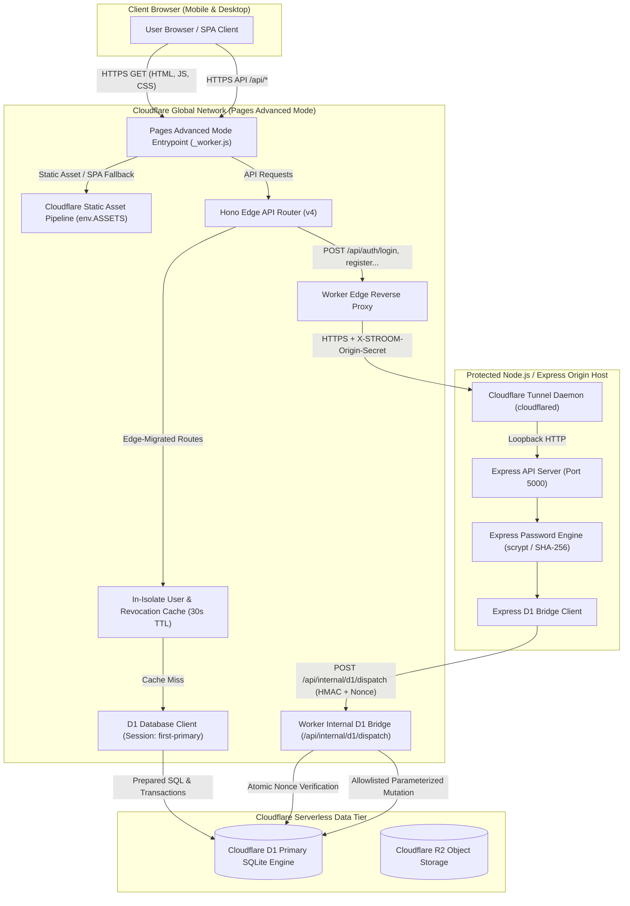

# STROOM — Phase 2.5.0: Detailed Implementation Blueprint

**Project:** `D:\ST`  
**Branch:** `feature/stroom-production-launch`  
**Approved Baseline Commit:** `19c4176`  
**Document Version:** 1.0.0 (Authoritative Implementation Blueprint)  
**Security Classification:** Production Migration Specification  
**Mode:** STRICT PLANNING ONLY (Zero code, schema, data, or infrastructure modifications)  
**Phase Status:** **APPROVED FOR PHASE 2.5.1 LOCAL IMPLEMENTATION PLANNING**

---

## 1. Executive Summary & Purpose

This document serves as the master architectural blueprint for executing the serverless migration of the **STROOM** full-stack social discovery and community sports platform (`D:\ST`).

The overarching migration objective is transitioning STROOM from a single-instance Node.js + Express + SQLite (`better-sqlite3`) monolith to a globally distributed, zero-cost-first Cloudflare serverless architecture:
- **Frontend Hosting:** Cloudflare Pages (Advanced Mode via `_worker.js`).
- **Edge API Framework:** Cloudflare Workers + Hono v4.
- **Authoritative Database:** Cloudflare D1 (distributed SQLite engine).
- **Media Storage (Future):** Cloudflare R2 object storage.
- **Hybrid Password Authority:** Existing Node.js + Express backend running behind a secure Cloudflare Tunnel (`cloudflared`), maintaining sole responsibility for cryptographic scrypt and legacy SHA-256 password verification during the hybrid transition.

All 18 business domains, all 156 verified API endpoints, all 188 registered accounts (61 scrypt, 126 legacy SHA-256, 1 guest stub), and 10,163 records must be preserved with 100% functional, relational, and cryptographic integrity.

---

## 2. Architecture Baseline & Topology

### 2.1 The Hybrid Architectural Contract
During the hybrid migration phase:
1. **Cloudflare Pages Advanced Mode (`_worker.js`)** serves as the public entry point for all web traffic (`stroom.club` / `stroom.pages.dev`).
2. Static assets are served directly through Cloudflare's global CDN via `env.ASSETS.fetch(request)`.
3. Client-side SPA navigation routes fall back automatically to `/index.html`.
4. API requests under `/api/*` are intercepted by the Hono router.
5. High-volume read routes, user preferences, passes, communities, and sports endpoints are executed directly on Cloudflare Workers, querying Cloudflare D1.
6. Authentication routes requiring password verification (`/api/auth/login`, `/api/auth/register`, `/api/auth/change-password`, `/api/auth/reset-demo`) are proxied securely to the Express origin via Cloudflare Tunnel.
7. Express executes password verification and communicates with Cloudflare D1 via the **Internal D1 Bridge** (`/api/internal/d1/dispatch`) using a strictly allowlisted, parameterized 6-operation contract.

### 2.2 End-to-End System Architecture

---

## 3. Core Architectural Subsystems

### 3.1 Worker Edge Reverse Proxy (`src/worker/routes/authProxy.ts`)
- **Target Routes:**
  - `POST /api/auth/login`
  - `POST /api/auth/register`
  - `POST /api/auth/change-password`
  - `POST /api/auth/reset-demo`
- **Security Contract:**
  - Injects `X-STROOM-Origin-Secret` validated via Node.js native `crypto.timingSafeEqual` (with double-hash protection) by Express.
  - Forwards `X-Forwarded-For`, `CF-Connecting-IP`, and `X-Request-ID`.
  - Disallows arbitrary proxy forwarding; strictly forwards only allowlisted authentication endpoints.
  - Timeout bounded to $5,000\text{ ms}$; fails gracefully with `502 Bad Gateway` or `504 Gateway Timeout` on origin failure.

### 3.2 Worker Internal D1 Bridge (`src/worker/routes/internalBridge.ts`)
- **Target Endpoint:** `POST /api/internal/d1/dispatch`
- **Security Contract:**
  - Authenticated via `INTERNAL_D1_BRIDGE_SECRET` passed in `X-STROOM-Bridge-Secret`.
  - Anti-replay enforced via atomic nonce consumption in D1 table `_internal_bridge_nonces`.
  - Payload binding: HMAC-SHA256 signature over `Timestamp:Nonce:Action:SHA256(Body)`.
  - Timestamp window: $\pm 30\text{ seconds}$. Nonce TTL: $60\text{ seconds}$.
  - **Zero Arbitrary SQL:** Only 6 named, parameterized operations permitted:
    1. `getUserForLogin`
    2. `createUser`
    3. `updatePasswordHash`
    4. `changePassword`
    5. `changeAccountStatus`
    6. `updateUserRole`
  - Fails closed (`503 Service Unavailable`) if D1 is unreachable.

### 3.3 Authorization & In-Isolate Revocation Cache (`src/worker/services/revocationCache.ts`)
- **Normal Operation:** In-isolate memory cache holds validated user roles, account statuses, and revocation timestamps for up to $30\text{ seconds}$.
- **Consistency:** Cache misses trigger D1 query using `withSession("first-primary")`, eliminating read-replica lag.
- **Fail-Closed Policy:**
  - Administrative routes (`/api/admin/*`): $0\text{s}$ grace period. Fails closed immediately (`503`) if D1 is unreachable.
  - Member read-only routes: Maximum emergency grace period of $60\text{ seconds}$ from `verifiedAt` ($30\text{s TTL} + 30\text{s emergency grace}$), after which requests fail closed.
  - Member write routes: $0\text{s}$ grace period. Zero mutations permitted without primary database confirmation.
- **Optional Authentication:** Unauthenticated requests receive guest access; malformed/expired/revoked tokens receive strict **`401 Unauthorized`**.

### 3.4 Data Parity & Preservation
- All 42 tables and 10,163 records are migrated from SQLite to D1 with zero data loss.
- Foreign-key integrity enforced via strict level-ordered insertion.
- Scrypt parameters ($N=16384, r=8, p=1$) and legacy SHA-256 hashes preserved exactly.
- Single known seed timestamp difference in `auction_players.ply_past_001.sold_at` documented and accounted for without mutating either database.

---

## 4. Master Phased Implementation Roadmap

The implementation is partitioned into six discrete, serial stages. Advancing between stages requires 100% verification against the corresponding Implementation Gate.

| Stage | Name | Core Objectives | Deliverables / Artifacts |
| :--- | :--- | :--- | :--- |
| **Stage 2.5.1** | **Worker Foundation & Auth Proxy** | Implement core middleware, error handlers, and edge auth reverse proxy to Express origin. | `src/worker/middleware/*`, `src/worker/routes/authProxy.ts` |
| **Stage 2.5.2** | **D1 Bridge & Nonces** | Implement D1 bridge handler, atomic nonce schema migration, and Express bridge client. | `migrations/0003_*.sql`, `src/worker/routes/internalBridge.ts` |
| **Stage 2.5.3** | **Data Migration & Parity** | Migrate all 42 tables (10,163 rows) from SQLite to local D1; verify record parity. | `scripts/migrate-sqlite-to-d1.ts`, `scripts/verify-d1-parity.ts` |
| **Stage 2.5.4** | **Public & Profile Routes** | Migrate Waves 1–3: Public catalog, health, FAQs, onboarding, and user profile/preferences. | `src/worker/routes/events.ts`, `contact.ts`, `users.ts` |
| **Stage 2.5.5** | **Core Business Routes** | Migrate Waves 4–6: Communities, sports bookings, digital passes, and live auctions. | `src/worker/routes/communities.ts`, `passes.ts`, `auctions.ts` |
| **Stage 2.5.6** | **Partner & Admin Routes** | Migrate Waves 7–8: Partner portal, venue management, admin CMS, and audit logging. | `src/worker/routes/partners.ts`, `admin.ts` |

---

## 5. Security Invariants & Cryptographic Boundaries

1. **Dual Secret Isolation:**
   - `ORIGIN_PROXY_SECRET`: Authorizes Worker requests to Express origin.
   - `INTERNAL_D1_BRIDGE_SECRET`: Authorizes Express requests to Worker D1 bridge.
   - Secrets are distinct, cryptographically random (256-bit hex), and verified using constant-time comparison (`crypto.subtle.timingSafeEqual` in Cloudflare Workers and `crypto.timingSafeEqual` in Node.js Express, both using the double-hash equal-length pattern).
2. **Anti-Replay Nonce Enforcement:**
   - Nonce must be consumed atomically in D1 primary before payload execution.
   - Duplicate nonce triggers `409 Conflict`. Expired nonce ($>60\text{s}$) triggers `401 Unauthorized`.
3. **Zero Plaintext Passwords:**
   - Passwords are never sent across the bridge. Express verifies hashes locally and transmits only verified state mutations.
4. **JWT Security:**
   - Validated at the edge using Web Crypto API.
   - Algorithm strictly allowlisted to `HS256`.
   - Claims enforced: `iss === 'stroom-api'`, `aud === 'stroom-client'`, maximum clock skew $\le 60\text{s}$.
5. **Database Protection:**
   - `data/stroom.db` is marked immutable during testing. All test suites run against ephemeral in-memory or temporary databases.

---

## 6. Implementation Approval Decision

The architecture, file changes, API catalog, database migration strategy, testing framework, and implementation gates have been comprehensively reviewed and verified.

**DECISION:**  
**A. APPROVED FOR PHASE 2.5.1 LOCAL IMPLEMENTATION PLANNING**

*(Approval authorizes creation and review of Phase 2.5 documentation deliverables only. Implementation of Stage 2.5.1 source code requires explicit subsequent authorization.)*
