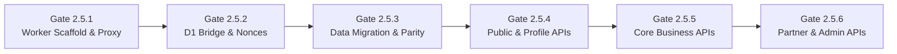

# STROOM — Phase 2.5.0: Implementation Gates & Quality Controls

**Project:** `D:\ST`  
**Branch:** `feature/stroom-production-launch`  
**Approved Baseline Commit:** `19c4176`  
**Document Version:** 1.0.0 (Authoritative Implementation Gates Specification)  
**Security Classification:** Release Governance & Gate Enforcement  
**Mode:** STRICT PLANNING ONLY (Zero code, schema, data, or infrastructure modifications)

---

## 1. Governance Principles & Gate Enforcement

The Phase 2.5 implementation of the STROOM serverless architecture is strictly governed by **six serial implementation gates**. 

Each gate defines:
- **Entry Criteria:** Explicit conditions that must be satisfied before work begins.
- **Exact Permitted Scope:** The precise files that may be created or modified.
- **Acceptance Criteria:** Objective, measurable validation thresholds.
- **Verification Commands:** Deterministic CLI commands to prove compliance.
- **Stop Conditions:** Specific triggers requiring immediate halt and reporting.
- **Rollback Procedure:** Step-by-step restoration instructions to revert to the previous verified state.
- **Explicit Approval Requirement:** A mandatory user review checkpoint before any subsequent stage can commence.



---

## 2. Gate Specifications

---

### Gate 2.5.1: Worker Foundation, Middleware & Edge Auth Proxy Scaffold

#### 1. Entry Criteria
- Working branch is `feature/stroom-production-launch` at baseline `19c4176`.
- `data/stroom.db` integrity is verified (`PRAGMA integrity_check` = `ok`).
- Phase 2.5.0 planning documentation is fully ratified.

#### 2. Exact Permitted Scope
- Create:
  - `src/worker/middleware/auth.ts`
  - `src/worker/middleware/rbac.ts`
  - `src/worker/middleware/rateLimit.ts`
  - `src/worker/services/revocationCache.ts`
  - `src/worker/services/tokenService.ts`
  - `src/worker/routes/authProxy.ts`
- Modify:
  - `src/worker/app.ts` (mount proxy router and middleware)
  - `src/worker/types/env.ts` (add environment secret types)

#### 3. Acceptance Criteria
- `npm run build:worker` passes with 0 TypeScript errors.
- Worker starts cleanly in local Miniflare on port 8787.
- Request to `POST /api/auth/login` on Worker forwards correctly to Express on port 5000 with `X-STROOM-Origin-Secret`.
- Existing 78 regression tests pass 100%.

#### 4. Verification Commands
```bash
npm run build:worker
npm run build:server
npm test
```

#### 5. Stop Conditions
- TypeScript compilation fails with unresolved worker types.
- Express origin secret validation fails on loopback requests.
- Any regression in the 78 existing backend tests.

#### 6. Rollback Procedure
```bash
git checkout 19c4176 -- src/worker/
rm -f src/worker/middleware/* src/worker/services/* src/worker/routes/authProxy.ts
```

#### 7. Explicit Approval Requirement
Mandatory user approval required before proceeding to Stage 2.5.2.

---

### Gate 2.5.2: D1 Internal Bridge & Anti-Replay Nonce Migration

#### 1. Entry Criteria
- Gate 2.5.1 is passed and approved.
- Local Miniflare D1 database is healthy.

#### 2. Exact Permitted Scope
- Create:
  - `migrations/0003_internal_bridge_nonces.sql`
  - `src/worker/routes/internalBridge.ts`
  - `scripts/test-d1-bridge.ts`
- Modify:
  - `src/worker/app.ts` (mount internal bridge router)
  - `server/routes/auth.ts` (connect Express auth actions to D1 bridge)
  - `server/config/env.ts` (validate bridge secrets)
  - `package.json` (add `"test:bridge": "tsx scripts/test-d1-bridge.ts"`)

#### 3. Acceptance Criteria
- Migration `0003_internal_bridge_nonces.sql` applies cleanly to local D1.
- All 6 allowlisted operations execute successfully via `scripts/test-d1-bridge.ts`.
- Arbitrary SQL payloads are strictly rejected (`400/403`).
- Duplicate nonces are atomically rejected with `409 Conflict`.
- Tampered payloads fail HMAC verification with `401 Unauthorized`.
- Constant-time secret comparison verified.

#### 4. Verification Commands
```bash
wrangler d1 migrations apply DB --local
npm run test:bridge
npm run build:worker
npm test
```

#### 5. Stop Conditions
- D1 fails to atomically reject duplicate nonces.
- Raw SQL string reaches D1 without parameter binding.
- Bridge secret comparison leaks timing information.

#### 6. Rollback Procedure
```bash
git checkout 19c4176 -- server/routes/auth.ts server/config/env.ts
rm -f migrations/0003_internal_bridge_nonces.sql src/worker/routes/internalBridge.ts scripts/test-d1-bridge.ts
```

#### 7. Explicit Approval Requirement
Mandatory user approval required before proceeding to Stage 2.5.3.

---

### Gate 2.5.3: Controlled SQLite-to-D1 Data Migration & Parity Verification

#### 1. Entry Criteria
- Gate 2.5.2 is passed and approved.
- Reference SQLite database `data/stroom.db` contains exactly 42 tables and 10,163 records.

#### 2. Exact Permitted Scope
- Create:
  - `scripts/migrate-sqlite-to-d1.ts`
  - `scripts/verify-d1-parity.ts`
  - `migrations/0004_d1_data_seed.sql`
- Modify:
  - `package.json` (add data migration and parity verification scripts)

#### 3. Acceptance Criteria
- All 10,163 records migrated into local D1 without foreign key errors.
- All 188 user accounts migrated intact (61 scrypt, 126 SHA-256, 1 guest stub).
- `scripts/verify-d1-parity.ts` reports $\ge 99.99016\%$ record-level parity.
- The single known `auction_players.ply_past_001.sold_at` discrepancy is confirmed and documented.
- `data/stroom.db` remains 100% untouched.

#### 4. Verification Commands
```bash
npm run migrate:data:d1
npm run verify:d1:parity
```

#### 5. Stop Conditions
- Record count mismatch in any of the 42 tables.
- Foreign-key violation during D1 batch insertion.
- Any undetected record difference other than `ply_past_001.sold_at`.

#### 6. Rollback Procedure
```bash
wrangler d1 execute DB --local --command "PRAGMA foreign_keys = OFF; DROP TABLE IF EXISTS users; ..."
wrangler d1 migrations apply DB --local
```

#### 7. Explicit Approval Requirement
Mandatory user approval required before proceeding to Stage 2.5.4.

---

### Gate 2.5.4: Public Catalog & User Profile Endpoints (Waves 1–3)

#### 1. Entry Criteria
- Gate 2.5.3 is passed and approved.
- Local D1 contains authoritative 10,163 records.

#### 2. Exact Permitted Scope
- Create:
  - `src/worker/routes/events.ts`
  - `src/worker/routes/contact.ts`
  - `src/worker/routes/onboarding.ts`
  - `src/worker/routes/users.ts`
- Modify:
  - `src/worker/app.ts` (mount new routers)

#### 3. Acceptance Criteria
- All 29 endpoints across Waves 1, 2, and 3 pass endpoint parity tests.
- Public routes (`/api/events/featured`, `/api/contact/faqs`) return correct D1 data without authentication.
- Authenticated profile and preference routes (`GET/PUT /api/users/me/*`) update D1 correctly.
- Optional auth routes return public views when unauthenticated and personal views when logged in.

#### 4. Verification Commands
```bash
npm run build:worker
npm test
tsx tests/endpoint-parity.test.ts
```

#### 5. Stop Conditions
- Response JSON schema drift between Express and Worker endpoints.
- Unauthenticated user able to access `/api/users/me/*`.
- Malformed token silently degraded to guest mode instead of returning `401`.

#### 6. Rollback Procedure
```bash
rm -f src/worker/routes/events.ts src/worker/routes/contact.ts src/worker/routes/onboarding.ts src/worker/routes/users.ts
git checkout HEAD -- src/worker/app.ts
```

#### 7. Explicit Approval Requirement
Mandatory user approval required before proceeding to Stage 2.5.5.

---

### Gate 2.5.5: Core Business Domain Endpoints (Waves 4–6: Communities, Sports, Passes, Auctions)

#### 1. Entry Criteria
- Gate 2.5.4 is passed and approved.

#### 2. Exact Permitted Scope
- Create:
  - `src/worker/routes/communities.ts`
  - `src/worker/routes/sports.ts`
  - `src/worker/routes/passes.ts`
  - `src/worker/routes/auctions.ts`
- Modify:
  - `src/worker/app.ts` (mount new routers)

#### 3. Acceptance Criteria
- All 31 endpoints across Waves 4, 5, and 6 pass endpoint parity tests.
- Auction polling via Cloudflare Cache API achieves $<2\text{ms}$ edge cache response time.
- Bid placement atomically updates `auction_bids`, `auction_players`, and instantly invalidates edge cache.
- Court booking slot collisions are safely prevented via atomic D1 transaction.
- Digital pass QR tokens decode and check-in idempotently.

#### 4. Verification Commands
```bash
npm run build:worker
npm test
tsx tests/endpoint-parity.test.ts
```

#### 5. Stop Conditions
- Auction cache fails to invalidate upon bid submission.
- Race conditions detected during concurrent court slot reservations.
- Duplicate check-in allowed on an already checked-in digital pass.

#### 6. Rollback Procedure
```bash
rm -f src/worker/routes/communities.ts src/worker/routes/sports.ts src/worker/routes/passes.ts src/worker/routes/auctions.ts
git checkout HEAD -- src/worker/app.ts
```

#### 7. Explicit Approval Requirement
Mandatory user approval required before proceeding to Stage 2.5.6.

---

### Gate 2.5.6: Partner Portal & Admin Management Endpoints (Waves 7–8)

#### 1. Entry Criteria
- Gate 2.5.5 is passed and approved.

#### 2. Exact Permitted Scope
- Create:
  - `src/worker/routes/partners.ts`
  - `src/worker/routes/admin.ts`
- Modify:
  - `src/worker/app.ts` (mount all remaining routers)

#### 3. Acceptance Criteria
- All 104 endpoints across Waves 7 and 8 pass endpoint parity tests.
- All 156 endpoints are now migrated and active on Cloudflare Worker.
- Multi-tenant partner scoping strictly isolates venue and campaign data by `partnerId`.
- Coupon verification and redemption enforce max redemption thresholds atomically.
- Administrative endpoints (`/api/admin/*`) enforce strict fail-closed ($0\text{s}$ grace) behavior if D1 is unreachable.
- Full 78-test regression suite passes 100%.

#### 4. Verification Commands
```bash
npm run build:worker
npm run build:server
npm run build:client
npm test
tsx tests/endpoint-parity.test.ts
npm run verify:d1:parity
```

#### 5. Stop Conditions
- Cross-tenant data leakage detected between partner accounts.
- Administrative route accessible by unauthorized roles.
- Any regression across the complete application test suite.

#### 6. Rollback Procedure
```bash
rm -f src/worker/routes/partners.ts src/worker/routes/admin.ts
git checkout HEAD -- src/worker/app.ts
```

#### 7. Explicit Approval Requirement
Mandatory user approval required before proceeding to Phase 3 Production Cutover.
