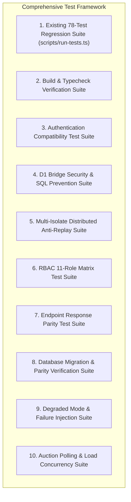

# STROOM — Phase 2.5.0: Testing & Rollback Strategy

**Project:** `D:\ST`  
**Branch:** `feature/stroom-production-launch`  
**Approved Baseline Commit:** `19c4176`  
**Document Version:** 1.0.0 (Authoritative Testing & Rollback Plan)  
**Security Classification:** Quality Assurance & Resilience Specification  
**Mode:** STRICT PLANNING ONLY (Zero code, schema, data, or infrastructure modifications)

---

## 1. Executive Summary & Safety Principles

The testing strategy for Phase 2.5 is designed to guarantee zero functional regressions, zero account lockouts, zero data corruption, and complete security validation across both the Node.js Express origin and the Cloudflare Worker edge.

### Core Testing Invariants:
1. **Strict Reference Database Immutability:**  
   The authoritative SQLite database `data/stroom.db` is strictly marked read-only during all testing operations. Tests **must never** execute against `data/stroom.db`.
2. **Disposable Harness Execution:**  
   All tests targeting SQLite run against ephemeral copies (`data/test_disposable_<id>.db`) created by `scripts/run-tests.ts` and destroyed in the `finally` block.
3. **Local Miniflare Isolation:**  
   All tests targeting Cloudflare D1 run against the local Miniflare D1 SQLite database (`.wrangler/state/v3/d1/...`), which can be dropped and recreated cleanly at any time without impacting production assets.

---

## 2. Test Suite Architecture & Catalog

The verification framework is composed of **10 specialized test suites**:

---

## 3. Detailed Test Suite Specifications

### 3.1 Suite 1: Existing 78-Test Regression Suite
- **Target:** All existing application logic across 18 business domains.
- **Runner:** `npm test` $\rightarrow$ `tsx scripts/run-tests.ts` $\rightarrow$ `tests/run-all-tests.ts`.
- **Harness:** Automatically clones `data/stroom.db` to an ephemeral test database and points `process.env.DB_PATH` to it.
- **Pass Threshold:** Exactly 78 passed tests, 0 failed tests, 0 leaked WAL files.

### 3.2 Suite 2: Build & Typecheck Verification Suite
- **Commands:**
  1. Frontend: `npm run build:client` (Vite build $\rightarrow$ `dist/`)
  2. Backend: `npm run build:server` (`tsc -p tsconfig.server.json`)
  3. Worker: `npm run build:worker` (`tsc -p tsconfig.worker.json --noEmit`)
- **Pass Threshold:** Zero TypeScript errors (`TS...`), clean Vite production bundle.

### 3.3 Suite 3: Authentication Compatibility Test Suite
- **Test File:** `tests/auth-compatibility.test.ts` (executed via disposable runner).
- **Test Vectors:**
  1. **Scrypt Login:** Verify existing scrypt accounts authenticate successfully using existing salt and parameters.
  2. **Legacy SHA-256 Login:** Verify legacy SHA-256 accounts authenticate successfully.
  3. **Automatic Upgrade on Login:** Verify that upon successful login of a legacy SHA-256 account, the password hash is upgraded to scrypt in D1 without prompting the user.
  4. **Guest Attendee Stub:** Verify `user_guest_001` cannot log in via password form, but valid digital passes and tickets can be generated for it.
  5. **JWT Claim Validation:** Verify issued JWTs contain `iss: 'stroom-api'`, `aud: 'stroom-client'`, standard `exp`, and validate within a $\pm 60\text{s}$ clock skew window.
  6. **Legacy JWT Deprecation:** Verify that during the 7-day migration window, tokens without `iss`/`aud` are accepted, and rejected thereafter.

### 3.4 Suite 4: D1 Bridge Security & Arbitrary SQL Prevention Suite
- **Test File:** `scripts/test-d1-bridge.ts`.
- **Test Vectors:**
  1. **Allowlist Enforcement:** Verify that only the 6 named operations execute (`getUserForLogin`, `createUser`, `updatePasswordHash`, `changePassword`, `changeAccountStatus`, `updateUserRole`).
  2. **Arbitrary SQL Injection:** Attempt to send raw SQL payloads (e.g. `{"sql": "DROP TABLE users;"}`). Verify strict rejection (`400 Bad Request` or `403 Forbidden`).
  3. **Secret Verification:** Verify request rejection if `X-STROOM-Bridge-Secret` is missing or invalid using runtime-appropriate constant-time comparison (`crypto.timingSafeEqual` in Node.js, `crypto.subtle.timingSafeEqual` in Workers, both with double-hash protection).
  4. **Payload HMAC Tampering:** Alter payload by 1 byte after signing; verify HMAC verification failure (`401 Unauthorized`).
  5. **Timestamp Window:** Send requests with timestamp $>30\text{s}$ in the past or future; verify clock skew rejection (`401 Unauthorized`).

### 3.5 Suite 5: Multi-Isolate Distributed Anti-Replay Suite
- **Scenario:** Simulating two concurrent Cloudflare Worker isolates receiving identical requests simultaneously.
- **Test Procedure:**
  1. Generate valid payload with fresh nonce $N_1$ and timestamp $T_0$.
  2. Spawn two concurrent asynchronous HTTP requests ($R_1$ and $R_2$) targeting the Worker bridge endpoint.
  3. D1 executes atomic `INSERT INTO _internal_bridge_nonces (nonce, ...) VALUES ($1, ...)`.
  4. Verify that exactly one request succeeds (`200 OK`) and the duplicate request is atomically rejected with **`409 Conflict`**.
  5. Resend request after 65 seconds; verify rejection as expired (`401 Unauthorized`).

### 3.6 Suite 6: RBAC 11-Role Matrix Test Suite
- **Target:** Verify access control across all 11 roles:
  1. `admin`
  2. `staff`
  3. `moderator`
  4. `city_lead`
  5. `event_organizer`
  6. `partner_admin`
  7. `partner_staff`
  8. `venue_manager`
  9. `auction_manager`
  10. `member`
  11. `guest`
- **Matrix Verification:**
  - Administrative routes (`/api/admin/*`): Permitted only for `admin` and `staff`; rejected with `403 Forbidden` for all other 9 roles.
  - Partner routes (`/api/partners/*`): Permitted only for `partner_admin`, `partner_staff`, `admin`. Multi-tenant boundary checks verify that `partnerId` in path matches user's assigned partner organization.
  - Auction control routes (`/api/auctions/:id/bid`): Permitted for `auction_manager` and registered bidders.

### 3.7 Suite 7: Endpoint Response Parity Test Suite
- **Test File:** `tests/endpoint-parity.test.ts`.
- **Methodology:**
  1. Start Express origin on port 5000 (connected to disposable SQLite).
  2. Start Worker on port 8787 (connected to local Miniflare D1).
  3. Query identical endpoints with identical parameters across both servers.
  4. Compare JSON responses: key structure, data types, HTTP status codes, and error envelopes.
- **Pass Threshold:** 100% schema match across all migrated read and write endpoints.

### 3.8 Suite 8: Database Migration & Parity Verification Suite
- **Command:** `npm run verify:d1:parity` $\rightarrow$ `tsx scripts/verify-d1-parity.ts`.
- **Pass Threshold:**
  - 42 out of 42 tables present in D1.
  - Total record count = 10,163.
  - Exactly 10,162 identical records matching byte-for-byte.
  - Exactly 1 recorded seed discrepancy (`auction_players.ply_past_001.sold_at`).
  - Overall record-level parity $\ge 99.99016\%$.
  - Zero foreign-key violations (`PRAGMA foreign_key_check` = 0).

### 3.9 Suite 9: Degraded Mode & Failure Injection Suite
- **Simulations:**
  1. **D1 Primary Unreachable:**
     - Admin endpoints (`/api/admin/*`): Fail closed immediately (`503 Service Unavailable`, 0s grace).
     - Member read-only endpoints: Serve from in-isolate cache for up to 60 seconds from `verifiedAt`, then fail closed (`503`).
     - Member write endpoints: Zero writes permitted; fail closed immediately (`503`).
  2. **Express Origin Unreachable:**
     - Reverse proxy forwards to down origin; returns `502 Bad Gateway` within 5,000ms timeout without crashing the Worker isolate.
  3. **Tunnel Disconnection:**
     - Tunnel drops; Worker edge returns graceful error payload advising client to retry.

### 3.10 Suite 10: Auction Polling & Load Concurrency Suite
- **Concurrency Test Vectors:** 10, 50, 100, 250, and 1,000 simulated concurrent clients polling `/api/auctions/:id` every 2 seconds.
- **Verification:**
  - Cloudflare Cache API intercepts $\approx 99.8\%$ of polling requests.
  - D1 row reads remain well below Cloudflare free-tier daily thresholds (5,000,000 reads/day).
  - Bid submission instantly invalidates cache across edge isolates.

---

## 4. Rollback & Disaster Recovery Procedures

| Failure Scenario | Immediate Action | Recovery Step | RTO / RPO |
| :--- | :--- | :--- | :--- |
| **Worker Script Syntax / Runtime Error** | Revert Worker routing in `src/worker/app.ts`. | Redeploy Worker scaffold or fall back to Express. | RTO: $<1\text{ min}$ RPO: 0 |
| **D1 Data Migration Inconsistency** | Clear local Miniflare D1. | Rerun `migrations/` and `scripts/migrate-sqlite-to-d1.ts`. | RTO: $<3\text{ mins}$ RPO: 0 |
| **Express D1 Bridge Secret Mismatch** | Reset secrets in `.env` and `wrangler.jsonc`. | Synchronize `INTERNAL_D1_BRIDGE_SECRET`. | RTO: $<2\text{ mins}$ RPO: 0 |
| **Unexpected Reference DB Mutation** | Halt all processes immediately. | Restore `data/stroom.db` from `backups/stroom-checkpoint-phase0-*.db`. | RTO: $<30\text{ secs}$ RPO: 0 |
