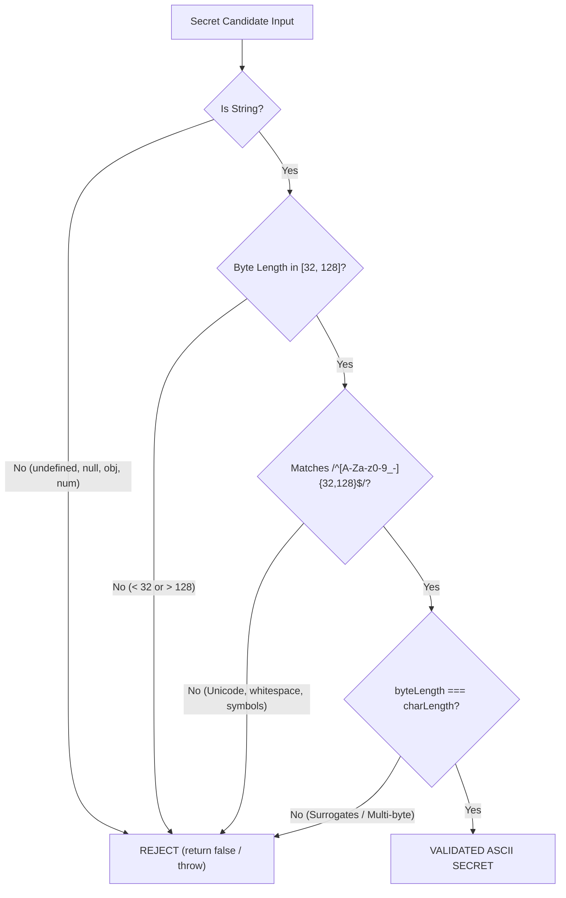

# STROOM — Phase 2.5.1.0.2: Secret Format and Validation Specification

**Project:** `D:\ST`  
**Branch:** `feature/stroom-production-launch`  
**Approved Baseline Commit:** `19c4176`  
**Document Version:** 1.0.0 (Cryptographic Secret Format & Validation Standard)  
**Security Classification:** Authentication Architecture & Secret Standard  
**Mode:** STRICT READ-ONLY SPECIFICATION (Zero code changes, zero database mutations)  
**Date:** November 14, 2026  

---

## 1. Executive Summary & Correction Mandate

In Phase 2.5.1.0.1, string length checking was identified as relying on JavaScript's standard `.length` property. In JavaScript, `String.prototype.length` measures 16-bit UTF-16 code units, not encoded UTF-8 byte length:
- Multi-byte characters (e.g., accented characters `ñ` or emojis `🔥`) occupy 2 to 4 bytes in UTF-8 but count as 1 or 2 code units in JavaScript.
- Lone surrogates (e.g., `\uD800` or `\uDFFF`) are invalid Unicode sequences but possess a `.length` of 1.
- Whitespace and control characters can manipulate header lengths while degrading entropy.

To eliminate encoding discrepancies, multi-byte confusion, and surrogate vulnerabilities across both Node.js Express and Cloudflare Worker runtimes, this specification formalizes a **Strict ASCII Base64URL / Hexadecimal Secret Format** with dual-phase byte-level validation.

---

## 2. Standardized Secret Format Specification

All inter-service authentication secrets (`INTERNAL_D1_BRIDGE_SECRET` and `ORIGIN_PROXY_SECRET`) must strictly conform to the following format contract:

| Property | Standardized Specification |
| :--- | :--- |
| **Character Set** | 7-bit ASCII URL-Safe Base64URL and Hexadecimal: `[A-Za-z0-9_-]` |
| **Byte Representation** | 1 character $\equiv$ 1 UTF-16 code unit $\equiv$ 1 UTF-8 byte (`0x2D`, `0x30–0x39`, `0x41–0x5A`, `0x5F`, `0x61–0x7A`) |
| **Minimum Length** | **32 bytes** (256 bits of minimum cryptographic entropy) |
| **Maximum Length** | **128 bytes** (Firm limit preventing Algorithmic / Hash DoS) |
| **Regular Expression** | `^[A-Za-z0-9_-]{32,128}$` |
| **Entropy Target** | Generated cryptographically via `crypto.randomBytes(32).toString('hex')` (64 chars) or base64url (43 chars) |

### Why This Format Completely Neutralizes Encoding Drift
Because the character set is restricted exclusively to single-byte 7-bit ASCII:
1. There is **zero difference** between JavaScript string character length, UTF-16 code units, and UTF-8 byte length.
2. All non-ASCII characters, multi-byte UTF-8 sequences, CJK characters, and Unicode emojis fail character validation immediately.
3. All malformed UTF-16 code units (including lone surrogates `\uD800` through `\uDFFF`) fail regex validation in $O(1)$ time.

---

## 3. Strict Rejection Policy (Allowlist Invariants)

The validation policy is a strict allowlist. Any input containing the following must be rejected immediately:

1. **Rejection of Missing, Non-String, and Empty Values**:
   - `undefined`, `null`, numbers, booleans, objects, and arrays are rejected immediately.
   - Empty strings (`""`) are rejected immediately.
2. **Rejection of Unicode and Multi-byte Characters**:
   - Emojis (e.g. `🔥`, `⚡`, `🎉`).
   - Accented or non-ASCII characters (e.g. `ñ`, `ü`, `é`).
   - CJK, Cyrillic, Arabic, or Hebrew scripts.
3. **Rejection of Whitespace and Control Characters**:
   - Spaces (`0x20`), tabs (`\t`, `0x09`), line feeds (`\n`, `0x0A`), carriage returns (`\r`, `0x0D`).
   - Leading, trailing, or embedded whitespace is strictly prohibited; secrets are never trimmed automatically.
4. **Rejection of Non-URL-Safe Punctuation**:
   - Punctuation (`!`, `@`, `#`, `$`, `%`, `^`, `&`, `*`, `(`, `)`, `=`, `+`, `/`, `\`, `?`, `:`, `;`, `"`, `'`).
   - Standard Base64 padding (`=`) and standard Base64 characters (`+`, `/`) are rejected in favor of Base64URL (`-`, `_`).
5. **Rejection of Malformed UTF-16 Lone Surrogates**:
   - High surrogates without low surrogates (`\uD800`–`\uDBFF`).
   - Low surrogates without high surrogates (`\uDC00`–`\uDFFF`).

---

## 4. Dual-Phase Validation Architecture

Validation is separated into two strictly differentiated operational contexts:

### 4.1 Phase 1: Startup Configuration Validation (Server / Worker Boot)
When Express starts (`server/index.ts`) or when the Cloudflare Worker isolate boots:
- The configured expected secret (`process.env.INTERNAL_D1_BRIDGE_SECRET` or `c.env.INTERNAL_D1_BRIDGE_SECRET`) is validated via `validateConfiguredSecret()`.
- **Behavior on Failure**: **THROWS FATAL STARTUP ERROR**.
  The application or Worker must crash immediately and refuse to serve traffic if configured with a missing, empty, short, or invalid secret.
- **Error Format**: `[STROOM Config Fatal] <SecretName> <detailed reason>`.

### 4.2 Phase 2: Runtime Request Validation (Per Request)
When an HTTP request arrives at `POST /api/internal/d1/execute` or an authenticated proxy route:
- The client-supplied header (`X-STROOM-Bridge-Secret` or `X-STROOM-Origin-Secret`) is validated via `isValidSecretShape()`.
- **Behavior on Failure**: **FAILS CLOSED (RETURNS `false`) IN $O(1)$ TIME**.
  Never throws unhandled exceptions; returns `401 Unauthorized` / `403 Forbidden` to the caller.
- **DoS Protection**: Validation occurs **prior** to any SHA-256 computation. Requests with invalid shapes, wrong lengths, or 100,000-character payloads are rejected without invoking cryptographic hashing.

---

## 5. Byte-Length Measurement Parity

Both runtimes explicitly verify byte length using native environment APIs:

| Runtime | Byte Length API | Validation Assertion |
| :--- | :--- | :--- |
| **Node.js Express** | `Buffer.byteLength(secret, 'utf8')` | `Buffer.byteLength(secret, 'utf8') === secret.length` |
| **Cloudflare Worker** | `new TextEncoder().encode(secret).byteLength` | `new TextEncoder().encode(secret).byteLength === secret.length` |

This double-check guarantees that even in edge cases where an unexpected character bypasses regex compilation, any discrepancy between character count and byte length triggers immediate rejection.
