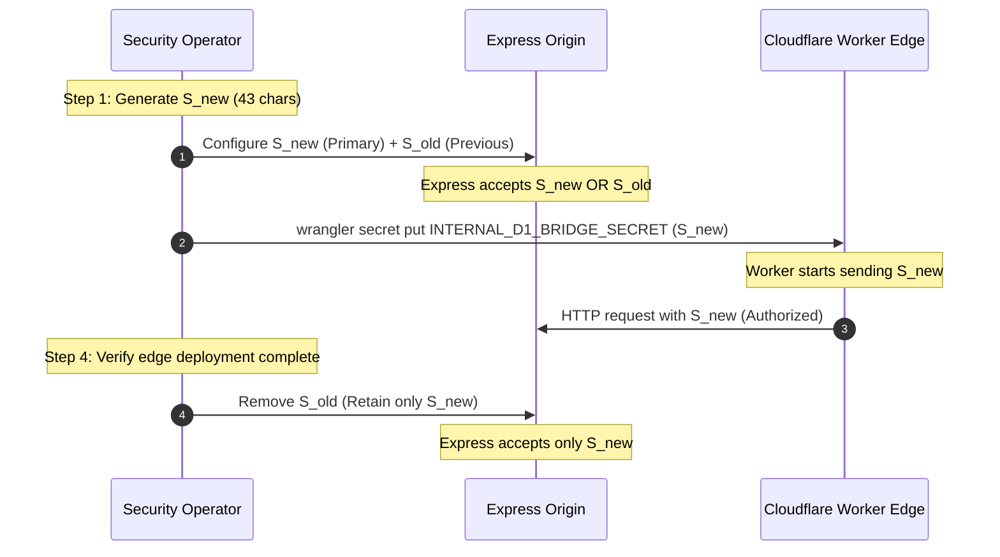

# STROOM — Phase 2.5.1.0.3: Secret Generation, Entropy & Rotation Specification

**Project:** `D:\ST`  
**Branch:** `feature/stroom-production-launch`  
**Approved Baseline Commit:** `19c4176`  
**Document Version:** 1.0.0 (Cryptographic Secret Lifecycle Standard)  
**Security Classification:** Cryptographic Management & Operational Security  
**Mode:** STRICT READ-ONLY SPECIFICATION (Zero code changes, zero database mutations)  
**Date:** November 14, 2026  

---

## 1. Mathematical Entropy Correction

In earlier planning documentation, a 32-character string was colloquially equated with "256 bits of entropy." In formal information theory, this equation is mathematically incorrect.

### 1.1 Entropy Calculations by Character Set
The Shannon entropy $H$ of a randomly chosen string of length $L$ drawn from an alphabet of size $N$ is given by:
$$H = L \cdot \log_2(N)$$

| Encoding Scheme | Alphabet Size ($N$) | Bits per Character ($\log_2 N$) | Entropy for 32 Characters | Required Length for 256 Bits |
| :--- | :---: | :---: | :---: | :---: |
| **Hexadecimal (`[0-9a-f]`)** | 16 | 4.0 bits | $32 \times 4 = \mathbf{128 \text{ bits}}$ | $256 \div 4 = \mathbf{64 \text{ chars}}$ |
| **Base64URL (`[A-Za-z0-9_-]`)** | 64 | 6.0 bits | $32 \times 6 = \mathbf{192 \text{ bits}}$ | $256 \div 6 = \mathbf{42.67 \rightarrow 43 \text{ chars}}$ |
| **Alphanumeric (`[A-Za-z0-9]`)** | 62 | $\approx 5.954$ bits | $32 \times 5.954 \approx \mathbf{190.5 \text{ bits}}$ | $256 \div 5.954 \approx \mathbf{43 \text{ chars}}$ |

### 1.2 The True 256-Bit Entropy Invariant
Entropy cannot be asserted from string length alone; it is strictly defined by the **randomness of the underlying generator**.
- **Cryptographic Requirement**: A 256-bit secret requires generating **32 bytes (256 bits) of raw cryptographically secure pseudorandom data** from an approved OS CSPRNG source (`node:crypto.randomBytes` or Web Crypto `crypto.getRandomValues`).
- **Base64URL Encoding Ratio**: Encoding 32 raw bytes (256 bits) into unpadded Base64URL produces:
  $$\left\lceil \frac{32 \times 8}{6} \right\rceil = \left\lceil 42.666... \right\rceil = \mathbf{43 \text{ ASCII characters}}$$
  The 43rd character encodes the final 4 bits of raw entropy padded with 2 zero bits. Unpadded Base64URL omits the trailing `=` character.
- **Canonical Output**: Exactly **43 ASCII characters** belonging to `[A-Za-z0-9_-]`.

---

## 2. Canonical Secret Generation Contracts

Both environments utilize native CSPRNG primitives to guarantee true 256-bit entropy:

### 2.1 Node.js Generation Contract
To generate a production bridge or origin secret:
```bash
node -e "console.log(require('node:crypto').randomBytes(32).toString('base64url'))"
```
**Programmatic Generation (`server/utils/crypto.ts`)**:
```typescript
import crypto from 'node:crypto';

export function generateSecretNode(): string {
  // Generates exactly 32 bytes from OS CSPRNG -> 43 unpadded Base64URL characters
  return crypto.randomBytes(32).toString('base64url');
}
```

### 2.2 Cloudflare Worker Generation Contract
In Cloudflare Workers / Web Crypto:
```typescript
export function generateSecretWorker(): string {
  const bytes = crypto.getRandomValues(new Uint8Array(32));
  let binary = '';
  for (let i = 0; i < bytes.length; i++) {
    binary += String.fromCharCode(bytes[i]);
  }
  // Convert standard base64 to unpadded base64url
  return btoa(binary)
    .replace(/\+/g, '-')
    .replace(/\//g, '_')
    .replace(/=+$/, '');
}
```

Both runtimes produce strings of length **43** containing exclusively `[A-Za-z0-9_-]` with 256 bits of underlying entropy.

---

## 3. Safe Storage and Secret Management

Production secrets must never appear in version control, diagnostic scripts, build logs, or unencrypted storage.

### 3.1 Local Development Storage
- **Express Backend**: Stored in `D:\ST\.env` (gitignored, file permissions restricted).
- **Cloudflare Worker (Miniflare)**: Stored in `D:\ST\.dev.vars` (gitignored, file permissions restricted).
- **Git Protection**: Verified present in `.gitignore`. Accidental commits are blocked by pre-commit hooks and repository rules.

### 3.2 Production Deployment Storage
- **Express Origin (Node.js Host)**:
  - Injected as environment variables via the host system service manager (`systemd` EnvironmentFile with `chmod 600`, or container runtime secret injection).
  - Never stored in plaintext files within the application root.
- **Cloudflare Workers (Edge Isolate)**:
  - Injected using the Cloudflare API / Wrangler CLI:
    ```bash
    wrangler secret put INTERNAL_D1_BRIDGE_SECRET
    wrangler secret put ORIGIN_PROXY_SECRET
    ```
  - Stored encrypted at rest within Cloudflare's Key Management Service (KMS). Worker isolates receive secrets as decrypted bindings in memory (`c.env`) during request dispatching.

---

## 4. Zero-Downtime Secret Rotation Procedure

In a hybrid architecture where Express runs on origin servers and the Hono reverse proxy runs at the Cloudflare edge, updating secrets cannot happen atomically across both layers at the exact same millisecond. To prevent authentication rejections during secret rotation, the system uses the **Dual-Secret Overlap Pattern**.



### Detailed 4-Step Rotation Lifecycle:
1. **Generation**: The operator generates `S_new` (43 characters, 256 bits of entropy) via `generateSecretNode()`.
2. **Origin Staging**:
   - In Express, configure:
     - `INTERNAL_D1_BRIDGE_SECRET = S_new`
     - `INTERNAL_D1_BRIDGE_SECRET_PREVIOUS = S_old`
   - Express authentication middleware accepts incoming requests if the secret matches *either* the primary secret or the previous secret using constant-time comparison.
3. **Edge Deployment**:
   - Update the Worker secret via `wrangler secret put INTERNAL_D1_BRIDGE_SECRET`.
   - As Worker isolates deploy globally across Cloudflare PoPs, requests transition from `S_old` to `S_new`. During the propagation window, Express accepts both seamlessly.
4. **Decommissioning**:
   - Once global Worker logs confirm 100% of incoming requests use `S_new`, remove `INTERNAL_D1_BRIDGE_SECRET_PREVIOUS` from Express and restart the service.
   - Rotation is complete with **zero downtime, zero rejected requests, and continuous cryptographic security**.
