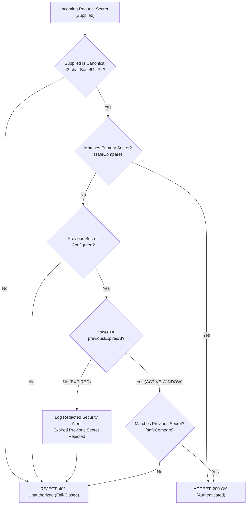

# STROOM — Phase 2.5.1.0.4: Secret Rotation Contract Specification

**Project:** `D:\ST`  
**Branch:** `feature/stroom-production-launch`  
**Approved Baseline Commit:** `19c4176`  
**Document Version:** 1.0.0 (Zero-Downtime Secret Lifecycle Contract)  
**Security Classification:** Cryptographic Lifecycle Standard  
**Mode:** STRICT READ-ONLY SPECIFICATION (Zero code changes, zero database mutations)  
**Date:** November 14, 2026  

---

## 1. Executive Summary & Purpose

In a distributed hybrid architecture connecting an Express origin backend to Cloudflare Worker edge isolates, secret rotation must be executed without service downtime or dropped requests. However, allowing former credentials to remain valid indefinitely creates a persistent attack surface.

This specification formalizes the **Time-Bounded Dual-Secret Rotation Contract**, establishing:
1. Strict definitions for Primary and Previous secrets.
2. A mandatory **72-hour maximum overlap period**.
3. An explicit, machine-enforced **retirement deadline** (`EXPIRES_AT`).
4. Automatic fail-closed rejection upon expiration.
5. An audited emergency rollback procedure.

---

## 2. Core Components of the Rotation Contract

| Component | Variable Name | Purpose & Invariant |
| :--- | :--- | :--- |
| **Primary Secret** | `INTERNAL_D1_BRIDGE_SECRET` | Active canonical 43-character Base64URL secret. Used for signing all new requests and primary authentication. |
| **Previous Secret** | `INTERNAL_D1_BRIDGE_SECRET_PREVIOUS` | Optional former primary secret accepted during the rotation transition. Must be canonical 43-character Base64URL. |
| **Retirement Deadline** | `INTERNAL_D1_BRIDGE_SECRET_PREVIOUS_EXPIRES_AT` | **Mandatory if previous secret is configured.** Epoch timestamp (ms) or ISO-8601 string defining the exact retirement cutoff. |
| **Maximum Overlap** | $\le \mathbf{72 \text{ hours}}$ | Standard rotation window. Under no circumstances may an overlap window exceed 7 days. |

---

## 3. Dual-Secret Verification Architecture

When an incoming request carries `X-STROOM-Bridge-Secret` or `X-STROOM-Origin-Secret`, authentication is evaluated through a strict time-aware pipeline:



### 3.1 Strict Expiration Invariant
> **The Expiry Rule**: If `now() > previousExpiresAt`, the previous secret is mathematically dead.  
> Even if the incoming header matches `INTERNAL_D1_BRIDGE_SECRET_PREVIOUS` bit-for-bit, authentication **MUST RETURN `false`** and fail with `401 Unauthorized`.  
> An expired secret must **never** be accepted under any configuration or exception.

---

## 4. Production Verification Implementation (`server/utils/crypto.ts`)

```typescript
export interface SecretAuthOptions {
  supplied: unknown;
  primary: string;
  previous?: string;
  previousExpiresAt?: number;
  now?: number;
}

/**
 * Evaluates request credentials against primary and unexpired previous secrets.
 * Enforces strict canonical validation, constant-time comparison, and expiry deadlines.
 */
export function authenticateBridgeSecret({
  supplied,
  primary,
  previous,
  previousExpiresAt,
  now = Date.now(),
}: SecretAuthOptions): boolean {
  // 1. Primary secret must be valid canonical Base64URL
  if (!isCanonicalBase64Url32Node(primary)) return false;

  // 2. Evaluate primary match (Constant-Time)
  if (safeCompareNode(supplied, primary)) return true;

  // 3. Evaluate previous secret if configured
  if (previous && isCanonicalBase64Url32Node(previous)) {
    // 4. Strict expiry enforcement: reject immediately if now > expiresAt
    if (typeof previousExpiresAt === 'number' && now <= previousExpiresAt) {
      if (safeCompareNode(supplied, previous)) {
        return true;
      }
    } else if (typeof previousExpiresAt === 'number' && now > previousExpiresAt) {
      console.warn('[STROOM Security Alert] Request attempted authentication with expired previous secret');
    }
  }

  return false;
}
```

---

## 5. End-to-End Operational Rotation Workflow

### Step 1: Secret Generation
The security operator generates a fresh canonical 43-character Base64URL secret ($S_{\text{new}}$) with 256 bits of CSPRNG entropy:
```bash
node -e "console.log(require('node:crypto').randomBytes(32).toString('base64url'))"
```

### Step 2: Origin Configuration Staging
Configure Express origin environment:
- `INTERNAL_D1_BRIDGE_SECRET` = $S_{\text{new}}$
- `INTERNAL_D1_BRIDGE_SECRET_PREVIOUS` = $S_{\text{old}}$
- `INTERNAL_D1_BRIDGE_SECRET_PREVIOUS_EXPIRES_AT` = $T_{\text{now}} + 72\text{ hours}$ (e.g. `2026-11-17T12:00:00Z`)
- Restart Express service. Express now accepts *both* $S_{\text{new}}$ and $S_{\text{old}}$.

### Step 3: Edge Worker Deployment
Deploy the new secret to Cloudflare Worker isolates:
```bash
wrangler secret put INTERNAL_D1_BRIDGE_SECRET
# Enter S_new
```
As edge isolates update globally, Worker requests transition to sending $S_{\text{new}}$. During propagation, Express seamlessly accepts $S_{\text{old}}$ or $S_{\text{new}}$.

### Step 4: Verification and Retirement
- Monitor Cloudflare analytics and Express access logs.
- Once 100% of incoming requests use $S_{\text{new}}$, or after 72 hours have elapsed:
  - Remove `INTERNAL_D1_BRIDGE_SECRET_PREVIOUS` and `INTERNAL_D1_BRIDGE_SECRET_PREVIOUS_EXPIRES_AT` from the Express configuration.
  - Restart Express. The previous secret $S_{\text{old}}$ is permanently decommissioned.

---

## 6. Emergency Rollback Procedure

If a newly deployed secret $S_{\text{new}}$ causes authentication failures (e.g., configuration typo or transmission error):

1. **Within the 72-Hour Window**:
   - In Express, set:
     - `INTERNAL_D1_BRIDGE_SECRET` = $S_{\text{old}}$
     - Remove `INTERNAL_D1_BRIDGE_SECRET_PREVIOUS`
   - In Worker, roll back via:
     ```bash
     wrangler secret put INTERNAL_D1_BRIDGE_SECRET
     # Enter S_old
     ```
2. **Result**: Full traffic is restored to $S_{\text{old}}$ within seconds without database downtime or code deployment.
