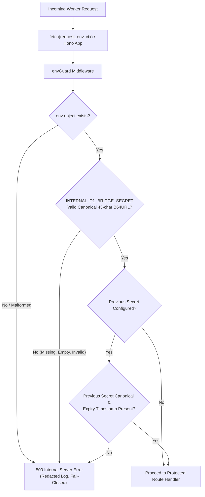

# STROOM — Phase 2.5.1.0.4: Worker Environment Validation Specification

**Project:** `D:\ST`  
**Branch:** `feature/stroom-production-launch`  
**Approved Baseline Commit:** `19c4176`  
**Document Version:** 1.0.0 (Worker Environment Architecture & Binding Validation)  
**Security Classification:** Cloudflare Workers Runtime Architecture  
**Mode:** STRICT READ-ONLY SPECIFICATION (Zero code changes, zero database mutations)  
**Date:** November 14, 2026  

---

## 1. Executive Summary & Worker Architecture Distinction

A fundamental architectural difference exists between the Node.js Express process model and Cloudflare Workers ES Module isolate model:

| Architectural Dimension | Node.js Express Backend | Cloudflare Workers (`workerd`) |
| :--- | :--- | :--- |
| **Execution Model** | Long-running Node.js process | Ephemeral V8 isolate |
| **Environment Availability** | `process.env` available at module import time | `env` bindings **ONLY** available per-request |
| **Initialization Context** | Top-level module evaluation (`server/index.ts`) | Passed as argument: `fetch(request, env, ctx)` |
| **Validation Point** | Server startup before `server.listen()` | Request preflight middleware before route dispatch |
| **Failure Response** | Process exits (`process.exit(1)`) | HTTP 500 Fail-Closed with redacted log |

Attempting to read `env.INTERNAL_D1_BRIDGE_SECRET` at the top level of a Worker module outside `fetch()` throws `ReferenceError: env is not defined`. Furthermore, naively caching a validation flag in an isolate-global variable risks stale authorization when environment bindings rotate or during testing.

This specification formalizes the **Request-Time Environment Validation Strategy** for Cloudflare Workers.

---

## 2. Request-Time Validation Architecture

Environment bindings are validated during request preflight via a dedicated middleware before any protected route executes.



### 2.1 Fail-Closed Invariants
1. **Immediate Execution Halt**: If `env` is missing, `INTERNAL_D1_BRIDGE_SECRET` is missing, empty, not 43 characters, or non-canonical, the request is halted immediately.
2. **Generic Client Response**: The client receives:
   ```json
   { "error": "Internal Server Error" }
   ```
   with status code `500 Internal Server Error`. No secret details, configuration keys, or validation rules are leaked over the wire.
3. **Log Redaction**: Server logs record an administrative alert (`[STROOM Worker Config Fatal] ...`) describing the structural failure without printing the secret value.
4. **Zero Cross-Request State Leakage**: Validation executes in $< 2\mu s$ per request. It does not write to module-scoped mutable variables, preventing stale configuration caching across requests or tests.

---

## 3. Worker Environment Validation Module (`src/worker/middleware/envGuard.ts`)

```typescript
import { Context, Next } from 'hono';
import { isCanonicalBase64Url32Worker } from '../utils/crypto';

export interface ValidatedWorkerConfig {
  primarySecret: string;
  previousSecret?: string;
  previousExpiresAt?: number;
}

/**
 * Validates Worker environment bindings on each request.
 * Fails closed before route handling if server secrets are misconfigured.
 */
export function validateWorkerEnvironment(env: unknown): ValidatedWorkerConfig {
  if (!env || typeof env !== 'object') {
    throw new Error('[STROOM Worker Config Fatal] Worker environment bindings are missing or invalid');
  }

  const e = env as Record<string, unknown>;
  const primary = e.INTERNAL_D1_BRIDGE_SECRET;

  if (typeof primary !== 'string' || !isCanonicalBase64Url32Worker(primary)) {
    throw new Error('[STROOM Worker Config Fatal] INTERNAL_D1_BRIDGE_SECRET is missing, empty, or not a canonical 43-character Base64URL secret');
  }

  let previousSecret: string | undefined;
  let previousExpiresAt: number | undefined;

  const prev = e.INTERNAL_D1_BRIDGE_SECRET_PREVIOUS;
  if (prev !== undefined && prev !== null && prev !== '') {
    if (typeof prev !== 'string' || !isCanonicalBase64Url32Worker(prev)) {
      throw new Error('[STROOM Worker Config Fatal] INTERNAL_D1_BRIDGE_SECRET_PREVIOUS is malformed or non-canonical');
    }
    previousSecret = prev;

    const exp = e.INTERNAL_D1_BRIDGE_SECRET_PREVIOUS_EXPIRES_AT;
    if (typeof exp === 'number') {
      previousExpiresAt = exp;
    } else if (typeof exp === 'string') {
      const parsed = Date.parse(exp);
      if (isNaN(parsed)) {
        throw new Error('[STROOM Worker Config Fatal] INTERNAL_D1_BRIDGE_SECRET_PREVIOUS_EXPIRES_AT is not a valid date string');
      }
      previousExpiresAt = parsed;
    } else {
      throw new Error('[STROOM Worker Config Fatal] INTERNAL_D1_BRIDGE_SECRET_PREVIOUS configured without required expiry timestamp');
    }
  }

  return { primarySecret: primary, previousSecret, previousExpiresAt };
}

/**
 * Hono preflight middleware protecting all internal bridge and auth proxy routes.
 */
export async function envGuardMiddleware(c: Context, next: Next) {
  try {
    const config = validateWorkerEnvironment(c.env);
    // Attach validated config to request context for route handlers
    c.set('workerConfig', config);
    return await next();
  } catch (err: any) {
    // Redacted server-side alert
    console.error(`[STROOM Alert] Internal configuration error: ${err.message}`);
    return c.json({ error: 'Internal Server Error' }, 500);
  }
}
```

---

## 4. Semantic Parity Between Node.js and Cloudflare Workers

Both environments enforce identical validation semantics:

| Requirement | Node.js Express (`server/`) | Cloudflare Worker (`src/worker/`) |
| :--- | :--- | :--- |
| **Validation Logic** | `isCanonicalBase64Url32Node()` | `isCanonicalBase64Url32Worker()` |
| **Required Length** | Exactly 43 characters | Exactly 43 characters |
| **Character Allowlist** | Deterministic `[A-Za-z0-9_-]` | Deterministic `[A-Za-z0-9_-]` |
| **Canonical Check** | Buffer decode & re-encode equality | Base64URL decode & re-encode equality |
| **Rotation Support** | Primary + Unexpired Previous | Primary + Unexpired Previous |
| **Expiry Enforcement** | Rejects previous if `now > expiresAt` | Rejects previous if `now > expiresAt` |
| **Secret Redaction** | Values never printed in logs | Values never printed in logs |
| **Execution Point** | Startup check (`server/index.ts`) | Preflight middleware (`envGuard`) |
