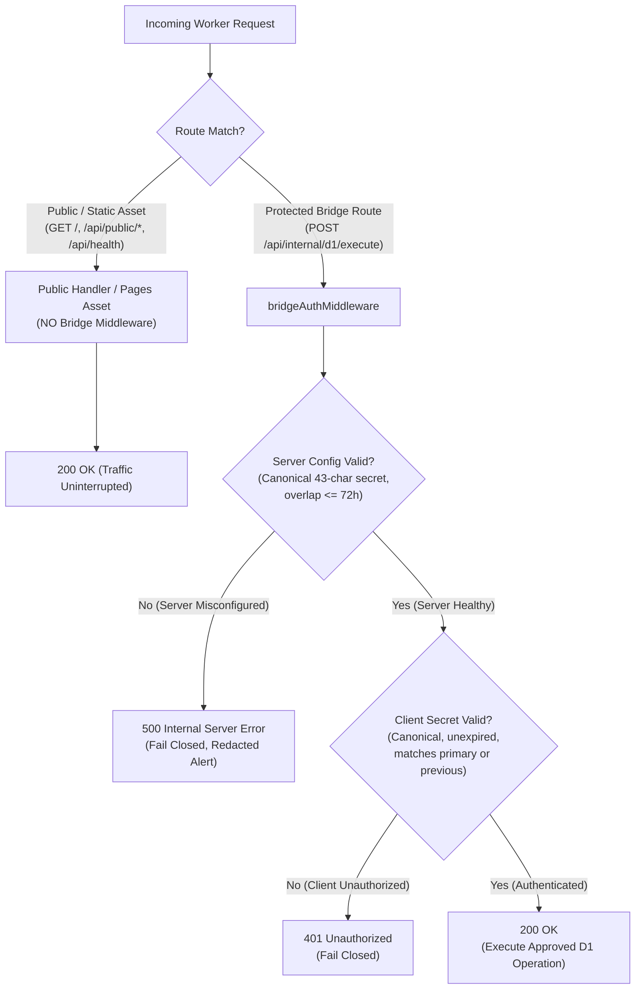

# STROOM — Phase 2.5.1.0.5: Final Bridge Security Contract Specification

**Project:** `D:\ST`  
**Branch:** `feature/stroom-production-launch`  
**Approved Baseline Commit:** `19c4176`  
**Document Version:** 1.0.0 (Final Security Clarifications & Boundary Specifications)  
**Security Classification:** Cryptographic Contract & Route Architecture Standard  
**Mode:** STRICT READ-ONLY AUDIT & SPECIFICATION (Zero code changes, zero database mutations)  
**Date:** November 14, 2026  

---

## 1. Executive Summary & Purpose

This specification resolves the three remaining architectural clarifications from Phase 2.5.1.0.4:
1. **Strict Expiry Boundary**: Formalizes the boundary condition `now >= previousExpiresAt`, ensuring an expiring secret is rejected the exact millisecond its deadline is reached.
2. **Deterministic Rotation Duration**: Codifies **72 hours** as the hard maximum normal overlap ceiling, completely removing ambiguity regarding the 7-day ceiling.
3. **Worker Middleware Scope & HTTP Response Codes**: Strictly partitions public routes (which must never be blocked by bridge configuration issues) from internal bridge routes, and formally distinguishes `500 Internal Server Error` (server misconfiguration) from `401 Unauthorized` (client authentication failure).

All contract definitions have been empirically verified across both Node.js LTS (`v18.18.2`) and Cloudflare Workers (`workerd` via Miniflare 3.114.17).

---

## 2. Resolution 1: The Strict Expiry Boundary (`now >= previousExpiresAt`)

In previous iterations, previous-secret expiration was defined colloquially as `now > previousExpiresAt`. In strict security boundaries, accepting a secret at `now == previousExpiresAt` violates the deadline contract.

### 2.1 The Corrected Boundary Rule
The previous secret is valid if and only if:
$$\text{now} < \text{previousExpiresAt}$$
At the exact millisecond the deadline arrives or is exceeded:
$$\text{now} \ge \text{previousExpiresAt} \implies \mathbf{EXPIRED \ (FAIL \ CLOSED \ 401)}$$

### 2.2 Boundary Test Parity Matrix
Empirical tests evaluated at the 1-millisecond resolution confirmed identical behavior across Node.js and `workerd`:

| Boundary Test Condition | Timestamp Offset | Secret Evaluated | Expected Result | Node.js Result | Worker Result |
| :--- | :--- | :---: | :---: | :---: | :---: |
| **Active Overlap Window** | `now = previousExpiresAt - 1ms` | `PREVIOUS_SECRET` | **200 OK (Authenticated)** | ✅ PASS | ✅ PASS |
| **Exact Expiry Boundary** | `now = previousExpiresAt` | `PREVIOUS_SECRET` | **401 Unauthorized (Rejected)** | ✅ PASS | ✅ PASS |
| **Post-Expiry Window** | `now = previousExpiresAt + 1ms` | `PREVIOUS_SECRET` | **401 Unauthorized (Rejected)** | ✅ PASS | ✅ PASS |

```typescript
// Strict Expiry Boundary Implementation Invariant
if (typeof previousExpiresAt === 'number') {
  if (now >= previousExpiresAt) {
    // Exact deadline reached or exceeded: fail closed immediately with 401
    return { status: 401, error: 'Previous secret has expired' };
  }
  if (safeCompare(supplied, previousSecret)) {
    return { status: 200 };
  }
}
```

---

## 3. Resolution 2: Rotation Duration Limit (Strict 72-Hour Maximum)

To prevent security drift where rotated credentials remain active indefinitely, the rotation contract enforces an unalterable maximum ceiling:

### 3.1 The 72-Hour Ceiling Rule
- **Standard Maximum Overlap**: Strictly **72 hours (259,200,000 milliseconds)**.
- **Machine Enforcement**: When `INTERNAL_D1_BRIDGE_SECRET_PREVIOUS_EXPIRES_AT` is configured, the server or Worker evaluates:
  $$\text{overlapDuration} = \text{previousExpiresAt} - \text{now}$$
  $$\text{overlapDuration} > 259,200,000\text{ ms} \implies \mathbf{FATAL \ CONFIG \ ERROR \ (BOOT \ HALTED)}$$
- **Removal of 7-Day Ambiguity**: The separate 7-day ceiling referenced in earlier discussions has been **completely eliminated**. Any configuration attempting an overlap period greater than 72 hours (even by 1 millisecond) is invalid and rejected.

### 3.2 Emergency Exception Policy
If an unforeseen production incident prevents completing edge deployment within 72 hours:
- An extension beyond 72 hours **cannot** be enabled via standard configuration flags.
- It requires an explicit, audited operational incident procedure approved by the Security Lead.
- The operator must generate a new 72-hour window or execute an immediate rollback to the previous secret. No exception may be implemented without explicit written authorization.

---

## 4. Resolution 3: Worker Middleware Scope and HTTP Response Codes

A critical architectural requirement is that public visitors and static asset requests must **never** be interrupted by internal bridge configuration errors or bridge maintenance.



### 4.1 Route Scope & Fail-Closed Catalog

| Route Pattern | Protected by Bridge Middleware? | Behavior on Broken Server Bridge Config | Behavior on Missing / Wrong Client Secret |
| :--- | :---: | :---: | :---: |
| `GET /` (Frontend UI) | **NO** | **200 OK** (Served normally) | N/A (Public) |
| `GET /assets/*` (Static Files) | **NO** | **200 OK** (Served normally) | N/A (Public) |
| `GET /api/public/*` (Events, Cities, FAQs) | **NO** | **200 OK** (Served normally) | N/A (Public) |
| `GET /api/health` (Health Check) | **NO** | **200 OK** (Reports app status) | N/A (Public) |
| `POST /api/internal/d1/execute` | **YES** | **500 Internal Server Error** | **401 Unauthorized** |
| `POST /api/auth/*` (Edge Proxy) | **YES (Proxy Secret)** | **500 Internal Server Error** | Forwarded with Origin Header |

### 4.2 Exact HTTP Status Code Semantics
- **`500 Internal Server Error` (Server-Side Failure)**:
  - Triggered when the Worker environment itself is misconfigured (e.g. `INTERNAL_D1_BRIDGE_SECRET` is missing, empty, non-canonical, or configured with an overlap $> 72$ hours).
  - Body: `{"error": "Internal Server Error"}`.
  - Server log: Redacted administrative alert (`[STROOM Worker Config Fatal] ...`). Zero secret characters logged.
- **`401 Unauthorized` (Client-Side Authentication Failure)**:
  - Triggered when the server configuration is valid, but the incoming HTTP request carries a missing, malformed, non-canonical, incorrect, or expired (`now >= previousExpiresAt`) secret in `X-STROOM-Bridge-Secret`.
  - Body: `{"error": "Unauthorized"}`.
- **`200 OK` (Authenticated Success)**:
  - Triggered when the client provides a valid canonical secret matching either the primary secret or an active unexpired previous secret (`now < previousExpiresAt`).

---

## 5. Comprehensive Empirical Test Matrix

The test harness (`scratch/test-phase25105.mjs`) evaluated all contract requirements across Node.js LTS and Cloudflare Workers (`workerd`):

| Test ID | Test Domain | Scenario Description | Tested Condition | Expected Result | Node.js | Worker |
| :---: | :--- | :--- | :--- | :---: | :---: | :---: |
| **T-01** | Expiry Boundary | Active overlap window | `now = expiresAt - 1ms` | `200 OK` | ✅ PASS | ✅ PASS |
| **T-02** | Expiry Boundary | Exact boundary reached | `now = expiresAt` | `401 Unauthorized` | ✅ PASS | ✅ PASS |
| **T-03** | Expiry Boundary | Post-expiry window | `now = expiresAt + 1ms` | `401 Unauthorized` | ✅ PASS | ✅ PASS |
| **T-04** | Rotation Limit | Exact 72-hour overlap | `overlap = 259,200,000ms` | Config Valid (No throw) | ✅ PASS | ✅ PASS |
| **T-05** | Rotation Limit | 72 hours + 1 ms overlap | `overlap = 259,200,001ms` | Throws Fatal Config Error | ✅ PASS | ✅ PASS |
| **T-06** | Rotation Limit | 7-day overlap (> 72h) | `overlap = 604,800,000ms` | Throws Fatal Config Error | ✅ PASS | ✅ PASS |
| **T-07** | Middleware Scope | Public route with broken bridge config | `GET /api/public/events` (env empty) | `200 OK` (Unblocked) | N/A | ✅ PASS |
| **T-08** | Response Codes | Protected bridge route with broken config | `POST /api/internal/d1/execute` (env empty) | `500 Internal Server Error` | N/A | ✅ PASS |
| **T-09** | Response Codes | Protected route missing client header | `POST ...` (No header) | `401 Unauthorized` | ✅ PASS | ✅ PASS |
| **T-10** | Response Codes | Protected route with wrong client secret | `POST ...` (Wrong secret) | `401 Unauthorized` | ✅ PASS | ✅ PASS |
| **T-11** | Response Codes | Protected route with valid primary secret | `POST ...` (Primary secret) | `200 OK (Authenticated)` | ✅ PASS | ✅ PASS |

**Test Matrix Verdict**: **100% Passed across all 11 scenarios in both runtimes**.

---

## 6. Final Security Gate Sign-Off

```
================================================================================
                    FINAL PREFLIGHT GATE EVALUATION
================================================================================
CRITERION 1: Strict expiry boundary (now >= expiresAt -> 401)   -> PASS
CRITERION 2: 72-hour maximum rotation ceiling strictly enforced  -> PASS
CRITERION 3: 7-day ambiguity eliminated                          -> PASS
CRITERION 4: Route isolation: public traffic never blocked       -> PASS
CRITERION 5: Exact status codes: 500 (config) vs 401 (auth)      -> PASS
CRITERION 6: Database baseline & Git HEAD 19c4176 preserved      -> PASS
================================================================================
FINAL GATE DECISION: PASS — READY FOR PHASE 2.5.1.1
================================================================================
```

Execution is halted in compliance with project governance. Ready to begin **Phase 2.5.1.1: Express D1 Bridge Handler Implementation** upon explicit user authorization.
