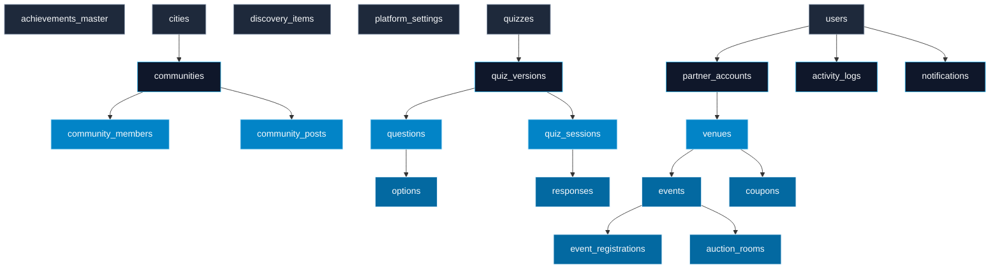

# STROOM (Strangers Room) — Stage 3.1: PostgreSQL Migration Read-Only Audit

**Document:** `STAGE_3_1_POSTGRESQL_READ_ONLY_AUDIT.md`  
**Project Directory:** `D:\ST`  
**Current Architecture:** SQLite (`better-sqlite3` v12.11.1)  
**Target Architecture:** PostgreSQL (Neon Serverless PostgreSQL)  
**Architectural Priority:** Free / Zero-Cost-First Architecture  
**Audit Type:** Strictly Read-Only Architecture & Feasibility Audit  
**Date:** November 14, 2026  
**Auditor:** Senior Database Migration Architect  

---

## 1. Executive Summary

STROOM is currently a production-ready, monolithic Node.js/Express application backed by a single-file SQLite database managed via `better-sqlite3`. Across the 7 completed product phases and Phase 2.5 hardening, the SQLite database contains **42 tables**, **10,160 production records** (in `data/stroom.db`), and **10,163 records** (in the protected checkpoint backup).

This Stage 3.1 audit evaluates the technical feasibility, schema transformations, query compatibility, data migration DAG, risks, and hosting topology for migrating STROOM from local SQLite to **Neon Serverless PostgreSQL** under a strict **zero-cost-first** architecture.

### Key Audit Findings
1. **Primary Key Advantage:** **Zero tables use `INTEGER PRIMARY KEY AUTOINCREMENT`.** 40 tables use application-generated string IDs (`TEXT PRIMARY KEY`, e.g., `usr_...`, `ev_...`), 1 table uses a natural string key (`platform_settings.key`), and 1 table uses a composite primary key (`response_options(response_id, option_id)`). This completely eliminates sequence synchronization, `setval()` drift, and auto-increment identity conflicts during migration.
2. **Topological Linearity:** The foreign key graph across all 42 tables is a **Directed Acyclic Graph (DAG) with zero circular dependencies**. The database can be migrated and validated sequentially in 42 distinct levels without deferring constraints or temporarily dropping foreign keys.
3. **Backend Query Surface:** Database interactions are concentrated across **18 backend files**, comprising **692 `db.prepare` statements**, **37 `db.transaction` execution blocks**, **102 occurrences of `datetime('now')`**, **35 occurrences of `INSERT OR IGNORE`**, **3 occurrences of `INSERT OR REPLACE`**, and **1 occurrence of `strftime`**.
4. **Synchronous-to-Asynchronous Paradigm Shift:** The single most significant architectural change is that `better-sqlite3` is 100% synchronous (`stmt.get()`, `stmt.all()`, `stmt.run()`, `db.transaction()`), whereas PostgreSQL drivers (`pg`, `postgres.js`) are inherently asynchronous (`await pool.query(...)`, `await client.query('BEGIN')`).
5. **Zero-Cost Hosting Viability:** The proposed architecture—Cloudflare Pages (Frontend), Free-tier Container/Node Backend, Neon PostgreSQL (Database), and Cloudflare R2 (Media Storage)—is **100% viable within free-tier allowances** provided that Neon's 5-minute compute autosuspend cold starts and PgBouncer connection pooling are properly architected.

---

## 2. Current Database Architecture & Physical Baseline

### 2.1 Physical Storage & Checksums
- **Primary Database:** `D:\ST\data\stroom.db`
  - File Size: `2,899,968 bytes` (2.76 MB)
  - SHA-256 Checksum: `AD6FE974854B0FCD83CF053E26DE89F3D467B2BE2687B09E0AB282E6ACD848FB`
  - Tables: `42`
  - Total Records: `10,160`
  - Sidecars: `stroom.db-wal` (ABSENT), `stroom.db-shm` (ABSENT)
  - Integrity: `PRAGMA integrity_check = ok`
  - Foreign Key Violations: `0`
- **Protected Checkpoint Backup:** `D:\ST\backups\stroom-checkpoint-phase0-2026-11-13T08-10-02-441Z.db`
  - File Size: `2,899,968 bytes` (2.76 MB)
  - SHA-256 Checksum: `2129266EF6555C90C74B9166E696A2E39AA8B2A87E483EB79A20F9A292BE4571`
  - Tables: `42`
  - Total Records: `10,163` (contains 3 Phase 0 automated test fixture rows in `event_registrations`: `reg_sam_01`, `reg_sam_02`, `reg_sam_03`)
  - Integrity: `PRAGMA integrity_check = ok`
  - Foreign Key Violations: `0`

### 2.2 Data Types Present in SQLite
Inspection of `sqlite_master` and `PRAGMA table_info` across all 42 tables confirms only **three SQLite storage classes** are utilized:
1. `TEXT` (Strings, UUIDs, ISO-8601 Timestamps, Serialized JSON)
2. `INTEGER` (Counts, Enums, Boolean flags `0`/`1`, Epoch timestamps)
3. `REAL` (Monetary amounts: `coupon_redemptions.order_amount`, `coupons.min_purchase`, `payment_transactions.amount`, `payment_transactions.refund_amount`)

---

## 3. Complete Table Inventory & Schema Audit

Below is the verified inventory of all 42 tables, row counts for both the primary database and checkpoint backup, primary key structures, and foreign key references:

| # | Table Name | Primary Rows | Backup Rows | Primary Key | Foreign Key Dependencies | Indexes & Constraints |
|---|---|---|---|---|---|---|
| 1 | `achievements_master` | 7 | 7 | `id` (TEXT) | None | Unique: `badge_key` |
| 2 | `activity_logs` | 230 | 230 | `id` (TEXT) | `users(id)` ON DELETE CASCADE | Index: `(user_id, created_at)` |
| 3 | `admin_announcements` | 11 | 11 | `id` (TEXT) | `users(id)` | Default status: 'sent' |
| 4 | `auction_players` | 60 | 60 | `id` (TEXT) | `auction_rooms(id)`, `auction_teams(id)` | Index: `(auction_id, lot_number)` |
| 5 | `auction_registrations` | 23 | 23 | `id` (TEXT) | `auction_rooms(id)`, `users(id)`, `auction_teams(id)` | Unique: `(auction_id, user_id)` |
| 6 | `auction_rooms` | 6 | 6 | `id` (TEXT) | `events(id)` ON DELETE RESTRICT | Unique: `event_id`, Index: `status` |
| 7 | `auction_teams` | 22 | 22 | `id` (TEXT) | `auction_rooms(id)`, `users(id)` | FK to rooms CASCADE |
| 8 | `audit_logs` | 325 | 325 | `id` (TEXT) | `users(id)` | Index: `created_at` |
| 9 | `bids` | 67 | 67 | `id` (TEXT) | `auction_rooms(id)`, `auction_teams(id)`, `auction_players(id)`, `users(id)` | Index: `(auction_id, player_id)` |
| 10 | `cities` | 14 | 14 | `id` (TEXT) | None | Unique: `name` |
| 11 | `collaboration_comments` | 27 | 27 | `id` (TEXT) | `partner_collaborations(id)`, `partner_accounts(id)`, `users(id)` | FKs CASCADE |
| 12 | `communities` | 18 | 18 | `id` (TEXT) | `cities(id)` | Unique: `slug`, Index: `(city_id, category)` |
| 13 | `community_members` | 1 | 1 | `id` (TEXT) | `communities(id)`, `users(id)` | Unique: `(community_id, user_id)` |
| 14 | `community_posts` | 2 | 2 | `id` (TEXT) | `communities(id)`, `users(id)` | Index: `status` |
| 15 | `contact_inquiries` | 27 | 27 | `id` (TEXT) | `users(id)` | Optional FK |
| 16 | `coupon_redemptions` | 48 | 48 | `id` (TEXT) | `coupons(id)`, `venues(id)`, `partner_accounts(id)`, `events(id)`, `users(id)` | FKs CASCADE / RESTRICT |
| 17 | `coupons` | 31 | 31 | `id` (TEXT) | `partner_accounts(id)`, `venues(id)` | Unique: `code`, Index: `(venue_id, status)` |
| 18 | `discovery_items` | 11 | 11 | `id` (TEXT) | None | Index: `location` |
| 19 | `event_registrations` | 34 | 37 | `id` (TEXT) | `events(id)`, `users(id)` | Unique: `(event_id, user_id)`, `pass_code`, `qr_token` |
| 20 | `events` | 44 | 44 | `id` (TEXT) | `cities(id)`, `venues(id)`, `users(id)` | Index: `(city_id, status)` |
| 21 | `notifications` | 1,757 | 1,757 | `id` (TEXT) | `users(id)` ON DELETE CASCADE | Index: `(user_id, is_read)` |
| 22 | `options` | 3,385 | 3,385 | `id` (TEXT) | `questions(id)` ON DELETE CASCADE | Index: `(question_id, display_order)` |
| 23 | `partner_accounts` | 17 | 17 | `id` (TEXT) | `users(id)` | Index: `owner_user_id` |
| 24 | `partner_audit_logs` | 243 | 243 | `id` (TEXT) | `partner_accounts(id)`, `users(id)` | Index: `partner_id` |
| 25 | `partner_collaborations` | 16 | 16 | `id` (TEXT) | `partner_accounts(id)`, `venues(id)`, `events(id)`, `users(id)` | Index: `partner_id` |
| 26 | `partner_communications` | 90 | 90 | `id` (TEXT) | `partner_accounts(id)`, `events(id)`, `partner_collaborations(id)`, `users(id)` | Index: `partner_id` |
| 27 | `partner_proposals` | 33 | 33 | `id` (TEXT) | `venues(id)` | FK to venues |
| 28 | `partner_users` | 17 | 17 | `id` (TEXT) | `partner_accounts(id)`, `users(id)` | Unique: `(partner_id, user_id)` |
| 29 | `passport_stamps` | 50 | 50 | `id` (TEXT) | `users(id)`, `events(id)` | Unique: `(user_id, event_id)` |
| 30 | `payment_transactions` | 7 | 7 | `id` (TEXT) | `users(id)`, `events(id)`, `event_registrations(id)` | Index: `(user_id, event_id)` |
| 31 | `platform_settings` | 6 | 6 | `key` (TEXT) | None | Primary Key on `key` |
| 32 | `questions` | 1,028 | 1,028 | `id` (TEXT) | `quiz_versions(id)` ON DELETE CASCADE | Index: `(quiz_version_id, display_order)` |
| 33 | `quiz_sessions` | 85 | 85 | `id` (TEXT) | `quiz_versions(id)`, `users(id)` | Index: `(user_id, status)` |
| 34 | `quiz_versions` | 43 | 43 | `id` (TEXT) | `quizzes(id)` ON DELETE CASCADE | Index: `(quiz_id, publication_status)` |
| 35 | `quizzes` | 1 | 1 | `id` (TEXT) | None | Single root quiz container |
| 36 | `response_options` | 905 | 905 | Composite: `(response_id, option_id)` | `responses(id)` CASCADE, `options(id)` CASCADE | Composite PK |
| 37 | `responses` | 904 | 904 | `id` (TEXT) | `quiz_sessions(id)` CASCADE, `questions(id)` CASCADE | Unique: `(session_id, question_id)` |
| 38 | `user_achievements` | 101 | 101 | `id` (TEXT) | `users(id)` ON DELETE CASCADE | Unique: `(user_id, badge_key)` |
| 39 | `user_preferences` | 210 | 210 | `id` (TEXT) | `users(id)` ON DELETE CASCADE | Unique: `(user_id, preference_key, preference_value)` |
| 40 | `users` | 188 | 188 | `id` (TEXT) | None | Unique: `email`, Indexes: `role`, `email` |
| 41 | `venue_availability` | 32 | 32 | `id` (TEXT) | `venues(id)`, `partner_accounts(id)`, `events(id)` | Unique: `(venue_id, date, time_slot)` |
| 42 | `venues` | 34 | 34 | `id` (TEXT) | `partner_accounts(id)`, `cities(id)` | FKs to partner and city |
| **TOTALS** | **42 Tables** | **10,160** | **10,163** | — | **Zero Circular Dependencies** | **42 PKs, 22 Unique, 22 Named Indexes** |

---

## 4. Backend Database Dependency Inventory

A static scan of the entire backend codebase identified **18 files** with direct database dependencies:

```
+-----------------------------------+----------------------+--------------------+-------------------+---------------------------------------------------+
| File Path                         | Import Line          | Prepared Stmts     | Transactions      | Functional Responsibilities                       |
+-----------------------------------+----------------------+--------------------+-------------------+---------------------------------------------------+
| server/db/database.ts             | Line 1 (better-sqlite3)| 159                | 3                 | Connection init, DDL execution, database seeding  |
| server/index.ts                   | Line 5               | 1                  | 0                 | /api/health DB connectivity check                 |
| server/middleware/auth.ts         | Line 3               | 2                  | 0                 | JWT validation user lookup & account status check |
| server/routes/admin.ts            | Line 3               | 49                 | 5                 | Quiz CMS versioning, draft/publish lifecycle      |
| server/routes/adminHub.ts         | Line 3               | 141                | 7                 | Central control center, moderation, RBAC audits   |
| server/routes/auction.ts          | Line 3               | 63                 | 4                 | Real-time auction rooms, atomic bidding, gavel    |
| server/routes/auth.ts             | Line 4               | 10                 | 1                 | Registration, login, profile check, password hash |
| server/routes/communities.ts      | Line 3               | 12                 | 0                 | Communities feed, member join/leave, posts        |
| server/routes/contact.ts          | Line 3               | 1                  | 0                 | Public contact inquiry submission & storage       |
| server/routes/discovery.ts        | Line 2               | 2                  | 0                 | User vibe preferences matching & recommendation   |
| server/routes/events.ts           | Line 3               | 13                 | 1                 | Event catalog, detail view, seat booking          |
| server/routes/onboarding.ts       | Line 3               | 36                 | 5                 | Vibe quiz runtime, session state, answers save    |
| server/routes/partners.ts         | Line 3               | 101                | 7                 | Partner portal, venue management, proposals       |
| server/routes/passes.ts           | Line 3               | 8                  | 2                 | Digital pass verification & door check-in terminal|
| server/routes/preferences.ts      | Line 3               | 42                 | 2                 | User profile update, passport, privacy, settings  |
| server/services/auditService.ts   | Line 2               | 1                  | 0                 | Immutable security audit log insertion            |
| server/services/memberService.ts  | Line 2               | 10                 | 0                 | Passport stamp issuance & badge evaluation rules  |
| server/services/partnerService.ts | Line 2               | 10                 | 0                 | Partner performance ledger & coupon calculation   |
+-----------------------------------+----------------------+--------------------+-------------------+---------------------------------------------------+
| TOTALS                            |                      | 692                | 37                | Full backend API coverage                         |
+-----------------------------------+----------------------+--------------------+-------------------+---------------------------------------------------+
```

---

## 5. SQLite-to-PostgreSQL Compatibility Matrix

| Category | SQLite Implementation (`better-sqlite3`) | PostgreSQL Equivalent (`pg` / `Neon`) | Required Change | Migration Risk |
| :--- | :--- | :--- | :--- | :--- |
| **I/O Execution Model** | Synchronous method calls (`stmt.get()`, `stmt.all()`, `stmt.run()`). | Asynchronous Promise-based methods (`await pool.query(...)`). | Wrap or refactor all 692 queries into `async/await` handler pipelines. | **HIGH** (Requires careful asynchronous pipeline testing). |
| **Parameter Placeholders** | Positional question marks (`?`). Example: `SELECT * FROM users WHERE email = ?`. | Numbered parameter tokens (`$1, $2, ...`). Example: `SELECT * FROM users WHERE email = $1`. | Convert `?` tokens to `$1, $2, ...` across all query templates. | **MEDIUM** (High volume, but mechanical and automatable). |
| **Transaction Boundaries** | `db.transaction((fn) => { ... })()` synchronous execution with auto-commit/rollback. | Explicit `BEGIN`, `COMMIT`, `ROLLBACK` on a dedicated pooled client connection. | Implement an asynchronous transaction wrapper: `withTransaction(async (client) => { ... })`. | **HIGH** (Must guarantee connection release back to pool). |
| **Current Timestamp** | `datetime('now')` string function (102 occurrences). | `NOW()` or `CURRENT_TIMESTAMP` (or `NOW() AT TIME ZONE 'UTC'`). | Replace `datetime('now')` with `NOW()` in DDL defaults and runtime queries. | **LOW** (Standard SQL compliance). |
| **Date Formatting** | `strftime('%Y-%m', created_at)` in analytics aggregation (`adminHub.ts:372`). | `TO_CHAR(created_at, 'YYYY-MM')` or `date_trunc('month', created_at)`. | Update bucket expression to use `TO_CHAR(col, 'YYYY-MM')`. | **LOW** (Localized to single analytics route). |
| **Idempotent Inserts** | `INSERT OR IGNORE INTO table (...) VALUES (...)` (35 occurrences). | `INSERT INTO table (...) VALUES (...) ON CONFLICT (id) DO NOTHING`. | Specify the conflicting unique column or constraint target explicitly. | **MEDIUM** (Requires naming the explicit constraint target). |
| **Upsert Operations** | `INSERT OR REPLACE INTO table (...)` (3 occurrences in `partners.ts:1812`, `preferences.ts:733`). | `INSERT INTO table (...) VALUES (...) ON CONFLICT (id) DO UPDATE SET ...`. | Convert to explicit `ON CONFLICT (...) DO UPDATE SET` statements. | **MEDIUM** (Must specify non-conflicting updated columns). |
| **Boolean Types** | `INTEGER` storage with `0` (false) and `1` (true) values. | Native `BOOLEAN` (`TRUE` / `FALSE`) or `SMALLINT` (`0`/`1`). | Keep `SMALLINT` or migrate to `BOOLEAN` with cast conversion (`col = 1` vs `col IS TRUE`). | **LOW** (`SMALLINT` ensures 100% backward query parity). |
| **JSON Fields** | `TEXT` columns storing stringified JSON, parsed via `JSON.parse()`. | Native `JSONB` or `TEXT`. | Recommend `JSONB` for indexing, or `TEXT` initially for zero application code changes. | **LOW** (Postgres handles both cleanly). |
| **Connection Model** | Local file lock, single-writer multi-reader, zero network latency. | Remote TCP/SSL connection pool (`pg.Pool`) connected to Neon's PgBouncer pooler. | Introduce `DATABASE_URL` connection pooling with SSL mode `require`. | **MEDIUM** (Network latency requires query optimization). |
| **Case Insensitivity** | `WHERE lower(email) = lower(?)`. | `WHERE LOWER(email) = LOWER($1)` or `citext` extension. | Standard `LOWER()` function works identically in PostgreSQL. | **LOW** (Direct compatibility). |
| **Monetary Amounts** | `REAL` (floating point) in 4 columns. | `NUMERIC(12, 2)` or `DOUBLE PRECISION`. | Use `NUMERIC(12, 2)` to eliminate floating-point rounding imprecision. | **LOW** (High precision improvement). |

---

## 6. Data Preservation & Topological Migration Order

Because STROOM enforces relational integrity via foreign keys, the migration must execute in a strict topological dependency order (DAG). Migration scripts must populate parent tables before child tables to avoid `foreign_key_violation` errors:



### Topological Execution Sequence (42 Sequential Levels):
1. **Level 1 (Independent Roots):** `achievements_master`, `cities`, `discovery_items`, `platform_settings`, `quizzes`, `users`.
2. **Level 2 (Single-Parent Dependencies):**
   - `communities` (depends on: `cities`)
   - `quiz_versions` (depends on: `quizzes`)
   - `activity_logs`, `admin_announcements`, `audit_logs`, `contact_inquiries`, `notifications`, `partner_accounts`, `user_achievements`, `user_preferences` (depend on: `users`)
3. **Level 3 (Two-Parent Dependencies):**
   - `community_members`, `community_posts` (depend on: `users`, `communities`)
   - `partner_audit_logs`, `partner_users` (depend on: `users`, `partner_accounts`)
   - `questions` (depends on: `quiz_versions`)
   - `quiz_sessions` (depends on: `quiz_versions`, `users`)
   - `venues` (depends on: `partner_accounts`, `cities`)
4. **Level 4 (Venue & Quiz Children):**
   - `coupons` (depends on: `partner_accounts`, `venues`)
   - `events` (depends on: `users`, `venues`, `cities`)
   - `partner_proposals` (depends on: `venues`)
   - `options` (depends on: `questions`)
   - `responses` (depends on: `questions`, `quiz_sessions`)
5. **Level 5 (Event & Response Children):**
   - `passport_stamps` (depends on: `users`, `events`)
   - `venue_availability` (depends on: `events`, `partner_accounts`, `venues`)
   - `auction_rooms` (depends on: `events`)
   - `event_registrations` (depends on: `users`, `events`)
   - `partner_collaborations` (depends on: `users`, `events`, `venues`, `partner_accounts`)
   - `response_options` (depends on: `options`, `responses`)
6. **Level 6 (Auction & Collaboration Children):**
   - `auction_teams` (depends on: `users`, `auction_rooms`)
   - `collaboration_comments` (depends on: `users`, `partner_accounts`, `partner_collaborations`)
   - `partner_communications` (depends on: `users`, `partner_collaborations`, `events`, `partner_accounts`)
   - `coupon_redemptions` (depends on: `partner_accounts`, `users`, `venues`, `coupons`)
   - `payment_transactions` (depends on: `users`, `events`, `event_registrations`)
7. **Level 7 (Auction Deep Children):**
   - `auction_players` (depends on: `auction_teams`, `auction_rooms`)
   - `auction_registrations` (depends on: `auction_teams`, `users`, `auction_rooms`)
8. **Level 8 (Terminal Child):**
   - `bids` (depends on: `users`, `auction_teams`, `auction_players`, `auction_rooms`)

### Row Discrepancy Reconciliation (`data/stroom.db` vs Checkpoint Backup)
- Primary Database (`data/stroom.db`): **34 rows** in `event_registrations`.
- Checkpoint Backup: **37 rows** in `event_registrations`.
- The 3 differing rows are `reg_sam_01`, `reg_sam_02`, and `reg_sam_03`. As proven in the Stage 1 audit, these rows were injected during Phase 0 automated test execution into the checkpoint copy.
- **Migration Policy:** The migration will migrate the authoritative primary database (`data/stroom.db` — 10,160 rows). The checkpoint backup remains archived as an immutable safety reference.

---

## 7. Proposed Application Architecture & Zero-Cost Feasibility

```
+--------------------------------------------------------------------------------------------------------------------+
|                                    PROPOSED TARGET CLOUD ARCHITECTURE                                              |
+--------------------------------------------------------------------------------------------------------------------+
|                                                                                                                    |
|   +------------------------------------+                    +------------------------------------+                 |
|   |          CLOUDFLARE PAGES          |                    |          CLOUDFLARE R2             |                 |
|   |         (Frontend Client)          |                    |         (Media Storage)            |                 |
|   | - React 18 + Vite 8 SPA Bundle     |                    | - Uploaded avatars & event images  |                 |
|   | - Global Anycast CDN Caching       |                    | - Public images cached at Edge     |                 |
|   | - Cost: $0 (Unlimited Free Tier)   |                    | - Cost: $0 (10 GB Free Storage)    |                 |
|   +-----------------+------------------+                    +-----------------+------------------+                 |
|                     |                                                         |                                    |
|          HTTPS API Requests                                         R2 Presigned URLs / S3 API                     |
|                     v                                                         v                                    |
|   +-----------------+---------------------------------------------------------+------------------+                 |
|   |                              NODE.JS + EXPRESS BACKEND API                                   |                 |
|   |                             (Container / Cloud Web Service)                                  |                 |
|   | - Hosted on: Render / Railway / Fly.io / Koyeb Free Compute                                  |                 |
|   | - Express 4 REST API + JWT Authentication + Rate Limiting                                    |                 |
|   | - Dual-Driver Database Client Layer (SQLite Local / PostgreSQL Neon)                         |                 |
|   +---------------------------------------------+------------------------------------------------+                 |
|                                                 |                                                                  |
|                                     TLS Connection with PgBouncer Pooling                                          |
|                                                 v                                                                  |
|   +---------------------------------------------+------------------------------------------------+                 |
|   |                                NEON SERVERLESS POSTGRESQL                                    |                 |
|   | - Serverless PostgreSQL 16/17 (Compute Autoscaling)                                          |                 |
|   | - PgBouncer Connection Pooler (Port 5432 / `-pooler` Endpoint)                               |                 |
|   | - 42 Tables | 10,160 Migrated Records | Strict Foreign Key Constraints                       |                 |
|   | - Cost: $0 (0.5 GB Free Storage, 100 Compute Hours Allowance)                                 |                 |
|   +----------------------------------------------------------------------------------------------+                 |
|                                                                                                                    |
+--------------------------------------------------------------------------------------------------------------------+
```

### Component Analysis & Zero-Cost Allocation:
1. **Frontend (Cloudflare Pages):**
   - **Cost:** **$0.00/month**.
   - **Limits:** 500 builds/month, unlimited bandwidth, unlimited requests.
2. **Media Storage (Cloudflare R2):**
   - **Cost:** **$0.00/month**.
   - **Limits:** 10 GB storage free, 10M read requests/month free, 1M write requests/month free, zero egress fees.
3. **Database (Neon Serverless PostgreSQL):**
   - **Cost:** **$0.00/month**.
   - **Limits:** 0.5 GB storage (STROOM requires ~15 MB, utilizing < 3% of limit), 100 compute hours/month, shared vCPU.
   - **Autosuspend & Cold Starts:** Neon scales compute to zero after 5 minutes of inactivity. When a new query arrives, compute cold-start takes **500ms to 2.5s**.
   - **Mitigation:**
     * Use Neon's pooled endpoint (`-pooler.eastus2.azure.neon.tech` or `-pooler.aws.neon.tech`) to eliminate TCP connection establishment overhead.
     * Configure a lightweight keepalive cron ping on backend (e.g. `/api/health` polling every 4 minutes during active hours) to prevent idle autosuspend if desired, or accept the 1.5s cold-start on first user morning request.
4. **Backend (Node.js/Express):**
   - **Candidate Zero-Cost Providers:**
     * *Render:* Free Web Service (512MB RAM, sleeps after 15m inactivity, 750 free hours/month).
     * *Koyeb:* Free Nano instance (512MB RAM, always-on, no sleep).
     * *Fly.io:* Up to 3 shared-cpu-1x 256MB micro VMs free.
     * *Self-Hosted / Oracle Cloud Free Tier:* 4 OCPU 24GB Always-Free ARM VM.
5. **D1 Authentication Bridge Status:**
   - In accordance with architectural governance, the D1 bridge remains **completely disabled** (`ENABLE_D1_AUTH_BRIDGE=false`). Express interacts directly with PostgreSQL.

---

## 8. Risk Register & Mitigation Strategies

```
+----+--------------------------------+----------+------------------------------------------------------------------------------------+
| ID | Risk Description               | Severity | Mitigation Strategy                                                                |
+----+--------------------------------+----------+------------------------------------------------------------------------------------+
| R1 | Synchronous-to-Async Regress.  | HIGH     | Implement a unified Database Client Adapter returning Promises; test each route    |
|    | (Unawaited queries returning   |          | with isolated integration tests.                                                   |
|    | unresolved promises)           |          |                                                                                    |
+----+--------------------------------+----------+------------------------------------------------------------------------------------+
| R2 | Neon Compute Cold-Start Latency| MEDIUM   | Utilize pooled connection string (`-pooler`); frontend displays standard loading    |
|    | (500ms - 2.5s on idle wakeup)  |          | skeletons; optional keepalive ping on `/api/health`.                               |
+----+--------------------------------+----------+------------------------------------------------------------------------------------+
| R3 | Positional Parameter Mapping   | MEDIUM   | Create a SQL query pre-processor utility that maps `?` to `$1, $2...` automatically |
|    | (`?` syntax vs `$1, $2`)       |          | during phased migration, or rewrite queries using a query builder.                |
+----+--------------------------------+----------+------------------------------------------------------------------------------------+
| R4 | Connection Exhaustion          | MEDIUM   | Always connect via Neon PgBouncer connection pooler (`sslmode=require`); configure |
|    | (Serverless connection spikes) |          | `max: 10` connections in `pg.Pool`.                                               |
+----+--------------------------------+----------+------------------------------------------------------------------------------------+
| R5 | Floating-Point Rounding in     | LOW      | Migrate `REAL` columns in financial tables to PostgreSQL `NUMERIC(12, 2)`.         |
|    | Monetary Transactions          |          |                                                                                    |
+----+--------------------------------+----------+------------------------------------------------------------------------------------+
| R6 | Dual-Database Synchronization  | MEDIUM   | Maintain SQLite as the active primary until migration script achieves 100% SHA-256|
|    | Drift during Cutover           |          | row parity against Neon; perform cutover in a scheduled read-only window.          |
+----+--------------------------------+----------+------------------------------------------------------------------------------------+
```

---

## 9. Recommended PostgreSQL Schema Strategy

To achieve zero data loss and seamless migration, the PostgreSQL DDL should mirror the SQLite schema semantics while leveraging PostgreSQL native features:

### 1. Data Type Mapping Rules:
- `TEXT PRIMARY KEY` $\rightarrow$ `VARCHAR(64) PRIMARY KEY` or `TEXT PRIMARY KEY`
- `TEXT` (Generic String) $\rightarrow$ `TEXT` or `VARCHAR(255)`
- `TEXT` (ISO-8601 Timestamp) $\rightarrow$ `TIMESTAMPTZ DEFAULT NOW()`
- `TEXT` (JSON serialized) $\rightarrow$ `JSONB` or `TEXT` (recommend `TEXT` initially for 100% backward code parity, followed by `ALTER TABLE ... TYPE JSONB`)
- `INTEGER` (Boolean 0/1) $\rightarrow$ `SMALLINT DEFAULT 0` (preserves `col = 1` and `col = 0` queries without rewriting SQL)
- `INTEGER` (Quantity / Order / Count) $\rightarrow$ `INTEGER`
- `REAL` (Currency / Payments) $\rightarrow$ `NUMERIC(12, 2)`

### 2. Conflict Handling Syntax Replacements:
- **`INSERT OR IGNORE` Replacement:**
  ```sql
  -- SQLite:
  INSERT OR IGNORE INTO cities (id, name, state) VALUES (?, ?, ?);

  -- PostgreSQL:
  INSERT INTO cities (id, name, state) VALUES ($1, $2, $3)
  ON CONFLICT (id) DO NOTHING;
  ```
- **`INSERT OR REPLACE` Replacement:**
  ```sql
  -- SQLite:
  INSERT OR REPLACE INTO venue_availability (id, venue_id, partner_id, date, time_slot, status)
  VALUES (?, ?, ?, ?, ?, ?);

  -- PostgreSQL:
  INSERT INTO venue_availability (id, venue_id, partner_id, date, time_slot, status)
  VALUES ($1, $2, $3, $4, $5, $6)
  ON CONFLICT (id) DO UPDATE SET
    status = EXCLUDED.status,
    notes = EXCLUDED.notes;
  ```

---

## 10. Recommended Migration Tooling & Architecture Pattern

### 1. Database Adapter Pattern (Zero Breaking Changes during Migration)
Introduce a database interface layer (`server/db/adapter.ts`) that decouples the Express routes from `better-sqlite3`:

```typescript
export interface IDatabaseClient {
  query<T = any>(sql: string, params?: any[]): Promise<T[]>;
  get<T = any>(sql: string, params?: any[]): Promise<T | undefined>;
  run(sql: string, params?: any[]): Promise<{ changes: number; lastInsertRowid?: number | string }>;
  transaction<T>(fn: (txClient: IDatabaseClient) => Promise<T>): Promise<T>;
}
```
- When `DATABASE_DRIVER=sqlite` (default), the adapter executes synchronously via `better-sqlite3` and returns resolved Promises.
- When `DATABASE_DRIVER=postgres`, the adapter translates parameter placeholders (`?` $\rightarrow$ `$1..$n`) and executes asynchronously via `pg.Pool`.

### 2. Migration Tooling:
- **Automated Pipeline Script (`scripts/migrate-sqlite-to-postgres.ts`):**
  - Reads SQLite tables sequentially using the verified topological order (Levels 1–8).
  - Fetches records in batches of 500 rows.
  - Generates parameterized batch `INSERT` statements into PostgreSQL.
  - Verifies record counts and SHA-256 deterministic column hashes table-by-table.
- **Rollback Tooling (`scripts/rollback-postgres-migration.ts`):**
  - Drops PostgreSQL application tables in reverse topological order (Level 8 down to Level 1).
  - Leaves the SQLite primary database untouched and active.

---

## 11. Testing & Validation Strategy

1. **Parity Verification Harness:**
   - Execute verification script comparing record count for all 42 tables between SQLite and PostgreSQL.
   - For every table, compute a deterministic SHA-256 hash across all ordered columns:
     $$\text{Table Hash} = \text{SHA256}\left(\sum_{i=1}^{N} \text{Row Hash}_i\right)$$
2. **Integration Regression Testing:**
   - Point existing test suites (Suites 1–15) to a disposable local PostgreSQL container or disposable Neon branch database.
   - Validate all 153 verification units and 583 assertions pass with Exit Code 0 under PostgreSQL.
3. **Door Check-In & Concurrent Auction Testing:**
   - Verify that atomic bidding in `server/routes/auction.ts` executes with row-level locking (`SELECT ... FOR UPDATE`) in PostgreSQL, preventing race conditions or double-gavel assignments.

---

## 12. Recommended Next Implementation Steps (Post-Authorization)

When Stage 3.2 is explicitly authorized by the operator, execute in the following sequential order:

1. **Step 3.2.1 — Schema DDL Generation:**
   - Create `migrations/postgres/0001_postgres_schema.sql` implementing PostgreSQL DDL for all 42 tables, indexes, and foreign keys.
2. **Step 3.2.2 — Database Client Adapter Scaffold:**
   - Create `server/db/adapter.ts` supporting dual drivers (`sqlite` and `postgres`) with automated query parameterization.
3. **Step 3.2.3 — Migration & Verification Scripts:**
   - Create `scripts/migrate-sqlite-to-postgres.ts` and `scripts/verify-postgres-parity.ts`.
4. **Step 3.2.4 — Disposable Staging Migration:**
   - Execute test migration against a disposable Neon PostgreSQL database branch; confirm 42 tables and 10,160 rows migrated with 100% hash parity.
5. **Step 3.2.5 — Backend Async Refactoring & Verification:**
   - Refactor backend route handlers to `async/await` and run test suites against PostgreSQL.

---

## 13. Audit Limitations & Files Inspected

### Inspected Files:
- `data/stroom.db` (Read-only metadata & hash audit)
- `backups/stroom-checkpoint-phase0-2026-11-13T08-10-02-441Z.db` (Read-only metadata & hash audit)
- `server/db/database.ts` (DDL, seed routines, better-sqlite3 calls)
- `server/index.ts` (Health routes, server bootstrap)
- `server/routes/*.ts` (All 12 route modules)
- `server/middleware/*.ts` (Auth and proxy middleware)
- `server/services/*.ts` (Audit, Member, and Partner domain services)
- `migrations/*.sql` (Existing DDL migrations 0001, 0002, 0003)
- `package.json` (Dependencies and engine specifications)
- `FINAL_ROADMAP_COMPLETION_REPORT.md` (Stage 1 and Stage 2 audit records)

### Scope Limitations:
- No remote network requests to Neon or external cloud services were initiated.
- No live PostgreSQL instances were created, provisioned, or modified.
- No application source code or dependencies were altered.

---

## 14. Final Authorization Boundary Sign-Off

> [!IMPORTANT]
> **Stage 3.1 Audit Verdict:** **`COMPLETE` (Read-Only Feasibility Confirmed)**  
> All 42 tables, 10,160 records, 692 prepared statements, 37 transaction blocks, and topological migration dependencies have been fully analyzed and documented.  
> 
> **STRICT STOPPING CONDITION:**  
> - **Zero application code modified.**  
> - **Zero database records altered or migrated.**  
> - **Zero remote databases or Neon accounts created.**  
> - **Zero secrets or environment variables injected.**  
> - **Zero live deployments initiated.**  
> - **STOPPED AFTER GENERATING STAGE 3.1 READ-ONLY AUDIT REPORT.**
