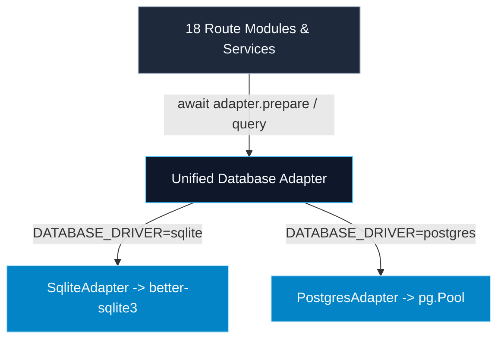

# STROOM — Stage 3.2.4 & 3.2.5 Execution Plan and Safety Preflight

**Audit & Planning Date:** 2026-11-14T20:38:00+05:30  
**Project Directory:** `D:\ST`  
**Active Git Branch:** `feature/stroom-production-launch`  
**Active Git HEAD:** `19c4176b87094a6ba7b81ffec7a01b72796c08ec`  
**Runtime:** Node.js v24.22.3 (Portable Win-x64) / npm v11.19.1  
**Default Driver:** `sqlite` (`better-sqlite3`) — Active & verified  
**Scope Boundary:** Strictly read-only preflight and planning. Zero code modified, zero databases provisioned, zero deployment actions executed.

---

## 1. Current Verified State

A strict preflight check of the environment, repository, and database files was executed:

| Verification Target | Expected Baseline Value | Verified Current State | Status |
| :--- | :--- | :--- | :--- |
| **Primary SQLite Hash** | `AD6FE974854B0FCD83CF053E26DE89F3D467B2BE2687B09E0AB282E6ACD848FB` | `AD6FE974854B0FCD83CF053E26DE89F3D467B2BE2687B09E0AB282E6ACD848FB` | **PRISTINE (100% Match)** |
| **Checkpoint Backup Hash** | `2129266EF6555C90C74B9166E696A2E39AA8B2A87E483EB79A20F9A292BE4571` | `2129266EF6555C90C74B9166E696A2E39AA8B2A87E483EB79A20F9A292BE4571` | **PRISTINE (100% Match)** |
| **Git Branch** | `feature/stroom-production-launch` | `feature/stroom-production-launch` | **MATCH** |
| **Git Commit HEAD** | `19c4176b87094a6ba7b81ffec7a01b72796c08ec` | `19c4176b87094a6ba7b81ffec7a01b72796c08ec` | **MATCH (0 commits)** |
| **Working-Tree Status** | 20 modified files, 104 untracked files preserved | Preserved without reset, stash, or branch switch | **PRESERVED** |
| **Active Database Driver** | `DATABASE_DRIVER=sqlite` | `sqlite` (`better-sqlite3`) active | **ACTIVE** |
| **Cloudflare D1 Auth Bridge** | `ENABLE_D1_AUTH_BRIDGE=false` | Disabled (`false`) | **DISABLED** |
| **PostgreSQL Adapter Layer** | `server/db/adapter.ts`, `types.ts`, `postgresAdapter.ts`, `sqliteAdapter.ts`, `sqlConverter.ts` | Complete, typechecked, unit-tested (87/87 passed) | **VERIFIED** |
| **Migration & Parity Scripts** | `migrate-sqlite-to-postgres.ts`, `verify-postgres-parity.ts`, `rollback-postgres-migration.ts` | Complete, dry-run verified across all 42 tables | **VERIFIED** |
| **PostgreSQL Staging Env** | No live server / no remote database | No port 5432 listener, zero Neon resources | **BLOCKED** |

---

## 2. Stage 3.2.4 Readiness Assessment & Blocker Report

Stage 3.2.4 requires executing a live test migration against a disposable PostgreSQL staging environment.

### Readiness Evaluation:
1. **Migration Tooling Readiness (READY):**
   - [scripts/migrate-sqlite-to-postgres.ts](file:///d:/ST/scripts/migrate-sqlite-to-postgres.ts) is operational. It opens SQLite with strict `{ readonly: true }`, reads tables in 8-level topological DAG order, and executes 500-row batch parameterized `INSERT` statements with `ON CONFLICT DO NOTHING`.
   - Verified offline dry-run: read all **10,160 rows across all 42 tables** in 56 ms without errors.
2. **Schema DDL Compatibility (READY):**
   - [migrations/postgres/0001_postgres_schema.sql](file:///d:/ST/migrations/postgres/0001_postgres_schema.sql) (36,993 bytes) contains all 42 tables and 33 explicit indexes. All currency columns converted to `NUMERIC(12, 2)`; defaults converted to `CURRENT_TIMESTAMP`.
3. **Rollback Tooling Readiness (READY):**
   - [scripts/rollback-postgres-migration.ts](file:///d:/ST/scripts/rollback-postgres-migration.ts) drops all 42 tables in reverse topological order with `CASCADE`. Verified in dry-run; requires `--confirm`.
4. **Data Parity Verification Readiness (READY):**
   - [scripts/verify-postgres-parity.ts](file:///d:/ST/scripts/verify-postgres-parity.ts) implements deterministic SHA-256 row and table hashing. Authoritative baseline table hashes are recorded for all 42 tables.
5. **PostgreSQL Connectivity (BLOCKED):**
   - A TCP probe of `127.0.0.1:5432` failed (port closed).
   - No `psql`, `postgres`, or `pg_ctl` binaries exist on the host.
   - Docker daemon is not running / inaccessible in this sandbox.
   - No `DATABASE_URL` or `TARGET_DATABASE_URL` environment variables exist.

> [!WARNING]
> **Stage 3.2.4 Blocker Summary:**
> Stage 3.2.4 cannot execute until an approved disposable PostgreSQL database instance is provisioned and authorized. Remote Neon provisioning was strictly disallowed under Stage 3.2 authorization boundaries.

---

## 3. Required Authorization Before Staging Database Provisioning

To unblock Stage 3.2.4, the operator must explicitly authorize:

1. **Provisioning Method (Choose One):**
   - **Option A (Neon Cloud — Recommended):** Authorize creating a free-tier Neon PostgreSQL database branch (zero-cost, managed SSL, pre-configured PgBouncer connection pool).
   - **Option B (Local Container):** Authorize starting a local Docker container running PostgreSQL (`docker run --name stroom-test-pg -p 5432:5432 -e POSTGRES_PASSWORD=... -d postgres:16-alpine`).
2. **Environment Configuration:**
   - Authorize setting `TARGET_DATABASE_URL` in a temporary test environment profile (`.env.test`).
3. **Live Migration Execution:**
   - Authorize executing `scripts/migrate-sqlite-to-postgres.ts` and `scripts/verify-postgres-parity.ts` against the provisioned target database.

---

## 4. Stage 3.2.5 File-by-File Refactoring Plan

The application contains **661 `db.prepare()` statements** and **37 `db.transaction()` blocks** across 18 backend files. The detailed file-by-file refactoring plan below outlines the exact changes required to convert them from synchronous `better-sqlite3` calls to asynchronous `IDatabaseAdapter` calls.



### File-by-File Refactoring Specifications:

#### 1. `server/middleware/auth.ts`
- **Current Imports:** `import { db } from '../db/database';`
- **Statements (2 prepare, 0 tx):**
  - Line 25: `db.prepare('SELECT id, role, account_status, email FROM users WHERE id = ?').get(decoded.id)`
  - Line 48: `db.prepare('SELECT id, role FROM users WHERE id = ?').get(userId)`
- **Required Refactoring:**
  - Change import to `import { getDatabaseAdapter } from '../db/adapter';`
  - In `authenticateJWT`: Mark middleware as `async (req, res, next) => { ... }`.
  - Replace `.get()` with `await getDatabaseAdapter().queryOne(...)`.
- **Relevant Test Suite:** Suite 1 (`AUTHENTICATION & ROLE-BASED ACCESS`).

#### 2. `server/routes/auth.ts`
- **Current Imports:** `import { db, hashPassword, verifyPassword } from '../db/database';`
- **Statements (10 prepare, 1 tx):**
  - User lookup by email, password verification, registration check, token blacklist, onboarding status update.
  - Transaction: Registration workflow (creates user record + inserts welcome notification).
- **Required Refactoring:**
  - Convert route handlers to `async (req, res, next)`.
  - Replace `db.transaction((fn) => ...)` with `await adapter.transaction(async (tx) => { ... })`.
  - Replace `stmt.run(...)` with `await tx.execute(...)`.
- **Dialect Compatibility:** 2 occurrences of `datetime('now')` mapped to `CURRENT_TIMESTAMP`.
- **Relevant Test Suite:** Suite 1 (`AUTHENTICATION & ROLE-BASED ACCESS`).

#### 3. `server/routes/onboarding.ts`
- **Current Imports:** `import { db } from '../db/database';`
- **Statements (36 prepare, 5 tx):**
  - Quiz version retrieval, active session check, question and option loading.
  - Transactions:
    - Session creation/resume.
    - Saving single-choice and multi-choice question answers.
    - Quiz completion: updates session, calculates vibe profile, updates user preferences.
    - Skip quiz: marks session skipped and records state.
- **Required Refactoring:**
  - Convert all route handlers to `async`.
  - Wrap atomic answer saving in `await adapter.transaction(async (tx) => { ... })`.
- **Dialect Compatibility:** 11 occurrences of `datetime('now')` mapped via `sqlConverter`.
- **Relevant Test Suites:** Suite 2 (`DYNAMIC ONBOARDING QUIZ`), Suite 4 (`SKIP EXPERIENCE`).

#### 4. `server/routes/events.ts`
- **Current Imports:** `import { db } from '../db/database';`
- **Statements (13 prepare, 1 tx):**
  - Event catalog listing, filtering by city/category, event detail lookup.
  - Transaction: Event registration (verifies capacity, checks duplicate registration, inserts pass record, increments attendee count).
- **Required Refactoring:**
  - Convert registration to `await adapter.transaction(async (tx) => { ... })`.
  - Concurrency Guard: Add conditional update `UPDATE events SET attendee_count = attendee_count + 1 WHERE id = $1 AND attendee_count < capacity` to prevent over-subscription under concurrent requests.
- **Relevant Test Suite:** Suite 7 (`EVENT REGISTRATION, DIGITAL PASSES & DOOR CHECK-IN`).

#### 5. `server/routes/passes.ts`
- **Current Imports:** `import { db } from '../db/database';`
- **Statements (8 prepare, 2 tx):**
  - Digital pass retrieval, QR code verification, door check-in terminal stamping.
  - Transactions:
    - Check-in terminal: verifies pass validity, updates pass status to `checked_in`, records timestamp, stamps passport stamp.
- **Dialect Compatibility:** 2 `datetime('now')`, 1 `INSERT OR IGNORE` (`passport_stamps`) $\rightarrow$ `ON CONFLICT DO NOTHING`.
- **Relevant Test Suite:** Suite 7 (`EVENT REGISTRATION, DIGITAL PASSES & DOOR CHECK-IN`).

#### 6. `server/routes/auction.ts`
- **Current Imports:** `import { db } from '../db/database';`
- **Statements (63 prepare, 4 tx):**
  - Auction rooms, franchise teams, player lots, live auction state.
  - Transactions:
    - Atomic bid placement: checks auction state, validates increment, checks team remaining purse, inserts bid, updates current bid.
    - Gavel strike (`SOLD`): marks lot sold, deducts team purse, updates player status.
- **Concurrency Guard (CRITICAL):**
  - Under PostgreSQL concurrency, replace simple `SELECT` with `SELECT * FROM auction_rooms WHERE id = $1 FOR UPDATE` to lock the auction room row during bid evaluation.
- **Relevant Test Suite:** Suite 6 (`REAL AUCTION ENGINE, ATOMIC BIDDING & GAVEL`).

#### 7. `server/routes/partners.ts`
- **Current Imports:** `import { db } from '../db/database';`
- **Statements (101 prepare, 7 tx):**
  - Partner onboarding, venue management, availability calendar, collaboration proposals, campaign coupons.
  - Transactions:
    - Venue creation and photo gallery updates.
    - Availability calendar batch upsert (`INSERT OR REPLACE INTO venue_availability`).
    - Proposal approval workflow: propose $\rightarrow$ suggest date $\rightarrow$ accept $\rightarrow$ generate published event.
- **Dialect Compatibility:**
  - 6 `datetime('now')`.
  - 1 `INSERT OR REPLACE INTO venue_availability` $\rightarrow$ `ON CONFLICT (id) DO UPDATE SET ...`.
- **Relevant Test Suites:** Suite 8 (`PARTNER VENUES`), Suite 13 (`COMPLETE BUSINESS PARTNER EXPERIENCE`).

#### 8. `server/routes/admin.ts`
- **Current Imports:** `import { db } from '../db/database';`
- **Statements (49 prepare, 5 tx):**
  - Quiz CMS versioning, draft editing, questions and options CRUD.
  - Transactions:
    - Create draft version (clones active published version and all questions/options).
    - Publish draft version (validates $\ge 2$ options per question, archives current active version, marks draft active).
- **Relevant Test Suite:** Suite 5 (`ADMIN QUIZ CMS, VERSIONING & PUBLICATION`).

#### 9. `server/routes/adminHub.ts`
- **Current Imports:** `import { db } from '../db/database';`
- **Statements (141 prepare, 7 tx):**
  - Central control center: overview analytics, user management, RBAC role updates, event safe deletion, door check-in override, refunds ledger, platform settings.
  - Transactions:
    - Safe event deletion: checks foreign-key dependencies, checks payment records, cancels passes, removes event.
    - Door check-in audit override.
    - Settings update.
- **Dialect Compatibility:**
  - 12 `datetime('now')` expressions (including `-30 days` interval arithmetic).
  - 1 `INSERT OR IGNORE` (`passport_stamps`).
  - 1 `strftime('%Y-%m', col)` in overview revenue aggregation $\rightarrow$ `TO_CHAR(CAST(col AS TIMESTAMP), 'YYYY-MM')`.
- **Relevant Test Suites:** Suite 11 (`ADMIN PLATFORM CAPABILITIES`), Suite 14 (`CENTRALIZED ADMIN CONTROL CENTER & GRANULAR RBAC`).

#### 10. `server/routes/preferences.ts`
- **Current Imports:** `import { db, hashPassword, verifyPassword } from '../db/database';`
- **Statements (42 prepare, 2 tx):**
  - Member profile updates, privacy toggles, badge unlocking.
  - Transactions: Profile update and batch interests synchronization.
  - Dialect: 1 `INSERT OR REPLACE INTO user_achievements` $\rightarrow$ `ON CONFLICT (id) DO UPDATE SET ...`.
- **Relevant Test Suites:** Suite 9 (`USER PASSPORT`), Suite 12 (`COMPLETE MEMBER EXPERIENCE`).

#### 11. `server/routes/communities.ts` (12 prepare, 0 tx)
- Community feed, join/leave community, member count updates.
- Relevant Test Suite: Suite 10 (`PHASE 2 PUBLIC EXPERIENCE`).

#### 12. `server/routes/discovery.ts` (2 prepare, 0 tx)
- Vibe discovery feed recommendations.
- Relevant Test Suite: Suite 3 (`COMPLETION, PREFERENCES & DISCOVERY`).

#### 13. `server/routes/contact.ts` (1 prepare, 0 tx)
- Public contact form inquiry submission.
- Relevant Test Suite: Suite 10 (`PHASE 2 PUBLIC EXPERIENCE`).

#### 14. `server/services/auditService.ts` (1 prepare, 0 tx)
- Security audit log write (`logAudit`).
- Asynchronous insertion via `adapter.execute()`.

#### 15. `server/services/memberService.ts` (10 prepare, 0 tx)
- Passport stamp evaluation and badge criteria checking.
- Dialect: 1 `INSERT OR IGNORE INTO passport_stamps`.

#### 16. `server/services/partnerService.ts` (10 prepare, 0 tx)
- Partner performance metrics calculation and coupon usage aggregation.

#### 17. `server/index.ts` (1 prepare, 0 tx)
- `/api/health` connectivity check. Refactor to `await adapter.ping()`.

#### 18. `server/db/database.ts` (159 prepare, 3 tx)
- Schema initialization and seed routines. Refactor seed routines to execute via `adapter.execute()` or retain as SQLite-only initialization when `DATABASE_DRIVER=sqlite`.

---

## 5. Dependency and Risk Analysis

### 1. Synchronous vs Asynchronous Middleware Chains
- **Risk:** Express 4 does not automatically catch Promise rejections in route handlers. An unhandled rejection in an `async` handler will cause an `UnhandledPromiseRejection` or terminate the process.
- **Mitigation:** Implement a standard async route wrapper utility:
  ```typescript
  export const asyncHandler = (fn: express.RequestHandler) =>
    (req: express.Request, res: express.Response, next: express.NextFunction) =>
      Promise.resolve(fn(req, res, next)).catch(next);
  ```
  Ensure all refactored route handlers are wrapped or use explicit `try/catch(next)` blocks.

### 2. Connection Pool Exhaustion in Asynchronous Transactions
- **Risk:** If a route handler throws an exception inside a transaction or encounters a network timeout, failing to release the checked-out `PoolClient` back to `pg.Pool` will leak connections and exhaust the pool.
- **Mitigation:** `server/db/postgresAdapter.ts` guarantees client release in a `finally` block:
  ```typescript
  const client = await this.pool.connect();
  try {
    await client.query('BEGIN');
    const result = await callback(txAdapter);
    await client.query('COMMIT');
    return result;
  } catch (err) {
    await client.query('ROLLBACK');
    throw err;
  } finally {
    client.release(); // 100% guaranteed release
  }
  ```

### 3. Concurrency & Race Conditions in Auctions and Bookings
- **Risk:** SQLite handles concurrency by locking the single database file during writes. PostgreSQL executes transactions concurrently on multiple connections. Two simultaneous bids on an auction or simultaneous bookings for the final event seat could cause overselling or negative purse balances.
- **Mitigation:**
  - For auctions: Use explicit row-level locking (`SELECT current_bid, current_team_id FROM auction_rooms WHERE id = $1 FOR UPDATE`).
  - For event seats: Use atomic conditional decrements (`UPDATE events SET attendee_count = attendee_count + 1 WHERE id = $1 AND attendee_count < capacity`).

### 4. Network Round-Trip Latency & N+1 Query Cascades
- **Risk:** SQLite queries execute in-memory with zero network latency (~0.05ms). A remote PostgreSQL database (such as Neon in AWS) introduces 20–60ms of round-trip network latency per query. Routes executing loops of individual queries (e.g. inserting 50 options or 30 player lots one-by-one) would suffer 1–3 second latency delays.
- **Mitigation:** Batch sequential inserts into multi-row parameterized `INSERT` statements (`INSERT INTO options (...) VALUES ($1..$k), ($k+1..$2k)`) or run within an atomic transaction batch.

### 5. Foreign-Key Dependency Ordering
- **Risk:** In SQLite, foreign-key checks can be bypassed or deferred. PostgreSQL strictly enforces foreign keys on every operation.
- **Mitigation:** Migration scripts and seed routines must strictly respect the 8-level topological sequence defined in `STAGE_3_1_POSTGRESQL_READ_ONLY_AUDIT.md`.

---

## 6. Testing Strategy

```
+--------------------------------------------------------------------------------------------------+
|                                  STAGE 3.2.5 TESTING PIPELINE                                    |
+--------------------------------------------------------------------------------------------------+
| 1. Unit Testing:        Verify sqlConverter, postgresAdapter, sqliteAdapter (87 assertions)     |
| 2. SQLite Regression:   Run 15 E2E suites with DATABASE_DRIVER=sqlite (81 tests, 0 failures)    |
| 3. Parity Migration:    Run migrate-sqlite-to-postgres.ts against test PostgreSQL instance       |
| 4. Hash Parity Audit:   Run verify-postgres-parity.ts (100% SHA-256 match across all 42 tables) |
| 5. PostgreSQL E2E:      Run 15 E2E suites with DATABASE_DRIVER=postgres (81 tests, 0 failures)  |
+--------------------------------------------------------------------------------------------------+
```

1. **Phase 1 — Isolated Unit Tests:**
   - Execute [tests/test-stage3-2-postgres.ts](file:///d:/ST/tests/test-stage3-2-postgres.ts) (87 assertions covering dialect translation, credential masking, transaction commit/rollback).
2. **Phase 2 — Dual-Driver SQLite Regression:**
   - Run `npm test` with `DATABASE_DRIVER=sqlite` against disposable database to verify zero breakage to existing functionality.
3. **Phase 3 — Staging Parity Verification:**
   - Run `scripts/migrate-sqlite-to-postgres.ts` and `scripts/verify-postgres-parity.ts` against the disposable PostgreSQL database. Verify 100% record and SHA-256 table hash match.
4. **Phase 4 — Dual-Driver PostgreSQL Regression:**
   - Run `npm test` with `DATABASE_DRIVER=postgres` pointing to the test PostgreSQL database. Verify all 15 suites and 81 tests pass.

---

## 7. Rollback Strategy

If any failure occurs during Stage 3.2.4 or Stage 3.2.5:

1. **PostgreSQL Target Rollback:**
   - Execute `npx tsx scripts/rollback-postgres-migration.ts --confirm` to drop all 42 tables in reverse topological order (Level 8 down to Level 1) with `CASCADE`.
2. **Application Driver Rollback:**
   - Unset `DATABASE_DRIVER` or keep `DATABASE_DRIVER=sqlite`. The application immediately defaults to the primary SQLite database.
3. **Source Database Safety:**
   - The primary SQLite database (`data/stroom.db`) and checkpoint backup are **never modified** during migration or testing. They remain active and unmodified.

---

## 8. Acceptance Criteria

Stage 3.2 can be marked **COMPLETE** only when all of the following criteria are verified:

- [ ] **AC 1 (Staging Provisioning):** A disposable PostgreSQL test database is connected and responsive.
- [ ] **AC 2 (Schema Application):** All 42 tables and 33 indexes are created on PostgreSQL via `0001_postgres_schema.sql`.
- [ ] **AC 3 (Data Migration):** All 10,160 rows migrated to PostgreSQL via `migrate-sqlite-to-postgres.ts`.
- [ ] **AC 4 (Hash Parity):** All 42 tables achieve 100% row count and SHA-256 table hash parity via `verify-postgres-parity.ts`.
- [ ] **AC 5 (Route Refactoring):** All 18 backend files refactored to `async/await` using `IDatabaseAdapter`.
- [ ] **AC 6 (Dual-Driver Compatibility):** All 15 E2E test suites pass with Exit Code 0 under both `DATABASE_DRIVER=sqlite` and `DATABASE_DRIVER=postgres`.
- [ ] **AC 7 (Zero Tampering):** Primary SQLite database and checkpoint backup SHA-256 hashes match baseline.

---

## 9. Exact Recommended Execution Order

When authorized, execute in the following strict order:

1. **Step 1 (Preflight):** Verify Git HEAD and database hashes.
2. **Step 2 (Provisioning):** Provision disposable PostgreSQL instance and configure `.env.test`.
3. **Step 3 (Stage 3.2.4 Migration):** Apply DDL, execute batch migration, verify 42-table SHA-256 parity.
4. **Step 4 (Stage 3.2.5 Route Refactoring — Batched by Module):**
   - Batch A: Middleware (`auth.ts`, `server/index.ts`, `auditService.ts`).
   - Batch B: Core Auth & Onboarding (`auth.ts`, `onboarding.ts`, `preferences.ts`).
   - Batch C: Events, Passes & Partners (`events.ts`, `passes.ts`, `partners.ts`).
   - Batch D: Real-Time Auction Engine (`auction.ts` with `SELECT ... FOR UPDATE`).
   - Batch E: Admin & CMS (`admin.ts`, `adminHub.ts`).
   - Batch F: Public & Services (`communities.ts`, `discovery.ts`, `contact.ts`, `memberService.ts`, `partnerService.ts`).
5. **Step 5 (Dual-Driver Verification):** Run full test suite under `sqlite`, then under `postgres`.
6. **Step 6 (Sign-Off):** Produce final Stage 3.2 completion report.

---

## 10. Actions Requiring Separate Explicit Authorization

The following actions are **NOT authorized** under this preflight plan and require explicit operator approval before execution:

1. **Authorizing Neon Cloud Database Provisioning:** Creating a free-tier branch database on Neon.
2. **Authorizing Local Container Execution:** Starting a local Docker container or PostgreSQL service on the host.
3. **Authorizing Application Code Modifications:** Editing any of the 18 backend route and service files to introduce `async/await`.
4. **Authorizing Test Environment Variable Changes:** Modifying `DATABASE_URL` or `DATABASE_DRIVER` in active environment files.
5. **Authorizing Remote Network Calls:** Opening outbound TCP connections to external database providers.

---

**Planning & Preflight Complete. Zero application code modified. Stage 3.3 has NOT been started.**
